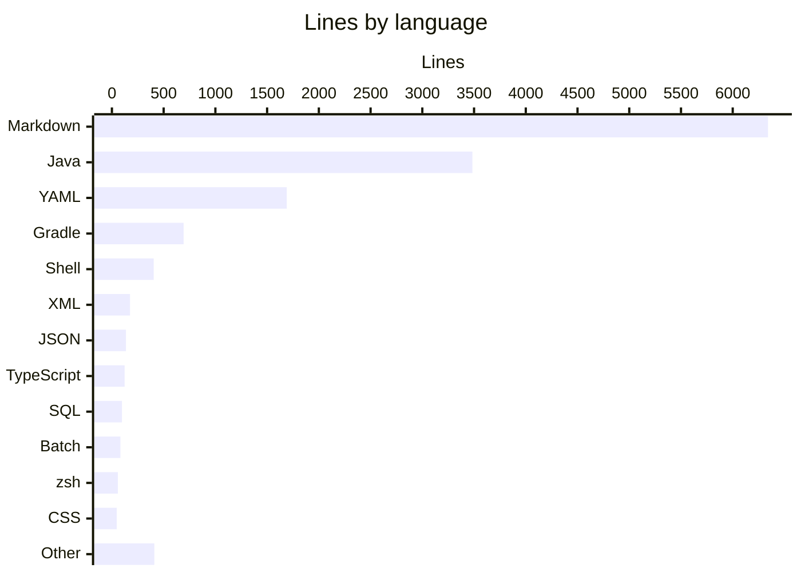
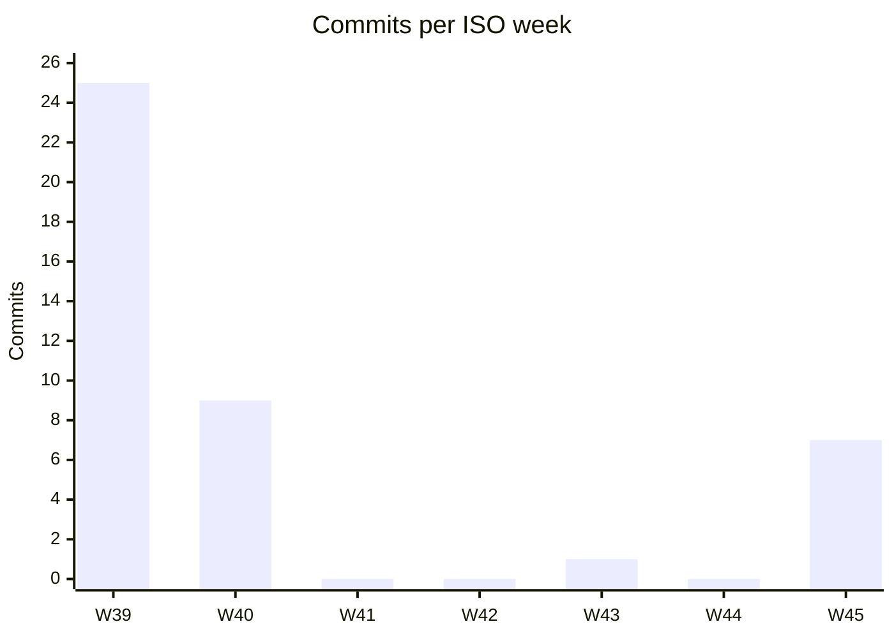

# By the numbers

Data collected on 2026-11-04.

A small codebase that grew fast. These figures come from `git ls-files`, `wc -l` and `git log` on `master` at commit `f97b7a4`, so they describe tracked files only (no build output, no `node_modules`).

## Size

The repository tracks 172 files and 13,740 lines, excluding three generated or binary files: `gradle/wrapper/gradle-wrapper.jar`, `qa/package-lock.json` and `.devcontainer/devcontainer-lock.json`.

48 of those files (5,332 lines) are this wiki. `droid-wiki/` was committed for the first time in `33ecb9c` (PR #6), so Markdown is now the largest language by line count. Without `droid-wiki/`, the repository is 124 files and 8,408 lines. The only change since the previous snapshot at `33ecb9c` is `f97b7a4` (PR #8), which added a net 4 lines across `AGENTS.md` and `.github/workflows/droid-wiki-refresh.yml`.

| Language | Files | Lines | Notes |
|---|---|---|---|
| Markdown | 57 | 6,341 | 47 wiki pages under `droid-wiki/` (5,251 lines); of the other 10, `AGENTS.md` alone is 574 lines |
| Java | 51 | 3,484 | 34 main (2,158 lines), 17 test (1,326 lines) |
| YAML (`.yml` + `.yaml`) | 31 | 1,690 | 12 GitHub workflows, Kubernetes manifests, `application.yml` |
| Gradle | 2 | 693 | `build.gradle` is 692 of them |
| Shell (`.sh`) | 5 | 404 | Everything under `scripts/` |
| XML | 3 | 175 | Checkstyle, PMD and Logback configs |
| TypeScript | 2 | 123 | The Playwright suite in `qa/` |
| SQL | 2 | 97 | The Flyway migration and `scripts/bootstrap-lab-db.sql` |
| Batch | 1 | 82 | `gradlew.bat` |
| zsh | 3 | 58 | The Docker image scripts at the repo root |
| JSON | 4 | 136 | Includes `droid-wiki/.wiki-meta.json` (81 lines) |
| CSS | 1 | 47 | `src/main/frontend/themes/mockingbird/styles.css` |
| Other | 10 | 410 | `.properties` files, `gradlew`, Dockerfiles, dotfiles, the pre-commit hook |

### File counts by role

| Role | Count | What it includes |
|---|---|---|
| Application source | 36 | 34 Java files under `src/main/java`, the theme CSS, the Flyway migration |
| Tests | 19 | 17 JUnit classes under `src/test/java`, 2 Playwright files under `qa/` |
| Configuration | 39 | 31 YAML files, 3 XML rule/logging configs, 3 JSON files, 2 `.properties` files |
| Generated documentation | 48 | The 47 pages of this wiki plus `droid-wiki/.wiki-meta.json` |

The test-to-code ratio for Java is 0.61 (1,326 test lines per 2,158 main lines). Coverage gates are described in [testing](how-to-contribute/testing.md).

## Activity

The whole history is 42 commits between 2026-09-26 and 2026-11-04. Almost all of it landed in the first three days; see [lore](lore.md) for what each burst was about.

| ISO week | Dates | Commits |
|---|---|---|
| 2026-W39 | Sep 21-27 | 25 |
| 2026-W40 | Sep 28-Oct 4 | 9 |
| 2026-W41 | Oct 5-11 | 0 |
| 2026-W42 | Oct 12-18 | 0 |
| 2026-W43 | Oct 19-25 | 1 |
| 2026-W44 | Oct 26-Nov 1 | 0 |
| 2026-W45 | Nov 2-8 | 7 |

By day, 2026-09-27 alone has 24 commits, 2026-09-28 has 8, and 2026-11-04 has 6.

### Churn hotspots

Files touched by the most commits (`git log --name-only`). The wiki pages have one commit each so far and do not appear here.

| File | Commits |
|---|---|
| `AGENTS.md` | 15 |
| `build.gradle` | 14 |
| `src/main/resources/application.yml` | 7 |
| `src/main/java/com/mockingbirdbank/ui/view/DashboardView.java` | 7 |
| `src/main/java/com/mockingbirdbank/ui/view/AccountDetailView.java` | 6 |
| `src/main/java/com/mockingbirdbank/service/AccountService.java` | 5 |
| `src/main/java/com/mockingbirdbank/security/SecurityConfig.java` | 5 |
| `src/main/java/com/mockingbirdbank/ui/layout/MainLayout.java` | 5 |
| `src/main/java/com/mockingbirdbank/ui/view/AccountCard.java` | 5 |
| `src/test/java/com/mockingbirdbank/service/AccountServiceTest.java` | 5 |
| `.gitignore` | 5 |

`AGENTS.md` and `build.gradle` lead because nearly every tooling change added a Gradle task and a matching paragraph of documentation. `AGENTS.md` pulled one ahead with `f97b7a4`, which changed only documentation and a workflow. `scripts/validate-agents-md.sh`, wired into `check` as `validateAgentsMd`, fails the build if `AGENTS.md` mentions a Gradle task or file path that no longer exists (see [tooling](how-to-contribute/tooling.md)).

### Bot-attributed commits

| Kind | Commits | Share of 42 |
|---|---|---|
| Carries a `Co-authored-by: factory-droid[bot]` trailer | 35 | 83.3% |
| Authored by `dependabot[bot]` | 1 | 2.4% |
| Either of the above | 36 | 85.7% |

Treat these as lower bounds. They only count commits where the trailer or bot author was recorded, and any agent help without a trailer is invisible to `git log`. The single Dependabot commit is `77317b7` (2026-09-28), which bumped Playwright in `qa/` from 1.49.1 to 1.63.0.

## Complexity

Main Java code, grouped by package under `src/main/java/com/mockingbirdbank/`:

| Package | Files | Lines | Average lines per file |
|---|---|---|---|
| `ui/view` | 5 | 675 | 135 |
| `service` | 2 | 172 | 86 |
| `ui/layout` | 2 | 161 | 81 |
| `observability` | 3 | 212 | 71 |
| `config` | 4 | 254 | 64 |
| `analytics` | 3 | 188 | 63 |
| `config/logging` | 1 | 53 | 53 |
| `model` | 5 | 247 | 49 |
| `security` | 2 | 86 | 43 |
| `resilience` | 2 | 59 | 30 |
| (root, `Application.java`) | 1 | 15 | 15 |
| `repository` | 4 | 36 | 9 |

The Vaadin views are the heaviest code because each one builds its layout, styling and event wiring in Java. Repositories are one-method Spring Data interfaces. See [UI](systems/ui.md) and [persistence](systems/persistence.md).

### Largest files

Excluding `droid-wiki/`. The largest wiki page is `droid-wiki/reference/configuration.md` at 224 lines, which would rank fifth.

| File | Lines |
|---|---|
| `build.gradle` | 692 |
| `AGENTS.md` | 574 |
| `gradlew` | 248 |
| `src/main/java/com/mockingbirdbank/ui/view/DashboardView.java` | 239 |
| `src/test/java/com/mockingbirdbank/service/AccountServiceTest.java` | 208 |
| `.github/workflows/publish-image.yml` | 206 |
| `scripts/k3d-deploy.sh` | 170 |
| `src/main/java/com/mockingbirdbank/ui/view/AccountDetailView.java` | 169 |
| `src/main/java/com/mockingbirdbank/ui/view/AccountNumberDisplay.java` | 149 |
| `.github/workflows/ci.yml` | 148 |

The build script is longer than any Java class: it carries the quality gates, coverage rules, test retry and timing reports, git metadata, the `installGitHooks` task, and the build-performance and code-quality summaries.

### Debt markers

There are zero `TODO` or `FIXME` comments in tracked code. Checkstyle is configured to report any such marker as a warning (`config/checkstyle/checkstyle.xml`), so the count is checked on every build.
