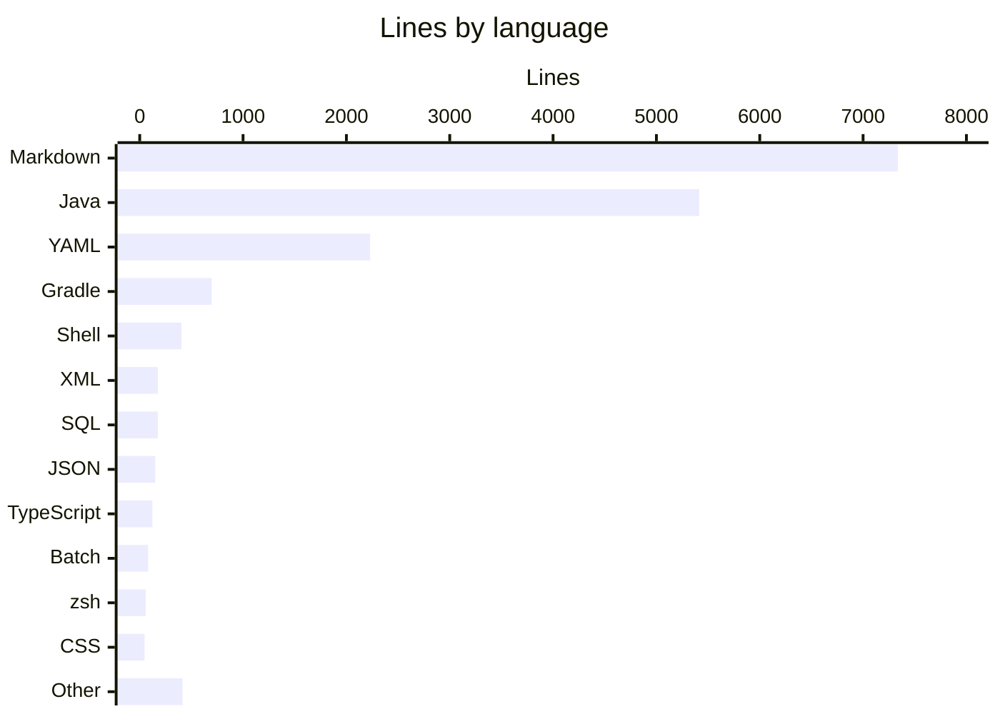
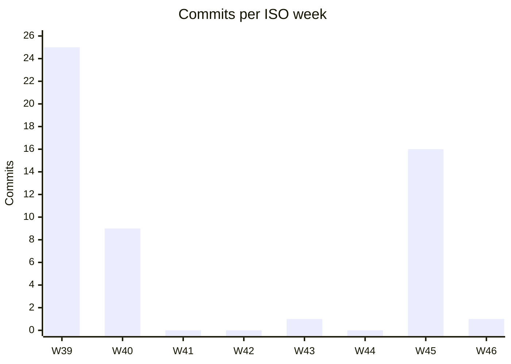

# By the numbers

Data collected on 2026-11-13.

A small codebase that grew fast. These figures come from `git ls-files`, `wc -l` and `git log` on `master` at commit `78a2f03`, so they describe tracked files only (no build output, no `node_modules`).

## Size

The repository tracks 198 files and 17,306 lines, excluding three generated or binary files: `gradle/wrapper/gradle-wrapper.jar`, `qa/package-lock.json` and `.devcontainer/devcontainer-lock.json`.

49 of those files (5,642 lines) are this wiki as committed on `master`. The rolling wiki PR is never merged (see [the rolling wiki PR](how-to-contribute/tooling.md#the-rolling-wiki-pr)), so the copy on `master` changes only when a feature PR edits its pages by hand. `3e172bf` (PR #16) did that for ten pages, and `78a2f03` (PR #17) edited 32 pages, added `droid-wiki/features/account-programs.md` and touched `droid-wiki/.wiki-meta.json`. Without `droid-wiki/`, the repository is 149 files and 11,664 lines, up from 134 files and 9,698 lines at `3e172bf`.

That growth is one commit. `78a2f03` (PR #17, SED-847, 2026-11-13) added account programs (see [account programs](features/account-programs.md)): 79 files changed, 2,651 lines added and 395 removed, or 2,114 added lines outside `droid-wiki/`. That makes it the largest code commit in the history, ahead of `25c37cd` (1,181 lines, 2026-09-28). Only the first wiki PR, `33ecb9c` (5,333 lines, almost all wiki pages), added more in total. Java grew by 14 files and 1,796 lines: 8 main files (`ProgramParticipation`, `ProgramType`, `ProgramParticipationRepository`, `ProgramService`, `ProgramEvaluation`, `BusinessClockConfig`, `ProgramCard`, `ProgramLookup`) and 6 test classes (`ProgramMigrationTest`, `BusinessClockConfigTest`, `ProgramServiceTest`, `AccountDetailViewTest`, `ProgramCardTest`, `ProgramLookupTest`). It also added the second Flyway migration, `src/main/resources/db/migration/V2__account_programs.sql` (35 lines), added 65 lines to `AGENTS.md` and 94 to `.factory/skills/qa-web/SKILL.md`, and bumped `baseVersion` in `gradle.properties` from 0.2.0 to 0.3.0.

| Language | Files | Lines | Notes |
|---|---|---|---|
| Markdown | 61 | 7,336 | 48 wiki pages under `droid-wiki/` (5,559 lines). Of the other 13, `AGENTS.md` is 650 lines and the three QA files under `.factory/skills/` (both QA skills and the report template) are 603 |
| Java | 66 | 5,414 | 42 main (3,005 lines), 24 test (2,409 lines) |
| YAML (`.yml` + `.yaml`) | 34 | 2,230 | 13 GitHub workflows, Kubernetes manifests, `application.yml`, the QA config |
| Gradle | 2 | 696 | `build.gradle` is 695 of them |
| Shell (`.sh`) | 5 | 404 | Everything under `scripts/` |
| XML | 3 | 175 | Checkstyle, PMD and Logback configs |
| SQL | 5 | 175 | The two Flyway migrations, `scripts/bootstrap-lab-db.sql`, and the QA seed and cleanup scripts |
| JSON | 5 | 151 | Includes `droid-wiki/.wiki-meta.json` (83 lines) and `.factory/settings.json` |
| TypeScript | 2 | 123 | The Playwright suite in `qa/` |
| Batch | 1 | 82 | `gradlew.bat` |
| zsh | 3 | 58 | The Docker image scripts at the repo root |
| CSS | 1 | 47 | `src/main/frontend/themes/mockingbird/styles.css` |
| Other | 10 | 415 | `.properties` files, `gradlew`, Dockerfiles, dotfiles, the pre-commit hook |

### File counts by role

| Role | Count | What it includes |
|---|---|---|
| Application source | 45 | 42 Java files under `src/main/java`, the theme CSS, the two Flyway migrations |
| Tests | 26 | 24 JUnit classes under `src/test/java` (109 test methods), 2 Playwright files under `qa/` |
| Configuration | 43 | 34 YAML files, 3 XML rule/logging configs, 4 JSON files, 2 `.properties` files |
| Agent skills | 7 | 3 `SKILL.md` files, the QA report template and 2 QA SQL files under `.factory/skills/`, plus `.factory/settings.json` (also counted as configuration) |
| Generated documentation | 49 | The 48 pages of this wiki plus `droid-wiki/.wiki-meta.json` |

The test-to-code ratio for Java is 0.80 (2,409 test lines per 3,005 main lines), up from 0.66 at `3e172bf`. `ProgramServiceTest` alone is 317 lines. Coverage gates are described in [testing](how-to-contribute/testing.md).

## Activity

The whole history is 52 commits between 2026-09-26 and 2026-11-13. Most of it landed in the first three days; see [lore](lore.md) for what each burst was about. PRs are squash-merged, so one commit can stand for a lot of work: `78a2f03` squashes 31 commits.

| ISO week | Dates | Commits |
|---|---|---|
| 2026-W39 | Sep 21-27 | 25 |
| 2026-W40 | Sep 28-Oct 4 | 9 |
| 2026-W41 | Oct 5-11 | 0 |
| 2026-W42 | Oct 12-18 | 0 |
| 2026-W43 | Oct 19-25 | 1 |
| 2026-W44 | Oct 26-Nov 1 | 0 |
| 2026-W45 | Nov 2-8 | 16 |
| 2026-W46 | Nov 9-15 | 1 |

By day, 2026-09-27 alone has 24 commits, 2026-09-28 has 8, 2026-11-04 has 7, 2026-11-07 has 7 (the three README title edits, the `AGENTS.md` auto-merge rules, the rolling wiki PR rule, the Droid review trigger change and the `showAccountCount` flag), and 2026-11-03, 2026-11-05 and 2026-11-13 have one each.

### Churn hotspots

Files outside `droid-wiki/` touched by the most commits (`git log --name-only`). The whole history fits inside the last 90 days, so this is also the all-time list. No wiki page has more than four commits yet (`droid-wiki/cleanup-opportunities.md` has four).

| File | Commits |
|---|---|
| `AGENTS.md` | 21 |
| `build.gradle` | 15 |
| `src/main/resources/application.yml` | 9 |
| `src/main/java/com/mockingbirdbank/ui/view/DashboardView.java` | 9 |
| `src/main/java/com/mockingbirdbank/ui/view/AccountDetailView.java` | 7 |
| `README.md` | 7 |
| `.gitignore` | 6 |
| `src/main/java/com/mockingbirdbank/service/AccountService.java` | 6 |
| `src/main/java/com/mockingbirdbank/ui/view/AccountCard.java` | 6 |
| `src/test/java/com/mockingbirdbank/service/AccountServiceTest.java` | 6 |
| `src/main/java/com/mockingbirdbank/config/DataInitializer.java` | 5 |
| `src/main/java/com/mockingbirdbank/config/FeatureFlagService.java` | 5 |
| `src/main/java/com/mockingbirdbank/config/FeatureFlagsProperties.java` | 5 |
| `src/main/java/com/mockingbirdbank/security/SecurityConfig.java` | 5 |
| `src/main/java/com/mockingbirdbank/ui/layout/MainLayout.java` | 5 |
| `src/test/java/com/mockingbirdbank/ApplicationSmokeTest.java` | 5 |
| `src/test/java/com/mockingbirdbank/config/FeatureFlagServiceTest.java` | 5 |

`AGENTS.md` and `build.gradle` lead because nearly every tooling change added a Gradle task and a matching paragraph of documentation. Of the last seven changes to `AGENTS.md`, only `78a2f03` also touched `build.gradle` (three lines); `f97b7a4`, `36ef6ef`, the auto-merge rules in `e6df51c`, the rolling wiki PR rule in `e3e97cb`, the branch protection notes in `cf064b0` and the `showAccountCount()` mention in `3e172bf` did not. The three README title edits, `db8ce7c`, `fcb7009` and `9327d84`, touched only the first line of `README.md`. `scripts/validate-agents-md.sh`, wired into `check` as `validateAgentsMd`, fails the build if `AGENTS.md` mentions a Gradle task or file path that no longer exists (see [tooling](how-to-contribute/tooling.md)).

### Bot-attributed commits

| Kind | Commits | Share of 52 |
|---|---|---|
| Carries a `Co-authored-by: factory-droid[bot]` trailer | 41 | 78.8% |
| Authored by `dependabot[bot]` | 1 | 1.9% |
| Either of the above | 42 | 80.8% |

Treat these as lower bounds. They only count commits where the trailer or bot author was recorded, and any agent help without a trailer is invisible to `git log`. The second wiki refresh PR (`7474d45`, #7) was generated by Droid in CI but carries only a human co-author trailer, so it is not counted. The three README title edits (`db8ce7c`, #10, `fcb7009`, #11, and `9327d84`, #12) have no trailer either. The single Dependabot commit is `77317b7` (2026-09-28), which bumped Playwright in `qa/` from 1.49.1 to 1.63.0.

## Complexity

Main Java code, grouped by package under `src/main/java/com/mockingbirdbank/`:

| Package | Files | Lines | Average lines per file |
|---|---|---|---|
| `ui/view` | 7 | 1,040 | 149 |
| `service` | 4 | 425 | 106 |
| `ui/layout` | 2 | 161 | 81 |
| `config` | 5 | 355 | 71 |
| `observability` | 3 | 212 | 71 |
| `analytics` | 3 | 188 | 63 |
| `config/logging` | 1 | 53 | 53 |
| `model` | 7 | 365 | 52 |
| `security` | 2 | 86 | 43 |
| `resilience` | 2 | 59 | 30 |
| (root, `Application.java`) | 1 | 15 | 15 |
| `repository` | 5 | 46 | 9 |

The Vaadin views are the heaviest code because each one builds its layout, styling and event wiring in Java; PR #17 added `ProgramCard` (160 lines) and `ProgramLookup` (56) there. `service` more than doubled with `ProgramService` (217 lines), which holds the program rules. Repositories are one-method Spring Data interfaces. See [UI](systems/ui.md) and [persistence](systems/persistence.md).

### Largest files

Excluding `droid-wiki/`. The largest wiki page on `master` is `droid-wiki/reference/configuration.md` at 226 lines, which would rank ninth.

| File | Lines |
|---|---|
| `build.gradle` | 695 |
| `AGENTS.md` | 650 |
| `.factory/skills/qa-web/SKILL.md` | 420 |
| `.github/workflows/qa.yml` | 367 |
| `src/main/java/com/mockingbirdbank/ui/view/DashboardView.java` | 317 |
| `src/test/java/com/mockingbirdbank/service/ProgramServiceTest.java` | 317 |
| `gradlew` | 248 |
| `src/main/java/com/mockingbirdbank/ui/view/AccountDetailView.java` | 240 |
| `src/test/java/com/mockingbirdbank/ui/view/DashboardViewTest.java` | 225 |
| `src/main/java/com/mockingbirdbank/service/ProgramService.java` | 217 |

The build script is still longer than any Java class: it carries the quality gates, coverage rules, test retry and timing reports, git metadata, the `installGitHooks` task, and the build-performance and code-quality summaries. The `qa-web` skill grew by 70 lines with the program flows and is now longer than the QA workflow; it is a test plan written as prose. `DashboardView.java` gained 62 lines for the "Your programs" section and is tied with `ProgramServiceTest.java` as the longest Java file.

### Debt markers

There are zero `TODO` or `FIXME` comments in tracked code. Checkstyle is configured to report any such marker as a warning (`config/checkstyle/checkstyle.xml`), so the count is checked on every build.
