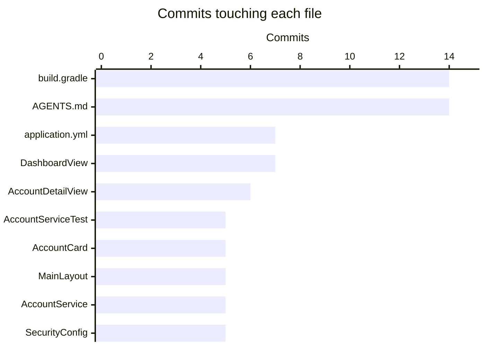

# Cleanup opportunities

Maintenance work found while documenting Mockingbird Bank, checked against the code at `2b3e914`. Items are tagged **high**, **medium** or **low** priority. High means a security or correctness problem; low means polish. For the traps behind several of these, see [pitfalls](background/pitfalls.md).

## Summary

| Priority | Item | Section |
|---|---|---|
| High | `/accounts/{id}` lacks an ownership check | [Bugs and gaps](#bugs-and-gaps) |
| Medium | Open circuit breaker shows a generic error page on page load | [Bugs and gaps](#bugs-and-gaps) |
| Medium | Failed-login usernames kept 30 days in the analytics log | [Bugs and gaps](#bugs-and-gaps) |
| Medium | Docs and runbooks query `/actuator/metrics`, which is not exposed | [Docs drift](#docs-drift) |
| Medium | Error-spike runbook uses the wrong event name and a missing file | [Docs drift](#docs-drift) |
| Low | The rest of the docs drift, UX nits, test gaps, dead code | Below |

## Bugs and gaps

**High: no ownership check on account detail.** `AccountService.requireAccount` (`src/main/java/com/mockingbirdbank/service/AccountService.java:63-67`) and `TransactionService.forAccount` load any account by ID. `AccountDetailView.setParameter` uses both, so a signed-in user can read another holder's balance and transactions by changing the URL. `revealAccountNumber` in the same class already does it right with `isOwnedBy`. Fix: filter `requireAccount` by the current holder and throw the same `IllegalArgumentException` for "missing" and "not yours", so the view's existing not-found path covers both. Add a test with two holders. Harmless while only one holder is seeded, but blocking for any multi-user rollout.

**Medium: `ServiceUnavailableException` escapes page construction.** When a breaker is open, the `DashboardView` constructor (`currentHolder`, `accountsFor`, `totalBalance`), `MainLayout`'s constructor and `AccountDetailView.setParameter` do not catch it, so it reaches `GlobalErrorHandler` and Vaadin's generic error page. Only `AccountNumberDisplay.onToggle` and `DashboardView.toggleAll` show a friendly notification. Fix: catch it in the views (or a shared `HasErrorParameter<ServiceUnavailableException>` error view) and render a "temporarily unavailable" message.

**Medium: attempted usernames in the analytics log.** `AuthenticationEventListener.onFailure` (`src/main/java/com/mockingbirdbank/analytics/AuthenticationEventListener.java:30-37`) writes whatever was typed into the username field to `build/logs/analytics-events.log`, kept 30 days by `src/main/resources/logback-spring.xml`. A password typed into the wrong field persists. Fix: drop the username on failure, or log a hash or a "known user" boolean.

**Low: `AppUserDetailsService` bypasses the breaker.** `src/main/java/com/mockingbirdbank/security/AppUserDetailsService.java` calls `AppUserRepository.findByUsername` directly, unlike every service call. Login during a database outage blocks on the connection instead of failing fast. Decide whether that is intended and note it either way.

**Low: `CorrelationIdFilter` trusts any incoming header.** `src/main/java/com/mockingbirdbank/observability/CorrelationIdFilter.java` reuses any non-blank `X-Correlation-Id` with no length or character check, then puts it into MDC, every log line and the response header. Cap the length and restrict to `[A-Za-z0-9-]`, generating a fresh ID otherwise.

**Low: `ProfilingEndpoint` errors return HTTP 200.** "A recording is already running" and "No recording is running" come back as a `Map` with an `error` key and status 200 (`src/main/java/com/mockingbirdbank/observability/ProfilingEndpoint.java:58,79`). Returning `WebEndpointResponse` with 409 would let scripts detect failure.

## Docs drift

| Priority | Mismatch | File to fix |
|---|---|---|
| Medium | `/actuator/metrics/product.events` is described as available, but exposure is `health,info,featureflags,profiling` | `AGENTS.md:290`, `src/main/java/com/mockingbirdbank/analytics/AnalyticsEventService.java:29`, `src/main/resources/application.yml:88`, `src/main/java/com/mockingbirdbank/resilience/ResilienceConfig.java:38-40`, `docs/runbooks/error-spike.md:4,10,18-19`. Either expose `metrics` (authenticated) or change the text. |
| Medium | Runbook filters on `tag=event:login` and talks about "`login` errors"; the event is `user.login` | `docs/runbooks/error-spike.md:18,43` |
| Medium | Runbook points to `SECURITY.md`, which does not exist | `docs/runbooks/error-spike.md:43` |
| Medium | Runbook blames `account.viewed` errors on "the account-ownership check in `AccountService`"; `requireAccount` has none | `docs/runbooks/error-spike.md:44` |
| Low | `trackError` Javadoc example uses `account.view_failed`; the code emits `account.viewed` with `outcome=error` | `src/main/java/com/mockingbirdbank/analytics/AnalyticsEventService.java:57` |
| Low | "Every route except `/actuator/health/**` requires auth"; `/actuator/info` and `/login` are public too | `docs/architecture.md:23-25` |
| Low | "Vaadin Flow + React"; there are no `.tsx`/`.jsx` files, all views are Java Flow | `AGENTS.md:8,15`, `docs/architecture.md:10` |
| Low | Business-logic coverage "94-100%" vs "92-100%" | `build.gradle:374` vs `AGENTS.md:203` |
| Low | Javadoc says "swap for a proper migration tool"; Flyway is already there, and the seed runs on any empty DB | `src/main/java/com/mockingbirdbank/config/DataInitializer.java:22-26` |
| Low | Comment points to `k8s/01-postgres-secret.yaml.example`, deleted in `278a4eb` | `src/main/resources/application.yml:7` |
| Low | `CircuitBreakerBehaviorTest` is said to verify "trip/recover"; it only tests tripping | `AGENTS.md:465` |
| Low | Comment calls `product.events` a "Micrometer registry"; it is a counter in the shared `MeterRegistry` | `src/main/java/com/mockingbirdbank/resilience/ResilienceConfig.java:38-40` |
| Low | Flag overrides need "no code change or redeploy"; they bind at startup, so a restart is needed | `AGENTS.md:229`, `src/main/resources/application.yml:94` |
| Low | `AccountCard` listed as a `FeatureFlagService` user; `DashboardView` makes that decision | `AGENTS.md:232` |
| Low | A build without args "reports `unknown`"; the version is actually `0.1.0-unknown` (commit and branch are `unknown`) | `AGENTS.md:263`, `Dockerfile:11` |
| Low | Tracing section does not mention that k3d sets `MANAGEMENT_TRACING_SAMPLING_PROBABILITY=0.0` | `AGENTS.md` ("Distributed tracing"), see `k8s/local/kustomization.yaml:42` |

## Inefficiencies and UX nits

- **Low: duplicate queries on dashboard load.** `MainLayout` and `DashboardView` each call `currentHolder()`, and `totalBalance(holder)` re-runs `accountsFor(holder)` that the view just ran (`src/main/java/com/mockingbirdbank/ui/view/DashboardView.java:51-53`, `src/main/java/com/mockingbirdbank/service/AccountService.java:126-130`). Summing the list the view already has would remove one query; caching the holder per request would remove another.
- **Low: "Across 1 accounts".** No singular form at `src/main/java/com/mockingbirdbank/ui/view/DashboardView.java:101`.
- **Low: mixed date formats.** The account header prints `openedAt` as ISO `LocalDate` (`AccountDetailView.java:98`) while the grid uses `MM/dd/yyyy` (`AccountDetailView.java:37`).
- **Low: dark-mode button label never changes.** It always reads "Dark mode" (`src/main/java/com/mockingbirdbank/ui/layout/MainLayout.java:69`), even when dark mode is on.
- **Low: no `@PageTitle` on the main views.** Only `LoginView` sets one; `DashboardView` and `AccountDetailView` do not.
- **Low: primary account line ignores `showAccountNumberOnDashboard`.** `balanceHero` always adds `primaryAccountLine` (`DashboardView.java:116-118`). With the flag off, the card numbers disappear but the hero still shows one. With it on, the first (checking) account has two independent reveal widgets on the same page.
- **Low: mixed `actions/checkout` versions.** `.github/workflows/droid-wiki-refresh.yml` uses `actions/checkout@v6` in both jobs while every other workflow uses `@v5`. Nothing depends on the difference (see [pitfalls](background/pitfalls.md#a-bad-factory_wiki_pr_token-looks-like-a-missing-credential)), so either direction works; moving the other nine checkout steps up to v6 avoids touching the wiki workflow. Dependabot's GitHub Actions entry should eventually propose that bump.
- **Low: flag defaults are written twice.** `FeatureFlagsProperties` field initializers and `src/main/resources/application.yml:95-101` must agree, and nothing checks that.

## Test gaps

- **Medium:** no test that `requireAccount` / `forAccount` reject another holder's account (they do not today; see above).
- **Low:** the only test under `src/test/java/com/mockingbirdbank/ui/` is `DashboardViewTest`, which covers just the account count line. `AccountNumberDisplay` (reveal, hide, the 30-second auto-hide generation check, detach) has no unit test even though its logic is non-trivial. Plain JUnit can construct it with a mocked `AccountService`.
- **Low:** `CircuitBreakerBehaviorTest` covers closed to open but not the half-open trial and recovery.
- **Low:** no test covers the `ServiceUnavailableException` path in `DashboardView` or `AccountDetailView`.
- **Low:** no test asserts that `FeatureFlagsProperties` defaults match `application.yml`.

## Dead ends

`config/pmd/dead-code.xml` enables unused local/private field/private method/formal parameter/assignment, useless override and empty catch rules as part of `check`. PMD cannot see two things:

- **Low: `AccountHolder.accounts` is never read.** The `@OneToMany(mappedBy = "holder", cascade = ALL, orphanRemoval = true)` list in `src/main/java/com/mockingbirdbank/model/AccountHolder.java:34-35` has a Lombok getter, but no code calls `getAccounts()`; accounts are always loaded with `AccountRepository.findByHolderIdOrderByAccountTypeAscIdAsc`, and `DataInitializer` saves accounts directly. Keep it only if cascade delete is wanted; otherwise remove it.
- **Low: `AccountHolderRepository` is seed-and-test only.** Main code uses it solely in `DataInitializer` (`count()`, `save()`); tests use it in `ApplicationSmokeTest` and `AccountTransactionQueryPerformanceTest`. That is fine, just not a runtime dependency.

No unused classes were found.

## TODO and FIXME markers

There are none in tracked source. Checkstyle's `TodoComment` module (`config/checkstyle/checkstyle.xml:101-106`) would report any as a warning; the only matches for the pattern are that rule and its description in `build.gradle:276` and `AGENTS.md`.

## Complexity hotspots

Largest tracked files:

| File | Lines |
|---|---|
| `build.gradle` | 692 |
| `AGENTS.md` | 573 |
| `src/main/java/com/mockingbirdbank/ui/view/DashboardView.java` | 239 |
| `src/test/java/com/mockingbirdbank/service/AccountServiceTest.java` | 208 |
| `.github/workflows/publish-image.yml` | 206 |
| `scripts/k3d-deploy.sh` | 170 |
| `src/main/java/com/mockingbirdbank/ui/view/AccountDetailView.java` | 169 |

Most-changed files (`git log --name-only`, commits touching each file):

`build.gradle` is both the largest and the most-changed file. Beyond dependencies, it holds the version and git metadata logic, test-retry and flaky reporting, per-test timings, coverage gates, Git hook installation, Harness Test Intelligence settings and the build-performance and code-quality summaries. **Medium:** moving the reporting logic into `buildSrc` or a convention plugin would make it reviewable in pieces. `DashboardView` is the largest Java class; the reveal-all toolbar logic (`revealAllToolbar`, `toggleAll`, `updateRevealAllToggle`) could move into its own component.

## Dependency freshness

Versions declared in `build.gradle` (Spring Boot's BOM manages the rest):

| Dependency | Version | Note |
|---|---|---|
| Spring Boot plugin | 4.1.1 | |
| `io.spring.dependency-management` | 1.1.6 | |
| Vaadin plugin and BOM | 25.3.0 | |
| Testcontainers BOM | 2.0.5 | Kept in sync with Spring Boot's managed version by hand (comment in `build.gradle`) |
| Resilience4j `circuitbreaker` / `micrometer` | 2.4.0 | Pinned by hand because the Spring Boot module is not used; outside any BOM |
| Spotless plugin | 7.0.2 | |
| google-java-format (via Spotless) | 1.25.2 | Tool version string; a bump can reformat every file |
| `de.aaschmid.cpd` | 3.5 | |
| `org.gradle.test-retry` | 1.6.2 | |
| `com.autonomousapps.dependency-analysis` | 3.19.2 | |
| Checkstyle tool | 10.20.2 | `toolVersion` string |
| PMD tool | 7.7.0 | `toolVersion` string, also used by CPD |
| JaCoCo tool | 0.8.12 | `toolVersion` string |
| Gradle wrapper | 9.5.1 | `gradle/wrapper/gradle-wrapper.properties` |

Dependabot (`.github/dependabot.yml`) groups Spotless, CPD and test-retry updates. The `toolVersion` strings and the google-java-format version are plain strings inside Gradle blocks, so check them by hand periodically rather than assuming a Dependabot PR will arrive. The repository history has one Dependabot commit (`77317b7`, Playwright in `qa/`). Latest upstream versions were not checked for this page. See [dependencies](reference/dependencies.md).
