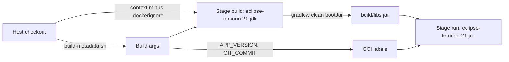

# Docker image

The `Dockerfile` builds the app in a JDK container and copies only the resulting Spring Boot jar into a JRE image. Every script and workflow that builds the image passes build metadata from `scripts/build-metadata.sh`, so the image knows its own version and commit.

## Dockerfile stages



| Stage | Base | What happens |
| --- | --- | --- |
| `build` | `eclipse-temurin:21-jdk` | `COPY . .`, then `./gradlew --no-daemon -Pvaadin.productionMode=true ... clean bootJar`. The Gradle wrapper pins the Gradle version, so no Gradle-specific base image is needed. |
| run (unnamed) | `eclipse-temurin:21-jre` | Copies `build/libs/*.jar` to `/app/app.jar`, `EXPOSE 8080`, `ENTRYPOINT ["java", "-jar", "app.jar"]` |

`gradle.properties` sets `vaadin.productionMode=false` for local work. The image build overrides it to `true`, so the Vaadin frontend bundle is compiled into the jar and no dev server runs in the container.

The runtime image contains a JRE and one jar, nothing else from the source tree. The repository does not record the image size. The Dockerfile has no `USER` directive and no `HEALTHCHECK`; health checking is left to Kubernetes probes and the CI smoke test (see [Deployment](index.md#health-checks)). It sets no JVM memory flags either; the local k3d deploy adds `JAVA_TOOL_OPTIONS=-XX:MaxRAMPercentage=75` through its ConfigMap.

## Build args and labels

| Build arg | Gradle property | Used for |
| --- | --- | --- |
| `APP_VERSION` | `-PappVersion` | Version string; also the `org.opencontainers.image.version` label |
| `GIT_COMMIT` | `-PgitCommit` | Commit id; also the `org.opencontainers.image.revision` label |
| `GIT_BRANCH` | `-PgitBranch` | Branch in `git.properties` |
| `GIT_DIRTY` | `-PgitDirty` | Dirty flag |
| `GIT_COMMIT_TIME` | `-PgitCommitTime` | Commit time (epoch seconds) |
| (none) | `-PbuildTime` | Set inside the build from `date -u`, so only image builds carry a build time |

The run stage also sets `org.opencontainers.image.title="mockingbird-bank"` and a `description` label. The description is set explicitly so the Ubuntu text from the JRE base image does not show through. Read them with `docker inspect`.

A `docker build .` without build args still succeeds. Commit and branch then read `unknown` and the version becomes `0.3.0-unknown`. The resolution rules are described in [Build version](../features/build-version.md).

## .dockerignore

`.dockerignore` keeps these out of the build context:

| Pattern | Reason |
| --- | --- |
| `.git` | Not needed in the image; this is why metadata arrives as build args |
| `.gradle`, `build/`, `target/`, `out/` | Local build output; the image always starts with `clean` |
| `node_modules/`, `src/main/frontend/generated/` | Regenerated by the Vaadin production build |
| `.idea`, `*.iml`, `.vscode`, `.DS_Store` | Editor files |
| `.env`, `*.log` | Local secrets and logs must never reach an image layer |

## scripts/build-metadata.sh

`scripts/build-metadata.sh` mirrors the version logic at the top of `build.gradle`, reading `baseVersion` from `gradle.properties` and the rest from `git` in the host checkout.

| Invocation | Output |
| --- | --- |
| `scripts/build-metadata.sh` | `KEY=value` lines, suitable for `>> "$GITHUB_OUTPUT"` |
| `scripts/build-metadata.sh --docker-args` | `--build-arg KEY=value ...` on one line |
| `APP_VERSION=0.2.0 scripts/build-metadata.sh` | Same, with the version overridden (used by `.github/workflows/release.yml`) |

A detached HEAD reports branch `detached`. If `git status` fails the dirty flag is `unknown`.

## Image scripts

All three scripts live at the repository root, are zsh, and require a `<version>` argument. They exit with a usage message if it is missing.

| Script | What it does |
| --- | --- |
| `createLocalDockerImage.zsh <version>` | `docker buildx build --platform linux/arm64 --load` with the metadata build args, tagged `ajpahl1008/mockingbird-bank:<version>`. Builds arm64 only, which matches an Apple Silicon laptop; on an amd64 host it needs emulation. |
| `runDockerImage.zsh <version>` | Loads `.env` into the shell, stops and removes any container named `mockingbird-bank`, then runs `ajpahl1008/mockingbird-bank:<version>` in the foreground with `--env-file .env` and `-p 8090:8080`. |
| `createDockerHubImage.zsh <version>` | `docker buildx build --platform linux/arm64,linux/amd64 --provenance=true --sbom=true --push`, tagged `ajpahl1008/mockingbird-bank:<version>`. Needs `docker login` first. |

The build scripts leave the `$(./scripts/build-metadata.sh --docker-args)` substitution unquoted on purpose: zsh word-splits it into separate `--build-arg` flags.

The `<version>` argument is only the image tag. The version the app reports comes from `build-metadata.sh` (`<baseVersion>-<short sha>`), so `createLocalDockerImage.zsh 1.0.0` produces an image tagged `1.0.0` that reports something like `0.3.0-78a2f03` at `/actuator/info`.

### .env and .env.example

`runDockerImage.zsh` expects a `.env` file at the repo root. Copy `.env.example`, which contains:

```
SPRING_DATASOURCE_URL=jdbc:postgresql://host.docker.internal:5432/mydatabase
SPRING_DATASOURCE_USERNAME=admin
SPRING_DATASOURCE_PASSWORD=secret
# SERVER_PORT=8080
```

`host.docker.internal` reaches a Postgres on the host from inside the container on Docker Desktop, so the app container does not need to share a network with the database. Starting the host Postgres with `docker compose up -d` matches these values. `.env` is gitignored and excluded from the Docker context.

The host port 8090 is fixed in the script; the container side is always 8080 unless `SERVER_PORT` changes it, in which case the `-p` mapping must change too. Commit `ef23e06` fixed an earlier version that mapped to the wrong container port and referenced a Docker network that was never created.

## Registries

| Registry | Pushed by | Tags | Platforms |
| --- | --- | --- | --- |
| Docker Hub `ajpahl1008/mockingbird-bank` | `createDockerHubImage.zsh`, by hand | The given `<version>` | arm64 and amd64 |
| GHCR `ghcr.io/<owner>/<repo>` | `.github/workflows/publish-image.yml` on every push to `master` | `latest`, `sha-<full sha>` | Runner default (amd64) |
| GHCR `ghcr.io/<owner>/<repo>` | `.github/workflows/release.yml` on a `v*.*.*` tag | `<version>`, `latest` | Runner default (amd64) |

The workflows are covered in [Releases](releases.md). The k3d deploy builds a native-arch image and never pushes it; see [Local k3d](local-k3d.md).

## Key source files

| File | Purpose |
| --- | --- |
| `Dockerfile` | Two-stage build, build args, OCI labels |
| `.dockerignore` | Build context exclusions |
| `scripts/build-metadata.sh` | Host-side version and commit for build args |
| `createLocalDockerImage.zsh` | Local arm64 image |
| `runDockerImage.zsh` | Run a local image against `.env` |
| `createDockerHubImage.zsh` | Multi-arch push to Docker Hub |
| `.env.example` | Template for `.env` |
