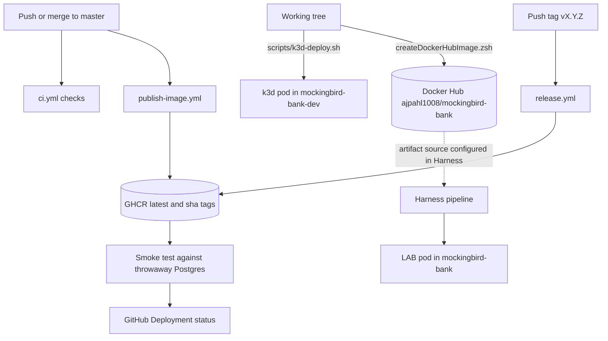

# Deployment

Mockingbird Bank ships as one Spring Boot jar inside one Docker image, and that image runs in several places: a laptop, a dev container, a local k3d cluster, the CI smoke test and the LAB Kubernetes cluster deployed by Harness. This page maps every path from source to a running process and links to the detailed pages.

## Pages in this section

| Page | Covers |
| --- | --- |
| [Docker image](docker-image.md) | `Dockerfile` stages, build args, OCI labels, the three `*.zsh` image scripts |
| [Releases](releases.md) | Release notes drafting, tag-driven releases, the GHCR publish and post-publish smoke test, rollback |
| [Local k3d](local-k3d.md) | `scripts/k3d-deploy.sh` and the kustomize manifests in `k8s/local/` |
| [LAB cluster](lab-cluster.md) | Harness-templated `k8s/*.yaml`, MetalLB, the external LAB Postgres |

## From commit to running pod

Two notes on the diagram:

- The Harness pipeline, its Service and its artifact source live in Harness, not in this repository. Commit `278a4eb` describes the artifact as `ajpahl1008/mockingbird-bank`, which is the Docker Hub repository that `createDockerHubImage.zsh` pushes to. The GHCR images from CI are a separate registry (`ghcr.io/<owner>/<repo>`). Check the Harness Service before assuming which registry LAB pulls from.
- The "GitHub Deployment" recorded by `.github/workflows/publish-image.yml` is a record of the smoke test on a GitHub runner, using environment name `production`. It does not deploy anything to a cluster.

## Environments compared

| Environment | Database | URL | Config source | Feature flags |
| --- | --- | --- | --- | --- |
| Laptop (`./gradlew bootRun`, `./scripts/dev-up.sh`) | `docker-compose.yml` Postgres at `localhost:5432/mydatabase` | `http://localhost:8080` | `src/main/resources/application.yml` defaults, overridable by env vars | `application.yml` defaults or `MOCKINGBIRD_FEATURE_FLAGS_*` env vars |
| Dev container (`.devcontainer/`) | Same Compose service, reached as `postgres:5432/mydatabase` | `http://localhost:8080` (published by `.devcontainer/docker-compose.yml`) | `environment:` block in `.devcontainer/docker-compose.yml` | Defaults |
| Plain container (`runDockerImage.zsh`) | Whatever `.env` points at; `.env.example` uses `host.docker.internal:5432/mydatabase` | `http://localhost:8090` | `.env` via `--env-file` | Add `MOCKINGBIRD_FEATURE_FLAGS_*` lines to `.env` |
| CI smoke test (`publish-image.yml`) | GitHub Actions service container `postgres:16-alpine`, `localhost:5432/mydatabase` | `http://localhost:8080` on the runner (`--network host`) | `-e` flags in the workflow | Defaults |
| Local k3d (`scripts/k3d-deploy.sh`) | In-cluster `postgres:16-alpine` StatefulSet, `postgres:5432/mockingbirdbank`, `local-path` PVC | `http://mockingbird.localhost:81` through Traefik (port depends on the k3d loadbalancer) | `configMapGenerator` and `secretGenerator` in `k8s/local/kustomization.yaml` | `MOCKINGBIRD_FEATURE_FLAGS_*` literals in the same `configMapGenerator`; tracing sampling forced to `0.0` |
| LAB cluster (Harness) | External Postgres `192.168.0.148:5432/mockingbirdbank` | `http://192.168.0.183` (MetalLB LoadBalancer, port 80) | `k8s/02-app-configmap.yaml` plus a Secret templated from `k8s/values.yaml` | Defaults; the manifests set no flag overrides |

Every environment configures the same app the same way: `SPRING_DATASOURCE_*` env vars for the database, `SERVER_PORT` for the port, and Spring relaxed binding for anything else. Flag values bind at startup, so changing one means restarting the process or rolling a new pod. See [Feature flags](../features/feature-flags.md) and [Configuration](../reference/configuration.md).

## Single replica

Both Kubernetes Deployments (`k8s/03-app.yaml` and `k8s/local/app.yaml`) run `replicas: 1`. Vaadin keeps each user's UI state in the server-side HTTP session, so a second replica would need sticky sessions at the load balancer or ingress. The comment in `k8s/local/app.yaml` names the Traefik setting that would be needed (`traefik.ingress.kubernetes.io/service.sticky.cookie`). Neither cluster sets it up today. See [Architecture](../overview/architecture.md) for the wider picture.

## Health checks

| Where | Check |
| --- | --- |
| `docker-compose.yml` | `pg_isready` on Postgres only |
| `publish-image.yml` smoke test | Polls `/actuator/health` for `"status":"UP"` 30 times, 2 seconds apart |
| `k8s/local/app.yaml` | Startup and liveness on `/actuator/health/liveness`, readiness on `/actuator/health` |
| `k8s/03-app.yaml` | Readiness on `/actuator/health` only |

`/actuator/health` and `/actuator/info` are the only public Actuator endpoints. `/actuator/info` reports the running version and commit; see [Build version](../features/build-version.md).

## Related

- [Getting started](../overview/getting-started.md) for the laptop and dev container setup.
- `docs/runbooks/rollback.md` for rolling back a bad deploy, summarised in [Releases](releases.md#rolling-back).
- [Alerting](../how-to-monitor/alerting.md) for the Slack alerts on CI and smoke test failures.
