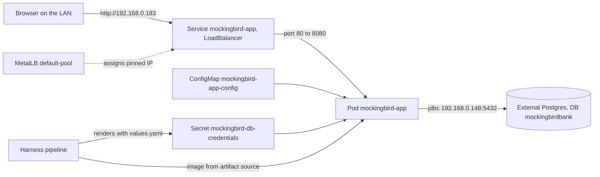

# LAB cluster

The LAB deployment runs one app pod in namespace `mockingbird-bank` on a home-lab Kubernetes cluster, deployed by a Harness pipeline from the manifests in `k8s/`. The database is an external Postgres the cluster does not manage, and the app is reached on a fixed MetalLB IP, `192.168.0.183`.

The Harness pipeline, Service, connectors and secrets are configured in Harness, not in this repository. This page covers what the repository controls.

## Topology



## Manifests

| File | Resource | Notes |
| --- | --- | --- |
| `k8s/00-namespace.yaml` | Namespace `mockingbird-bank` | |
| `k8s/01-app-db-secret.yaml` | Secret `mockingbird-db-credentials` | `SPRING_DATASOURCE_USERNAME` and `SPRING_DATASOURCE_PASSWORD`, rendered from `{{ .Values.dbUsername \| b64enc }}` and `{{ .Values.dbPassword \| b64enc }}` |
| `k8s/02-app-configmap.yaml` | ConfigMap `mockingbird-app-config` | `SPRING_DATASOURCE_URL: jdbc:postgresql://192.168.0.148:5432/mockingbirdbank`. Not a Secret because host, port and DB name are not sensitive. |
| `k8s/03-app.yaml` | Deployment and Service `mockingbird-app` | `image: {{ .Values.image }}`, one replica, readiness probe, LoadBalancer Service |
| `k8s/values.yaml` | Harness values file | The only file with Harness expressions |

The numeric prefixes give the apply order: namespace, then the Secret and ConfigMap the Deployment depends on.

## Harness templating

```yaml
# k8s/values.yaml
image: <+artifact.image>
dbUsername: admin
dbPassword: <+secrets.getValue("postgres-lab-secret")>
```

Harness resolves `<+...>` expressions only inside a values file, not inside raw manifests. The manifests are therefore Go templates that read `{{ .Values.x }}`, and `values.yaml` carries the expressions:

- `<+artifact.image>` becomes the image from the Harness Service's artifact source.
- `<+secrets.getValue("postgres-lab-secret")>` is read from the Harness secret manager at deploy time. It is the same secret behind the `postgresdb` Harness connector, so the password never appears in git.

Commit `b3f9fd0` introduced this layout after the first version put the expressions directly in the Secret and Deployment manifests, where Harness left them unresolved. The same commit wired the Harness Service's `manifest.valuesPaths` to `k8s/values.yaml`.

These files are not valid Kubernetes YAML until rendered, so `kubectl apply -f k8s/` does not work. For a local cluster use [Local k3d](local-k3d.md) instead.

## Deployment and probes

`k8s/03-app.yaml` defines a single container `app` on port 8080 with:

- `envFrom` the ConfigMap, plus the two credentials from the Secret via `secretKeyRef`.
- A readiness probe on `/actuator/health`, starting after 20 seconds, every 10 seconds.
- `replicas: 1`, because Vaadin UI state lives in the server-side session (see [Deployment](index.md#single-replica)).

There is no startup or liveness probe and no resource requests or limits, unlike `k8s/local/app.yaml`. A hung JVM stays in place but is removed from the Service once readiness fails. Readiness uses the full health endpoint, which includes the database check, so a Postgres outage takes the pod out of rotation without restarting it. See [Database down](../../docs/runbooks/database-down.md).

Feature flags and tracing use the `application.yml` defaults, since the ConfigMap sets only the datasource URL. Tracing samples every request and exports to `http://localhost:4318/v1/traces`; with no collector there, spans are dropped. To change a flag, add a `MOCKINGBIRD_FEATURE_FLAGS_*` key to `k8s/02-app-configmap.yaml` and redeploy. See [Feature flags](../features/feature-flags.md).

## MetalLB LoadBalancer

The Service is `type: LoadBalancer`, port 80 to target port 8080. The cluster runs MetalLB with one auto-assign pool, `default-pool` (192.168.0.180-189), which also serves the cluster's elastic, envoy and portainer services. The annotation `metallb.io/loadBalancerIPs: 192.168.0.183` pins the address MetalLB first handed out, so recreating the Service does not move the app to another free IP. Drop the annotation if the app ever needs to move.

Check what is running:

```
curl http://192.168.0.183/actuator/health
curl http://192.168.0.183/actuator/info
```

## External Postgres

The database lives at `192.168.0.148:5432`, outside the cluster, behind the `postgresdb` Harness connector. The app uses a dedicated database, `mockingbirdbank`, which must exist before the first deploy. Postgres has no `CREATE DATABASE IF NOT EXISTS`, and Flyway only manages schema inside an existing database, so `scripts/bootstrap-lab-db.sql` is run once by hand:

```
psql -h 192.168.0.148 -U admin -d postgres -f scripts/bootstrap-lab-db.sql
```

Connect to an existing database such as `postgres` first; the script runs `CREATE DATABASE mockingbirdbank`, reconnects with `\c mockingbirdbank` and creates the four tables. The `CREATE TABLE` statements are a literal copy of `src/main/resources/db/migration/V1__init_schema.sql`, not a `\i` include, so the file works when only it is available. With a GUI client, run the `CREATE DATABASE`, open a new connection to `mockingbirdbank`, and run the rest.

On first boot against these tables, `spring.flyway.baseline-on-migrate: true` sees a non-empty schema and records a baseline at version 1 instead of running V1. Flyway then applies V2, which adds the program tables and columns. On an empty database, `DataInitializer` then finds no holders and seeds the two demo holders, with the `jordan.ellis` and `riley.chen` logins. A LAB database that an older build already seeded keeps its old data, so it has only `jordan.ellis` until the database is recreated. See [Persistence](../systems/persistence.md).

### Why a dedicated database

The first LAB deploy pointed at an existing shared database, `metamanagement`, which already held unrelated tables. `baseline-on-migrate` treated that non-empty schema as an existing install, marked V1 as applied without running it, and the app's own tables were never created. Commit `b809e47` moved the app to its own `mockingbirdbank` database and added the bootstrap script. The general lesson, that `baseline-on-migrate` cannot tell "this app's old schema" from "someone else's tables", is recorded in [Pitfalls](../background/pitfalls.md).

## How the setup evolved

All of these commits landed on 2026-09-26 and 2026-09-27, apart from the k3d split.

| Commit | Change |
| --- | --- |
| `57f6ca0` | Initial scaffold: `00-namespace`, `01-postgres-secret`, `02-postgres` StatefulSet, `03-app-configmap`, `04-app`, all in-cluster |
| `ce54a61` | Stopped committing the Postgres Secret; replaced it with a gitignored file and a `.example` template |
| `278a4eb` | Switched to the external LAB Postgres, removed the in-cluster StatefulSet and secret template, renumbered files, added `01-app-db-secret.yaml` and `image: <+artifact.image>` |
| `b3f9fd0` | Moved Harness expressions into `k8s/values.yaml` with Go-template manifests |
| `b809e47` | Dedicated `mockingbirdbank` database and `scripts/bootstrap-lab-db.sql` |
| `47b5026` | Service changed from ClusterIP, which was unreachable from the LAN, to LoadBalancer |
| `39aca95` | Pinned the LoadBalancer IP to `192.168.0.183` |
| `5fbf51f` | Added the separate `k8s/local/` kustomize setup for k3d; the LAB files were left unchanged |

## Rolling back

```
kubectl -n mockingbird-bank rollout history deploy/mockingbird-app
kubectl -n mockingbird-bank rollout undo deploy/mockingbird-app
kubectl -n mockingbird-bank rollout status deploy/mockingbird-app
```

To go back further, re-run the Harness pipeline with a known-good image. The full procedure is in [Releases](releases.md#rolling-back) and `docs/runbooks/rollback.md`.

## Key source files

| File | Purpose |
| --- | --- |
| `k8s/values.yaml` | Harness expressions for image and DB credentials |
| `k8s/00-namespace.yaml` | Namespace |
| `k8s/01-app-db-secret.yaml` | Templated DB credentials Secret |
| `k8s/02-app-configmap.yaml` | JDBC URL for the external Postgres |
| `k8s/03-app.yaml` | Deployment, readiness probe, MetalLB Service |
| `scripts/bootstrap-lab-db.sql` | One-time database and table creation |
| `src/main/resources/application.yml` | `baseline-on-migrate` and app defaults |
