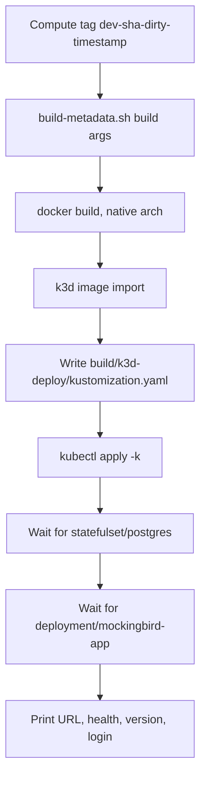
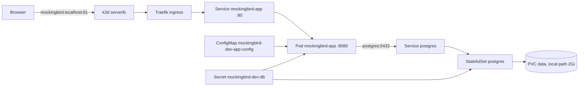

# Local k3d

`scripts/k3d-deploy.sh` builds the current working tree into an image, imports it into a local k3d cluster and deploys it with its own in-cluster Postgres. Use it to see a change running in Kubernetes before it reaches `master`. The manifests are plain kustomize files in `k8s/local/` and share nothing with the Harness manifests described in [LAB cluster](lab-cluster.md).

## Quick reference

| Command | Effect |
| --- | --- |
| `./scripts/k3d-deploy.sh` (or `deploy`, `up`) | Build, import, apply, wait for rollout, print the URL |
| `./scripts/k3d-deploy.sh status` | `kubectl get pods,svc,ingress,pvc` in the namespace |
| `./scripts/k3d-deploy.sh logs` | Follow the app logs |
| `./scripts/k3d-deploy.sh logs postgres` (or `logs db`) | Follow the Postgres logs |
| `./scripts/k3d-deploy.sh down` | Delete the app Deployment, Service and Ingress, scale Postgres to 0, keep the PVC |
| `./scripts/k3d-deploy.sh down --purge-db` | Delete the whole `mockingbird-bank-dev` namespace, database included |
| `./scripts/k3d-deploy.sh help` | Print the usage header |

| Variable | Default | Meaning |
| --- | --- | --- |
| `CONTEXT` | `k3d-dev-k8s` | Kube context. Every `kubectl` call passes `--context`, so the current context is never used. |
| `CLUSTER` | `dev-k8s` | k3d cluster name for `k3d image import` and the loadbalancer lookup |
| `ROLLOUT_TIMEOUT` | `300s` | Timeout for each `kubectl rollout status` |

Before any subcommand, a preflight check requires `docker`, `k3d`, `kubectl` and `git` on the `PATH`, a running Docker daemon, the kube context and the k3d cluster.

## What a deploy does

1. **Tag.** `dev-<short sha>`, plus `-dirty` if `git status --porcelain` is non-empty, plus `-<YYYYmmddHHMMSS>`. A unique tag changes the Deployment spec on every run, so Kubernetes rolls a new pod. Reusing a fixed tag with `imagePullPolicy: IfNotPresent` would keep the old cached image.
2. **Build.** `docker build` with the build args from `scripts/build-metadata.sh --docker-args`, tagged both `mockingbird-bank:<tag>` and `mockingbird-bank:dev`. This is the same `Dockerfile` that releases use, so the pod reports its real version. See [Docker image](docker-image.md).
3. **Import.** `k3d image import mockingbird-bank:<tag> mockingbird-bank:dev -c dev-k8s` loads both tags into the nodes' containerd. No registry is involved.
4. **Overlay.** Writes `build/k3d-deploy/kustomization.yaml`, which includes `../../k8s/local` and sets `images: [{name: mockingbird-bank, newTag: <tag>}]`. It lives under `build/` because kustomize refuses absolute paths to a base, and `build/` is gitignored and excluded from the Docker context.
5. **Apply and wait.** `kubectl apply -k`, then `rollout status` for Postgres and the app. If the app rollout times out, the script prints the namespace state and a `describe pod` hint, then exits 1.
6. **Report.** Prints the URL, a `curl` for `/actuator/health`, the version and the demo login `jordan.ellis` / `mockingbird`.

The URL comes from `docker port k3d-<cluster>-serverlb 80/tcp`. On the reference cluster that is port 81, giving `http://mockingbird.localhost:81`. If the loadbalancer maps no host port to 80, the script suggests `kubectl -n kube-system port-forward svc/traefik 8081:80` and `http://mockingbird.localhost:8081` instead. `*.localhost` resolves to 127.0.0.1, so no hosts-file entry is needed.

`k8s/local/` also works without the script: `kubectl apply -k k8s/local` uses the `mockingbird-bank:dev` tag that every scripted build imports as a fallback.

## Cluster layout

Everything lives in namespace `mockingbird-bank-dev` and carries the labels `app.kubernetes.io/part-of: mockingbird-bank` and `app.kubernetes.io/environment: local-dev`.

| File | Resources |
| --- | --- |
| `k8s/local/namespace.yaml` | Namespace `mockingbird-bank-dev` |
| `k8s/local/postgres.yaml` | ClusterIP Service `postgres` and StatefulSet `postgres` |
| `k8s/local/app.yaml` | Deployment and ClusterIP Service `mockingbird-app` |
| `k8s/local/ingress.yaml` | Ingress `mockingbird-app`, class `traefik`, host `mockingbird.localhost` |
| `k8s/local/kustomization.yaml` | Namespace, labels, resource list, Secret and ConfigMap generators |

### Postgres StatefulSet

- Image `postgres:16-alpine`, the same as `docker-compose.yml` and the Testcontainers tests.
- Reads `POSTGRES_USER`, `POSTGRES_PASSWORD` and `POSTGRES_DB` from the `mockingbird-dev-db` Secret.
- `PGDATA=/var/lib/postgresql/data/pgdata`, a subdirectory, so `initdb` does not trip over anything the volume provisioner leaves at the mount root.
- Readiness and liveness both run `pg_isready` (readiness after 5s every 5s, liveness after 30s every 10s).
- Requests 100m CPU and 256Mi, limit 512Mi memory.
- `volumeClaimTemplates` asks for a 2Gi `ReadWriteOnce` volume on storage class `local-path`, so data survives redeploys and `down`.

### App Deployment

- `replicas: 1` with `maxSurge: 1`, `maxUnavailable: 0`, so a new pod must be ready before the old one stops. Vaadin sessions are in memory, so they do not survive the switch, and scaling out would need sticky sessions (see [Deployment](index.md#single-replica)).
- An init container `wait-for-postgres` loops on `pg_isready -h postgres -p 5432` before the app starts.
- Database credentials come from the same `mockingbird-dev-db` Secret (`POSTGRES_USER`, `POSTGRES_PASSWORD`), everything else from the ConfigMap.
- Requests 250m CPU and 512Mi, limit 1Gi memory.

| Probe | Path | Timing |
| --- | --- | --- |
| Startup | `/actuator/health/liveness` | Every 5s, up to 36 failures (3 minutes) for Spring, Flyway and Vaadin to start |
| Liveness | `/actuator/health/liveness` | Every 10s, 3 failures |
| Readiness | `/actuator/health` | Every 10s, 3 failures. Includes the DB check, so traffic stops if Postgres goes away without restarting the pod. |

### Generated Secret and ConfigMap

`secretGenerator` creates `mockingbird-dev-db` with `POSTGRES_USER=admin`, a throwaway local password and `POSTGRES_DB=mockingbirdbank`. Postgres only reads these when it initialises an empty data directory, so changing them requires `down --purge-db`.

`configMapGenerator` creates `mockingbird-dev-app-config`:

| Key | Value | Why |
| --- | --- | --- |
| `SPRING_DATASOURCE_URL` | `jdbc:postgresql://postgres:5432/mockingbirdbank` | In-cluster Service |
| `VAADIN_LAUNCH_BROWSER` | `false` | No browser to open in a pod |
| `MANAGEMENT_ENDPOINT_HEALTH_PROBES_ENABLED` | `true` | Enables `/actuator/health/liveness` for the probes |
| `JAVA_TOOL_OPTIONS` | `-XX:MaxRAMPercentage=75` | Size the heap from the 1Gi limit |
| `MANAGEMENT_TRACING_SAMPLING_PROBABILITY` | `0.0` | No OTLP collector runs in the cluster; without this the exporter logs an ERROR every few seconds |

To collect traces, set the sampling probability to `1.0` and add `MANAGEMENT_OPENTELEMETRY_TRACING_EXPORT_OTLP_ENDPOINT`. See [Tracing](../how-to-monitor/tracing.md).

To flip a feature flag for a local deploy, add a literal such as `MOCKINGBIRD_FEATURE_FLAGS_SHOW_WELCOME_BANNER=true` to the same generator and redeploy. kustomize appends a content hash to generated names, so a changed ConfigMap also changes the pod template and rolls the pod. See [Feature flags](../features/feature-flags.md).

## Docker VM sizing

The image build runs the full Gradle and Vaadin production build inside the same Docker VM as the k3d nodes. AGENTS.md records what happened on Rancher Desktop:

| Docker VM | Result |
| --- | --- |
| 2 CPUs, 6 GB, Rancher Desktop's own Kubernetes also running | Each build starved the k3d API server; `kubectl` hung for 1.5 to 3.5 minutes per deploy |
| 6 CPUs, 12 GB, Rancher Desktop Kubernetes off (`rdctl set --kubernetes.enabled=false`) | A full no-cache build took about 3 minutes and the API answered in under a second |

k3d only needs the Docker engine, so turning off Rancher Desktop's built-in Kubernetes costs nothing here.

## Things to know

- Each deploy leaves an image in the nodes' containerd. Kubelet image garbage collection removes unused ones when node disk fills; the script does not clean them up.
- The database starts empty on the first deploy, so Flyway runs V1 and V2 and `DataInitializer` seeds the two demo holders. Both are skipped on later deploys while the PVC exists. See [Persistence](../systems/persistence.md).
- The script's `help` prints lines 2 to 17 of the script file, so the header comment is the help text.

## Key source files

| File | Purpose |
| --- | --- |
| `scripts/k3d-deploy.sh` | Build, import, deploy, status, logs, teardown |
| `k8s/local/kustomization.yaml` | Namespace, labels, generators, flag overrides |
| `k8s/local/app.yaml` | App Deployment, probes, resources, Service |
| `k8s/local/postgres.yaml` | Postgres StatefulSet, Service, PVC template |
| `k8s/local/ingress.yaml` | Traefik Ingress for `mockingbird.localhost` |
| `k8s/local/namespace.yaml` | Namespace |
