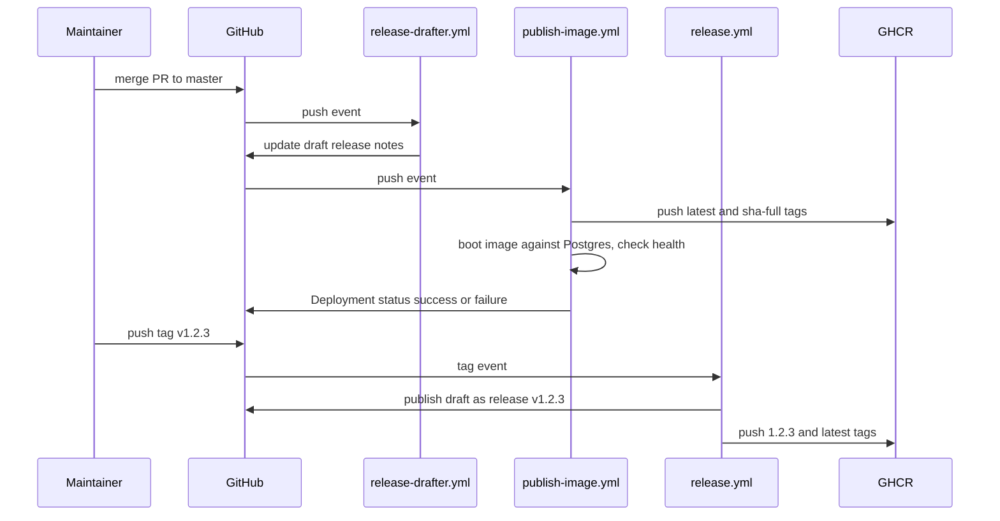

# Releases

Three GitHub Actions workflows turn commits into published artifacts. `release-drafter.yml` keeps draft release notes current, `publish-image.yml` pushes an image to GHCR and smoke-tests it on every push to `master`, and `release.yml` turns a `v*.*.*` tag into a published GitHub Release plus a versioned image.

## Overview



## Release notes: release-drafter

`.github/workflows/release-drafter.yml` runs `release-drafter/release-drafter@v6` on every push to `master` with `contents: write` and `pull-requests: read`. It never publishes anything. It rewrites one draft release from the labels on merged PRs, as configured in `.github/release-drafter.yml`.

| Category | PR labels |
| --- | --- |
| Features | `feature`, `enhancement` |
| Bug Fixes | `fix`, `bug` |
| Security | `security` |
| Dependencies | `dependencies` |
| Maintenance | `chore`, `maintenance`, `documentation` |

PRs labelled `skip-changelog` are left out. Each entry renders as `- $TITLE (#$NUMBER)`, and the body ends with a compare link from the previous tag.

The draft's name and tag are `v$RESOLVED_VERSION`, where the version resolver bumps the last release:

| Bump | Labels |
| --- | --- |
| Major | `major` |
| Minor | `minor`, `feature`, `enhancement` |
| Patch | `patch`, `fix`, `bug`, `chore`, `dependencies` (also the default) |

The resolved version is only a suggestion. `release.yml` uses whatever tag you push.

## Every push to master: publish-image

`.github/workflows/publish-image.yml` has two jobs. A `concurrency` group per ref with `cancel-in-progress: false` means overlapping pushes queue instead of cancelling each other.

### publish

1. Logs in to GHCR with the built-in `GITHUB_TOKEN` (`packages: write`), so no extra registry credentials are needed.
2. Runs `scripts/build-metadata.sh >> "$GITHUB_OUTPUT"` to get the version and commit.
3. Uses `docker/metadata-action@v5` to tag the image `latest` and `sha-<full commit sha>`. It overrides the `org.opencontainers.image.version` label with the real app version, because metadata-action would otherwise set it to `latest`.
4. Builds and pushes with `docker/build-push-action@v6`, passing the five build args and using the GitHub Actions cache (`type=gha`).

The job exports `sha_tag: sha-${{ github.sha }}` so the second job can pull exactly the image it just pushed.

### deployment-smoke-test

This job checks that the pushed image starts and reaches a database.

1. Starts a `postgres:16-alpine` service container (`mydatabase`, `admin`/`secret`) with a `pg_isready` health check.
2. Creates a GitHub Deployment for the commit with environment `production` and marks it `in_progress`.
3. Pulls `ghcr.io/<repo>:sha-<sha>` and runs it with `--network host` and `SPRING_DATASOURCE_*` pointing at `localhost:5432`.
4. Polls `http://localhost:8080/actuator/health` up to 30 times, 2 seconds apart, for `"status":"UP"`. On failure it prints `docker logs smoke-test`.
5. Always sets the Deployment status to `success` or `failure`, and always removes the container.
6. On failure, posts to Slack through the `SLACK_ALERTS_WEBHOOK_URL` secret. Without the secret it logs a message and exits 0. See [Alerting](../how-to-monitor/alerting.md).

The test proves the app boots, runs Flyway and reports healthy. It does not sign in or render a page; the browser-driven check is `scripts/run-interactive-qa.sh`, which runs only on demand (see [Testing](../how-to-contribute/testing.md)).

### The required_contexts fix

The Deployments API defaults `required_contexts` to every commit status on the ref and returns `409 Conflict` if any of them is pending or failed. CI, CodeQL, DAST and the secret scan all run in parallel with this workflow, so the first real run failed before the smoke test started: the gitleaks check had failed on that commit for an unrelated false positive. Commit `979d4da` builds the request body with `jq` and sends it through `gh api ... --input -` so `required_contexts` can be an explicit empty array. Per-field `-f`/`-F` flags cannot express an empty array, which is why the step looks different from the status calls after it.

## Tagged releases: release.yml

`.github/workflows/release.yml` triggers on tags matching `v*.*.*`.

| Job | What it does |
| --- | --- |
| `publish-release` | Strips the `v` from the tag to get the version, then runs release-drafter with `publish: true`, `tag` and `name` set to the tag. This publishes the current draft as the real release. |
| `publish-image` | Needs `publish-release`. Runs `build-metadata.sh` with `APP_VERSION` set to the tag version, then builds and pushes `ghcr.io/<repo>:<version>` and `ghcr.io/<repo>:latest`. |

Because `APP_VERSION` overrides the computed version, tag `v0.2.0` produces an app that reports `0.2.0` at `/actuator/info`, with the commit still read from git. See [Build version](../features/build-version.md).

Both `publish-image.yml` and `release.yml` push `latest`, so after the next push to `master` `latest` no longer points at the release. Pin a version or `sha-` tag when you need a specific build. Neither workflow pushes to Docker Hub; that only happens through `createDockerHubImage.zsh` (see [Docker image](docker-image.md)).

## Cutting a release

1. Open the draft under the repository's Releases tab and check the notes and suggested version. Fix PR labels if something landed in the wrong category.
2. Tag the commit and push the tag:

   ```
   git tag v1.2.3
   git push origin v1.2.3
   ```

3. Watch the Release workflow. When it finishes, the GitHub Release is published and `ghcr.io/<repo>:1.2.3` exists.

The tag must have three numeric parts; `v1.2` does not match `v*.*.*` and triggers nothing. The local clone has no tags yet, so no release has been cut from it.

## Rolling back

The full procedure is in `docs/runbooks/rollback.md` ([runbook](../../docs/runbooks/rollback.md)). In short:

1. Find the last good commit. Every push to `master` has a `sha-<commit>` image and a Deployment record with the smoke test result: `gh api 'repos/{owner}/{repo}/deployments'` (run inside the checkout, so `gh` fills in this repository).
2. For a quick fix, `kubectl -n mockingbird-bank rollout undo deploy/mockingbird-app` returns the LAB Deployment to its previous revision.
3. To skip past several bad revisions, re-run the Harness pipeline with the last known-good image instead of `latest` (`k8s/values.yaml` takes `image: <+artifact.image>`).
4. Revert the bad commit through a PR so the next deploy does not bring it back.

A `success` Deployment record only means the image booted against an empty Postgres on a GitHub runner. It says nothing about what LAB is running; check `/actuator/info` on the LAB service for that (see [LAB cluster](lab-cluster.md)).

## Key source files

| File | Purpose |
| --- | --- |
| `.github/workflows/release-drafter.yml` | Updates the draft release on every push to `master` |
| `.github/release-drafter.yml` | Categories, version resolver, template |
| `.github/workflows/publish-image.yml` | GHCR publish, Deployment record, smoke test, Slack alert |
| `.github/workflows/release.yml` | Tag-driven release publish and versioned image |
| `scripts/build-metadata.sh` | Version and commit for every image build |
| `docs/runbooks/rollback.md` | Rollback runbook |
