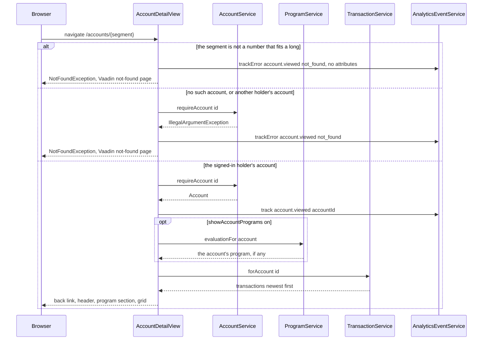

# Account detail

Active contributors: ajpahl1008 (AJ Pahl)

The account detail page at `/accounts/{id}` shows one of the signed-in holder's accounts: its header, current balance, and full transaction history, newest first. With the `showAccountPrograms` flag on it also shows the program the account takes part in. It is reached by clicking an account card on the [dashboard](dashboard.md) or an account link on a program card.

## Purpose

Let the holder read every transaction on one account. The layout follows the "Account Detail" artboard of the design mockup (per the class Javadoc). Like the rest of the app it is read-only.

## Key abstractions

| Class | File | Role |
| --- | --- | --- |
| `AccountDetailView` | `src/main/java/com/mockingbirdbank/ui/view/AccountDetailView.java` | The route. Implements `HasUrlParameter<String>`, turns the parameter into an account ID with `parseAccountId`, and builds the page in `setParameter`. |
| `AccountService.requireAccount` | `src/main/java/com/mockingbirdbank/service/AccountService.java` | Loads one of the signed-in holder's own accounts by ID. Throws `IllegalArgumentException` for a missing account and for another holder's account alike. |
| `TransactionService.forAccount` | `src/main/java/com/mockingbirdbank/service/TransactionService.java` | Returns the account's transactions ordered by `postedAt` descending, inside the `transactions` circuit breaker. |
| `TransactionRepository` | `src/main/java/com/mockingbirdbank/repository/TransactionRepository.java` | `findByAccountIdOrderByPostedAtDesc`. |
| `AccountNumberDisplay` | `src/main/java/com/mockingbirdbank/ui/view/AccountNumberDisplay.java` | Masked number with eye button in the header. See [Account number reveal](account-number-reveal.md). |
| `ProgramService.evaluationFor` | `src/main/java/com/mockingbirdbank/service/ProgramService.java` | The evaluated program the account takes part in, if any, inside the `programs` circuit breaker. See [Account programs](account-programs.md). |
| `ProgramCard` | `src/main/java/com/mockingbirdbank/ui/view/ProgramCard.java` | The program card shown in the "Program" section. |
| `Transaction` | `src/main/java/com/mockingbirdbank/model/Transaction.java` | Signed `amount`; `isCredit()` is true when positive. |

## How it works

`AccountDetailView` is `@Route(value = "accounts", layout = MainLayout.class)` and `@PermitAll`. It shares the `accounts` path with `DashboardView`; Vaadin tells them apart because this view requires a URL parameter, so `/accounts` is the dashboard and any single segment below it, such as `/accounts/7` or `/accounts/abc`, is this view. The parameter is a `String`. `parseAccountId` accepts what Vaadin accepts for a `Long` URL parameter (`RouteParameterRegex.LONG`: up to 19 ASCII digits with an optional sign) when the value fits a `long`, so non-ASCII digits such as Arabic-Indic ones are not an ID. The class Javadoc explains why it is not a `Long` parameter: with one, a non-numeric segment would match no route, and `VaadinSecurityConfigurer` answers a path that matches no route with 403 Forbidden, even for a signed-in user.

`setParameter` calls `removeAll()` before adding content, so navigating from one account to another reuses the view instance cleanly.

### Page content

1. **Back link.** An `Anchor` to `accounts` labelled "← Back to accounts".
2. **Header.** Left: display name, then the account number and "· Opened <openedAt>". The number is an `AccountNumberDisplay` with prefix "Account " when `allowAccountNumberReveal` is on (default), otherwise a plain masked `Span`. `openedAt` is a `LocalDate` concatenated directly, so it renders in ISO form (for the seeded checking account, `2021-03-12`), unlike the grid dates. Right: "Current balance" and the balance in USD.
3. **Program section** (only when `showAccountPrograms` is on, default off). A muted "Program" label in a section with CSS class `account-program`, followed by the account's `ProgramCard`, or "This account isn't part of a program." (class `program-none`). If programs can't be read (the `programs` breaker is open, or the program read fails with a database error; see `ProgramLookup`), it shows "Programs can't be shown right now. Please try again later." (class `programs-unavailable`) and the rest of the page still renders. When the flag is off, no program is evaluated. See [Account programs](account-programs.md).
4. **Transaction grid.** A Vaadin `Grid<Transaction>` with `setAllRowsVisible(true)` (no inner scrolling):

| Column | Source | Format |
| --- | --- | --- |
| Date | `postedAt` | `DateTimeFormatter.ofPattern("MM/dd/yyyy")` |
| Description | `description` | as stored, flex-grows |
| Category | `category` | as stored |
| Amount | `amount` | `NumberFormat.getCurrencyInstance(Locale.US)`, right-aligned, bold; credits use `var(--mb-positive)`, debits use `var(--mb-text)` |

Amounts are signed (negative is a debit), so debits render with a minus sign from the US currency formatter.

### Not-found handling

`requireAccount` throws `IllegalArgumentException("No such account: …")` for an unknown ID and for an account that belongs to another holder. The view catches it, records `account.viewed` with outcome error and reason `not_found` (attribute `accountId`), and throws Vaadin's `NotFoundException`, which renders Vaadin's standard not-found response. A non-numeric ID such as `/accounts/abc`, or a number too large for a `long`, gets the same not-found page without any service call. It is recorded as `account.viewed` / `not_found` with no attributes, because the raw path segment is user input and is not written to the event log.

### Ownership

`requireAccount` resolves `currentHolder()`, loads the account by ID, and keeps it only if `isOwnedBy` matches the signed-in holder, the same comparison `revealAccountNumber` uses. Another holder's account therefore gets the same not-found page as a missing one, so the page neither shows it nor reveals that the ID exists. `TransactionService.forAccount` has no check of its own, but this view calls it only after `requireAccount` has returned the account. See [Security](../security.md#account-detail-ownership-check).

## Integration points

- **Analytics:** `account.viewed` (success, `accountId`) and `account.viewed` / `not_found`, plus `programs.unavailable` (reason the exception's simple class name) when the program section shows the "unavailable" message. See [Analytics](../systems/analytics.md).
- **Resilience:** `requireAccount` (including its `currentHolder()` lookup) runs inside the `accounts` breaker and `forAccount` inside the `transactions` breaker. An open `accounts` or `transactions` breaker throws `ServiceUnavailableException`, which this view does not catch, so it reaches `GlobalErrorHandler`. An open `programs` breaker, and a database error from the program read, are caught in the program section through `ProgramLookup`. See [Resilience](../systems/resilience.md).
- **Flags:** `allowAccountNumberReveal` and `showAccountPrograms`. `showAccountNumberOnDashboard` does not apply here. See [Feature flags](feature-flags.md).
- **Persistence:** `Transaction.account` is a `@ManyToOne`; the grid only reads scalar columns. See [Persistence](../systems/persistence.md).

## Entry points for modification

- Load anything else per account only after `requireAccount` has returned, as the program section and `forAccount` do, so the ownership check stays in front of it.
- New grid column: add an `addColumn` call in `transactionTable`.
- Paging: `forAccount` returns the whole list; large histories would need a pageable repository method and a lazy `DataProvider`.

## Testing

- `src/test/java/com/mockingbirdbank/ui/view/AccountDetailViewTest.java`: every single segment under `accounts` routes to this view and a longer path does not; non-numeric, empty and out-of-range IDs get the not-found page with no service call; non-ASCII digits are not an ID; an unknown or foreign ID gets the not-found page with `accountId`; the signed-in holder's own account renders.
- `src/test/java/com/mockingbirdbank/service/AccountServiceTest.java`: `requireAccountThrowsForUnknownId`, `requireAccountReturnsSignedInHoldersOwnAccount`, `requireAccountRejectsAccountOwnedBySomeoneElseLikeAnUnknownOne`.
- `src/test/java/com/mockingbirdbank/service/TransactionServiceTest.java`: `forAccount` delegates to the ordered repository query.
- `qa/tests/dashboard.spec.ts`: clicks Everyday Checking, expects a URL matching `/accounts/.+` and the seeded "Trader Joe's" and "Direct Deposit - Bespin Engineering" rows.

## Key source files

| File | Purpose |
| --- | --- |
| `src/main/java/com/mockingbirdbank/ui/view/AccountDetailView.java` | Route, header, program section, grid, not-found handling |
| `src/main/java/com/mockingbirdbank/service/AccountService.java` | Owner-only `requireAccount` |
| `src/main/java/com/mockingbirdbank/service/ProgramService.java` | `evaluationFor` |
| `src/main/java/com/mockingbirdbank/ui/view/ProgramCard.java` | Program card |
| `src/main/java/com/mockingbirdbank/service/TransactionService.java` | `forAccount` with `transactions` breaker |
| `src/main/java/com/mockingbirdbank/repository/TransactionRepository.java` | Ordered query |
| `src/main/java/com/mockingbirdbank/model/Transaction.java` | Signed amount, `isCredit()` |
