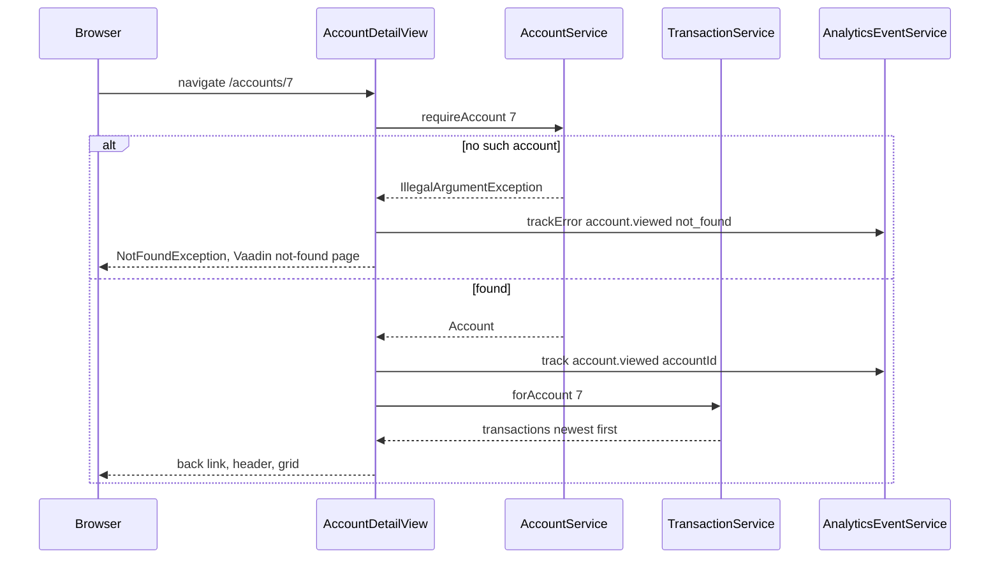

# Account detail

Active contributors: ajpahl1008 (AJ Pahl)

The account detail page at `/accounts/{id}` shows one account's header, current balance, and full transaction history, newest first. It is reached by clicking an account card on the [dashboard](dashboard.md).

## Purpose

Let the holder read every transaction on one account. The layout follows the "Account Detail" artboard of the design mockup (per the class Javadoc). Like the rest of the app it is read-only.

## Key abstractions

| Class | File | Role |
| --- | --- | --- |
| `AccountDetailView` | `src/main/java/com/mockingbirdbank/ui/view/AccountDetailView.java` | The route. Implements `HasUrlParameter<Long>` and builds the page in `setParameter`. |
| `AccountService.requireAccount` | `src/main/java/com/mockingbirdbank/service/AccountService.java` | Loads the account by ID or throws `IllegalArgumentException`. |
| `TransactionService.forAccount` | `src/main/java/com/mockingbirdbank/service/TransactionService.java` | Returns the account's transactions ordered by `postedAt` descending, inside the `transactions` circuit breaker. |
| `TransactionRepository` | `src/main/java/com/mockingbirdbank/repository/TransactionRepository.java` | `findByAccountIdOrderByPostedAtDesc`. |
| `AccountNumberDisplay` | `src/main/java/com/mockingbirdbank/ui/view/AccountNumberDisplay.java` | Masked number with eye button in the header. See [Account number reveal](account-number-reveal.md). |
| `Transaction` | `src/main/java/com/mockingbirdbank/model/Transaction.java` | Signed `amount`; `isCredit()` is true when positive. |

## How it works

`AccountDetailView` is `@Route(value = "accounts", layout = MainLayout.class)` and `@PermitAll`. It shares the `accounts` path with `DashboardView`; Vaadin tells them apart because this view requires a `Long` URL parameter, so `/accounts` is the dashboard and `/accounts/7` is this view.

`setParameter` calls `removeAll()` before adding content, so navigating from one account to another reuses the view instance cleanly.

### Page content

1. **Back link.** An `Anchor` to `accounts` labelled "← Back to accounts".
2. **Header.** Left: display name, then the account number and "· Opened <openedAt>". The number is an `AccountNumberDisplay` with prefix "Account " when `allowAccountNumberReveal` is on (default), otherwise a plain masked `Span`. `openedAt` is a `LocalDate` concatenated directly, so it renders in ISO form (for the seeded checking account, `2021-03-12`), unlike the grid dates. Right: "Current balance" and the balance in USD.
3. **Transaction grid.** A Vaadin `Grid<Transaction>` with `setAllRowsVisible(true)` (no inner scrolling):

| Column | Source | Format |
| --- | --- | --- |
| Date | `postedAt` | `DateTimeFormatter.ofPattern("MM/dd/yyyy")` |
| Description | `description` | as stored, flex-grows |
| Category | `category` | as stored |
| Amount | `amount` | `NumberFormat.getCurrencyInstance(Locale.US)`, right-aligned, bold; credits use `var(--mb-positive)`, debits use `var(--mb-text)` |

Amounts are signed (negative is a debit), so debits render with a minus sign from the US currency formatter.

### Not-found handling

`requireAccount` throws `IllegalArgumentException("No such account: …")` for an unknown ID. The view catches it, records `account.viewed` with outcome error and reason `not_found` (attribute `accountId`), and throws Vaadin's `NotFoundException`, which renders Vaadin's standard not-found response. A non-numeric ID such as `/accounts/abc` fails Vaadin's `Long` parameter conversion before `setParameter` runs, so it is not tracked.

### No ownership check

`requireAccount` loads any account by ID. It does not compare the account's holder with the signed-in holder, unlike `revealAccountNumber`. A signed-in user who types another holder's account ID would see that account's balance and transactions; only the full-number reveal would be refused. With a single seeded holder this is not reachable in the demo data, but it matters as soon as a second holder exists. See [Security](../security.md).

## Integration points

- **Analytics:** `account.viewed` (success, `accountId`) and `account.viewed` / `not_found`. See [Analytics](../systems/analytics.md).
- **Resilience:** `requireAccount` runs inside the `accounts` breaker and `forAccount` inside the `transactions` breaker. An open breaker throws `ServiceUnavailableException`, which this view does not catch, so it reaches `GlobalErrorHandler`. See [Resilience](../systems/resilience.md).
- **Flags:** `allowAccountNumberReveal` only. `showAccountNumberOnDashboard` does not apply here. See [Feature flags](feature-flags.md).
- **Persistence:** `Transaction.account` is a `@ManyToOne`; the grid only reads scalar columns. See [Persistence](../systems/persistence.md).

## Entry points for modification

- Add an ownership check: compare `account.getHolder().getId()` with `currentHolder().getId()` in `AccountService.requireAccount` (or a new method) and treat a mismatch like not-found, the same way `revealAccountNumber` does.
- New grid column: add an `addColumn` call in `transactionTable`.
- Paging: `forAccount` returns the whole list; large histories would need a pageable repository method and a lazy `DataProvider`.

## Testing

- `src/test/java/com/mockingbirdbank/service/AccountServiceTest.java`: `requireAccountThrowsForUnknownId`, `requireAccountReturnsMatchFromRepository`.
- `src/test/java/com/mockingbirdbank/service/TransactionServiceTest.java`: `forAccount` delegates to the ordered repository query.
- `qa/tests/dashboard.spec.ts`: clicks Everyday Checking, expects a URL matching `/accounts/.+` and the seeded "Trader Joe's" and "Direct Deposit - Bespin Engineering" rows.

## Key source files

| File | Purpose |
| --- | --- |
| `src/main/java/com/mockingbirdbank/ui/view/AccountDetailView.java` | Route, header, grid, not-found handling |
| `src/main/java/com/mockingbirdbank/service/AccountService.java` | `requireAccount` |
| `src/main/java/com/mockingbirdbank/service/TransactionService.java` | `forAccount` with `transactions` breaker |
| `src/main/java/com/mockingbirdbank/repository/TransactionRepository.java` | Ordered query |
| `src/main/java/com/mockingbirdbank/model/Transaction.java` | Signed amount, `isCredit()` |
