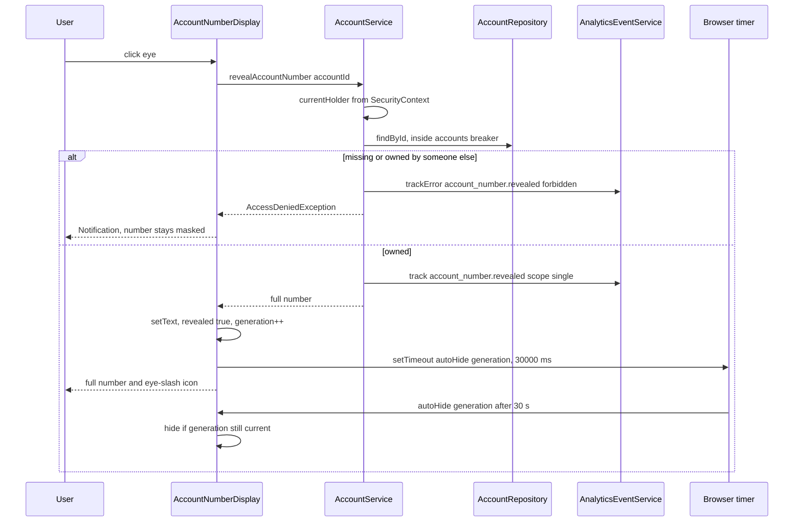
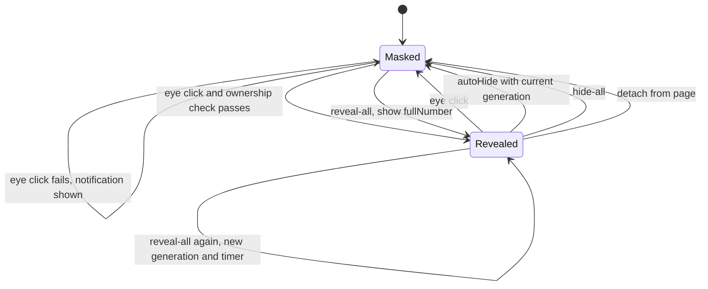

# Account number reveal

Active contributors: ajpahl1008 (AJ Pahl)

Account numbers are masked everywhere (`•••• 4821`). An eye button next to each masked number fetches the full number from the server only when clicked, after checking that the signed-in holder owns the account. The number re-masks itself after 30 seconds, when the user clicks again, or when the component leaves the page. The dashboard also has a toggle that reveals all of the holder's numbers in one call.

This feature landed in commit `09f771a` ("Add show/hide eye toggles for full account numbers (SED-649) (#1)").

## Purpose

Let a holder copy or verify a full account number without the full number ever being sent to the browser until they ask for it. Each reveal is recorded as an analytics event, and the number is never logged.

## Key abstractions

| Class / member | File | Role |
| --- | --- | --- |
| `AccountNumberDisplay` | `src/main/java/com/mockingbirdbank/ui/view/AccountNumberDisplay.java` | `HorizontalLayout` with a number `Span` and an eye `Button`. Holds only the account ID and masked text while masked. |
| `AccountNumberDisplay.AUTO_HIDE_SECONDS` | same | `30`. |
| `revealGeneration` | same | Counter bumped on every show and hide, so a stale auto-hide timer cannot hide a later reveal. |
| `autoHide(int generation)` | same | `@ClientCallable` invoked by the browser timer. |
| `AccountService.revealAccountNumber(Long)` | `src/main/java/com/mockingbirdbank/service/AccountService.java` | Single reveal with ownership check. |
| `AccountService.revealAccountNumbers()` | same | All of the signed-in holder's numbers, keyed by account ID. |
| `DashboardView.toggleAll()` | `src/main/java/com/mockingbirdbank/ui/view/DashboardView.java` | Reveal-all / hide-all toolbar button. |
| `FeatureFlagService.allowAccountNumberReveal()` | `src/main/java/com/mockingbirdbank/config/FeatureFlagService.java` | When false, views render a plain masked `Span` instead of `AccountNumberDisplay`. |
| `Account.getMaskedNumber()` | `src/main/java/com/mockingbirdbank/model/Account.java` | `"•••• " + last four digits`, or `"••••"` if shorter than four. |

## Where it appears

| Location | Prefix | Shown when |
| --- | --- | --- |
| Dashboard hero, "Primary account" line | `Primary account ` | Holder has at least one account |
| Dashboard `AccountCard` | none | `showAccountNumberOnDashboard` is on |
| `AccountDetailView` header | `Account ` | Always |

In every location, `allowAccountNumberReveal` (default `true`) decides between an `AccountNumberDisplay` and a plain masked `Span`. With the flag off, no eye buttons and no reveal-all toolbar are rendered, and no code path calls the reveal methods.

## How a single reveal works

Step by step:

1. **Click handling.** The eye listener is registered on the element with `.preventDefault().stopPropagation()`. On the dashboard the display sits inside `AccountCard`, which is an `<a>`; without this the click would also navigate to the account page.
2. **Ownership check.** `revealAccountNumber` resolves the current holder, loads the account through `protectedCall`, and keeps it only if `account.getHolder().getId()` equals the holder's ID (`isOwnedBy`, which also returns false if either ID is null). A missing account and a foreign account fail identically, with `AccessDeniedException("Account not available")` and a `forbidden` error event, so a caller cannot probe which IDs exist.
3. **Success.** The service records `account_number.revealed` with `accountId` and `scope=single`, then returns the number. The number is not an event attribute and is not logged.
4. **Show.** `show(fullNumber)` sets the span text, marks the display revealed, increments `revealGeneration`, and runs `setTimeout(() => this.$server && this.$server.autoHide($0), $1)` on the element with the new generation and `30 * 1000`. The `this.$server &&` guard avoids an error if the element has been detached. The icon switches to `EYE_SLASH` and the aria-label and tooltip to "Hide full account number".
5. **Listeners.** Every show and hide runs the registered reveal listeners. `DashboardView` uses this to relabel its reveal-all button.
6. **Failure.** `AccessDeniedException` or `ServiceUnavailableException` (open `accounts` breaker) shows a 4-second top-center notification: "We couldn't show the full account number right now. Please try again." Other exceptions are not caught and reach `GlobalErrorHandler`.

## States

### Why the generation counter exists

Each reveal starts its own browser timer, and timers are never cancelled. Without the counter, this sequence would hide too early: reveal at t=0, hide at t=5, reveal again at t=20; the first timer fires at t=30 and would hide the second reveal after 10 seconds instead of 30. Because `hide()` and `show()` both increment `revealGeneration`, the t=30 callback carries a generation that no longer matches and `autoHide` ignores it. The comment on the field states this invariant.

### Detach

The constructor registers `addDetachListener(detach -> hide())`. Navigating away from the dashboard or detail page, or the view being rebuilt, resets the text to the masked value and drops the full number from the component. `hide()` is a no-op when already masked, so it does not fire listeners needlessly.

## Reveal-all on the dashboard

`DashboardView` collects every `AccountNumberDisplay` it creates in `numberDisplays`. If that list is non-empty, a toolbar button is added above the hero.

- **Label.** "Show account numbers" (aria-label "Show all account numbers") unless every display is revealed, then "Hide account numbers" ("Hide all account numbers").
- **Hide path.** If all are revealed, call `hide()` on each.
- **Show path.** Otherwise call `accountService.revealAccountNumbers()` once. It loads `accountsFor(currentHolder())`, builds a `LinkedHashMap<Long, String>` of ID to number, and records one `account_number.revealed` event with `scope=all` and `accountCount`. The view then calls `show(number)` on each display whose ID is in the map. Displays that were already revealed get a fresh generation and a new 30-second timer.
- **Ownership.** No per-account check is needed because the query only returns the signed-in holder's accounts.
- **Failure.** Only `ServiceUnavailableException` is caught, with the same notification.

The checking account appears twice on the dashboard (primary line and card). Revealing one does not reveal the other, and both must be revealed for the button to switch to "Hide".

## Integration points

- **Security:** the ownership check lives in `AccountService`, not the view. `requireAccount`, used by the detail page, has no such check; see [Account detail](account-detail.md) and [Security](../security.md).
- **Analytics:** `account_number.revealed` success with `scope` `single` or `all`, and error with reason `forbidden`. See [Analytics](../systems/analytics.md).
- **Resilience:** both service methods use the `accounts` breaker through `protectedCall`. See [Resilience](../systems/resilience.md).
- **Logging:** account numbers are 13 digits, which `ScrubbingMessageConverter` would redact as card-like if one were logged by mistake. That is a safety net; the code does not log them.
- **Flags:** `allowAccountNumberReveal`, plus `showAccountNumberOnDashboard` for the card line. Override with `MOCKINGBIRD_FEATURE_FLAGS_ALLOW_ACCOUNT_NUMBER_REVEAL=false`. See [Feature flags](feature-flags.md).

## Entry points for modification

- Change the timeout: `AUTO_HIDE_SECONDS` in `AccountNumberDisplay`.
- Show a number somewhere new: construct `new AccountNumberDisplay(account, prefix, accountService)` behind `featureFlagService.allowAccountNumberReveal()`, falling back to `new Span(prefix + account.getMaskedNumber())`. If the new place is inside a link, the existing `preventDefault`/`stopPropagation` already covers it.
- Any new reveal path must go through `AccountService` so it keeps the ownership check and the analytics event.

## Testing

- `src/test/java/com/mockingbirdbank/service/AccountServiceTest.java` covers: own account returns the number and records `scope=single`; someone else's account and an unknown ID both throw `AccessDeniedException`, with a `forbidden` event; `revealAccountNumbers` returns only the holder's accounts and records `scope=all`; an open breaker throws `ServiceUnavailableException`.
- `qa/tests/dashboard.spec.ts` ("eye toggles reveal and re-mask full account numbers"): checks `1000000004821` is not on the page before reveal, that the card eye reveals it without leaving the dashboard and hides it again, and that the reveal-all button shows and re-masks both seeded numbers.
- Nothing tests the 30-second auto-hide, the generation counter, or the detach hide; `AccountNumberDisplay` has no unit test.

## Key source files

| File | Purpose |
| --- | --- |
| `src/main/java/com/mockingbirdbank/ui/view/AccountNumberDisplay.java` | Component, timer, generation counter, detach hide |
| `src/main/java/com/mockingbirdbank/ui/view/DashboardView.java` | Reveal-all toolbar and listener wiring |
| `src/main/java/com/mockingbirdbank/ui/view/AccountCard.java` | Hosts the display inside an `<a>` |
| `src/main/java/com/mockingbirdbank/ui/view/AccountDetailView.java` | Header display |
| `src/main/java/com/mockingbirdbank/service/AccountService.java` | `revealAccountNumber`, `revealAccountNumbers`, `isOwnedBy` |
| `src/main/java/com/mockingbirdbank/config/FeatureFlagsProperties.java` | `allowAccountNumberReveal` default |
| `src/test/java/com/mockingbirdbank/service/AccountServiceTest.java` | Service tests |
| `qa/tests/dashboard.spec.ts` | Browser test |
