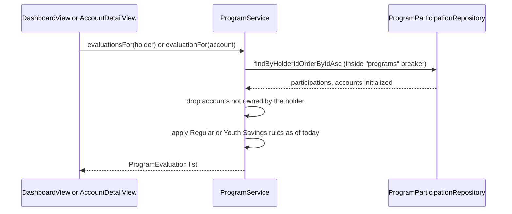

# Account programs

A program groups some of a customer's accounts under a set of rules. There are two, Regular and Youth Savings. With the `showAccountPrograms` flag on, the [dashboard](dashboard.md) lists the signed-in holder's programs and the [account detail](account-detail.md) page shows the program an account takes part in, each with whether its rules are met and a message for every rule that is not.

## Purpose

Show customers which of their accounts belong to a program and whether the program's requirements are currently met. Like the rest of the app it is read-only: an unmet rule only produces a message. Nothing changes an account, a balance or a program, and no result is stored.

## Key abstractions

| Class | File | Role |
| --- | --- | --- |
| `ProgramType` | `src/main/java/com/mockingbirdbank/model/ProgramType.java` | Enum `REGULAR` ("Regular") and `YOUTH_SAVINGS` ("Youth Savings"), with `getDisplayName()`. |
| `ProgramParticipation` | `src/main/java/com/mockingbirdbank/model/ProgramParticipation.java` | Entity for one customer's participation in one program: `holder`, `programType`, and the `accounts` linked to it. |
| `ProgramParticipationRepository` | `src/main/java/com/mockingbirdbank/repository/ProgramParticipationRepository.java` | `findByHolderIdOrderByIdAsc(Long holderId)`. |
| `ProgramService` | `src/main/java/com/mockingbirdbank/service/ProgramService.java` | Evaluates participations against their rules: `evaluationsFor(holder)` and `evaluationFor(account)`. Uses the `programs` circuit breaker. |
| `ProgramEvaluation` | `src/main/java/com/mockingbirdbank/service/ProgramEvaluation.java` | Record `(programType, accounts, unmetRules)`. `eligible()` is true when `unmetRules` is empty; `includes(accountId)` checks membership. |
| `BusinessClockConfig` | `src/main/java/com/mockingbirdbank/config/BusinessClockConfig.java` | The `businessClock` bean, `Clock.system(America/New_York)`, which defines "today" for the age rule. |
| `ProgramCard` | `src/main/java/com/mockingbirdbank/ui/view/ProgramCard.java` | The card for one evaluation, the dashboard notice, and the muted one-line messages. |
| `ProgramLookup` | `src/main/java/com/mockingbirdbank/ui/view/ProgramLookup.java` | Runs a view's program lookup and returns empty when programs can't be read, so the view shows the "unavailable" message instead of failing the page. |

## Data model

An account takes part in at most one program, because the link is a single nullable column, `account.program_participation_id`. A participation belongs to one holder and can have several accounts. `src/main/resources/db/migration/V2__account_programs.sql` adds the table and the columns the rules need:

- `program_participation` (`id`, `holder_id`, `program_type`), with a check that `program_type` is `REGULAR` or `YOUTH_SAVINGS`.
- `account.program_participation_id`, with a composite foreign key `(program_participation_id, holder_id)` to `program_participation (id, holder_id)`. The database therefore rejects linking an account to another customer's program.
- `account.currency`, `VARCHAR(3)`, default `USD`, checked against three upper-case letters.
- `account_holder.date_of_birth`, nullable.

Existing rows become USD accounts with no date of birth and no program. Nobody is enrolled automatically. Column details are in [Data models](../reference/data-models.md).

## Rules

| Program | Rule | Boundary behavior |
| --- | --- | --- |
| Regular | Exactly one checking account | Zero or two or more fail, with a message that says how many are linked |
| Regular | Exactly one savings account | Same |
| Regular | The savings account is in USD | Any other currency fails. Balances are never converted |
| Regular | The savings balance is strictly greater than $100.00 | $100.00 fails, $100.01 passes. Only checked when there is exactly one savings account |
| Youth Savings | No checking account | Any linked checking account fails, and the message names it |
| Youth Savings | Exactly one savings account | Zero or two or more fail |
| Youth Savings | The customer is under 18 on today's business date | The 18th birthday and later fail. A missing date of birth fails. A date of birth after today fails |

Only the Regular rule reads `currency`. Everywhere else, balances and the dashboard total are still shown as US dollars, as they were before programs. Every seeded and migrated account is USD, so a non-USD account can only come from hand-written SQL.

Youth Savings has no minimum balance. Age is `Period.between(dateOfBirth, today).getYears()`, so a customer born on February 29 turns 18 on March 1 in a year without a February 29. "Today" is `LocalDate.now(businessClock)`, the date in America/New_York, not UTC: at 9 p.m. Eastern it is already the next day in UTC, but a customer whose 18th birthday is that next day is still 17.

## How it works

1. `evaluationsFor(holder)` loads the holder's participations in ID order inside the `programs` breaker and initializes each one's `accounts` collection there. `ProgramParticipation.accounts` is `@OneToMany(mappedBy = "programParticipation")` with `@OrderBy("accountType ASC, id ASC")` and `@BatchSize(size = 20)`, so the accounts of several participations load in one query.
2. For each participation, `evaluate` keeps only the accounts that `AccountService.isOwnedBy` accepts for the participation's holder, so another customer's account is never shown or counted. The composite foreign key already prevents such a link; the filter is a second guard in case that constraint were ever bypassed.
3. It then applies the rules for the program type and returns a `ProgramEvaluation`.
4. `evaluationFor(account)` evaluates all of the account holder's programs and returns the one that includes the account, if any.

The service runs in a read-only transaction (`@Transactional(readOnly = true)`) and evaluates on every call. Nothing is cached.

## What the customer sees

Both screens are gated by `showAccountPrograms` (`mockingbird.feature-flags.show-account-programs`, env var `MOCKINGBIRD_FEATURE_FLAGS_SHOW_ACCOUNT_PROGRAMS`, default `false`). When the flag is off, neither view calls `ProgramService`. See [Feature flags](feature-flags.md).

| Where | Shows | CSS class |
| --- | --- | --- |
| Dashboard, after "Your accounts" | "Your programs" heading and one `ProgramCard` per program | `programs-section` |
| Dashboard, no programs | "You're not part of any programs." | `programs-none` |
| Dashboard, top of the page | "Some of your program requirements aren't met. The details are under Your programs below. Your accounts and balances are not affected." Only when at least one program has an unmet rule. `role="status"` | `program-notice` |
| Account detail, between header and transactions | "Program" label and the account's `ProgramCard` | `account-program` |
| Account detail, no program | "This account isn't part of a program." | `program-none` |
| Either screen, programs can't be read (`programs` breaker open, or a database error from the program read) | "Programs can't be shown right now. Please try again later." The rest of the page still renders | `programs-unavailable` |

Each `ProgramCard` (class `program-card`, with a `data-program` attribute holding the enum name) shows:

- The program name (`program-name`) and a pill reading "Requirements met" or "Requirements not met" (`program-status`).
- The linked accounts (`program-accounts`), each a link to `accounts/{id}` labelled "Name · Checking" or "Name · Savings" (`program-account`). With no owned accounts it shows "No accounts are linked to this program." (`program-no-accounts`).
- When a rule is unmet, an "Unmet requirements" box (`program-unmet-rules`) with one list item per message (`program-unmet-rule`).

## Seed data

`DataInitializer` seeds one program for each demo holder, and both meet their rules:

| Holder | Login | Program | Accounts |
| --- | --- | --- | --- |
| Jordan Ellis, born 1988-04-23 | `jordan.ellis` | Regular | Everyday Checking, High-Yield Savings ($18,200.00). Vacation Savings is in no program |
| Riley Chen, born 15 years before the seed date (America/New_York) | `riley.chen` | Youth Savings | Youth Savings ($245.50) |

Riley's date of birth is relative to the seed date, so a freshly seeded database always has a customer under 18. Riley turns 18 three years after the seed, and Youth Savings then shows as not met. See [Persistence](../systems/persistence.md#seeding).

## Integration points

- **Resilience:** the `programs` breaker shares the tuning from `ResilienceConfig.defaultConfig()` but keeps its own state, so failing program queries do not stop accounts or transactions from loading. Both views read programs through `ProgramLookup`, which turns `ServiceUnavailableException` and the database errors from the program read (`DataAccessException`, `TransactionException`, `PersistenceException`) into the "unavailable" message, tracks each one as `programs.unavailable` with the exception's simple name as the reason, and logs the database errors at WARN. Those types also cover bugs such as a query against a missing table; they get the same fallback and still show up in the error count. Only calls inside `protectedCall` count toward opening the breaker: `ProgramService` is `@Transactional`, so a connection that can't be taken from the pool arrives as `CannotCreateTransactionException` from the transaction proxy before the breaker sees the call. Any other exception still propagates. See [Resilience](../systems/resilience.md).
- **Security:** evaluation is per holder, and accounts owned by someone else are never shown. The account page only evaluates an account after `requireAccount` has confirmed it belongs to the signed-in holder. See [Security](../security.md#program-links).
- **Analytics:** viewing programs records no events of its own. When a program section shows the "unavailable" message, `ProgramLookup` records `programs.unavailable` (outcome error, reason the exception's simple class name). See [Analytics](../systems/analytics.md).

## Entry points for modification

- New program: add a value to `ProgramType`, a matching rules method in `ProgramService.evaluate`, and a new Flyway migration that widens the `program_participation_known_type` check.
- New rule: add it to the program's rules method in `ProgramService` and return a customer-facing message when it is not met.
- Enrolling accounts: there is no UI or service for it. Accounts are linked through `Account.setProgramParticipation` (as `DataInitializer` does) or in SQL.

## Testing

- `src/test/java/com/mockingbirdbank/service/ProgramServiceTest.java`: the Regular balance boundary as a `@ParameterizedTest`, missing and extra accounts, non-USD savings, the Youth Savings age boundaries (the day before, on and after the 18th birthday), the New York date versus the UTC date, missing and future dates of birth, the leap-day birthday, a cross-customer account, `evaluationFor`, and the open breaker.
- `src/test/java/com/mockingbirdbank/ui/view/ProgramCardTest.java`: account links and labels, the status pill, and the unmet-rules list.
- `src/test/java/com/mockingbirdbank/ui/view/DashboardViewTest.java`: the flag off and on, the notice, the "none" message, and the "unavailable" message with the accounts still shown, for an open breaker and for a database error.
- `src/test/java/com/mockingbirdbank/ui/view/ProgramLookupTest.java`: the lookup result, an open breaker, the three database error types with their `programs.unavailable` counts, and an unrelated exception that still propagates.
- `src/test/java/com/mockingbirdbank/config/BusinessClockConfigTest.java`: the business clock runs on New York time.
- `src/test/java/com/mockingbirdbank/ProgramMigrationTest.java` (Testcontainers and Flyway directly): data written under V1 survives V2 as USD with no program, and the database rejects a cross-customer link (SQLSTATE `23503`), an unknown program type and a lower-case currency code (`23514`).
- `src/test/java/com/mockingbirdbank/ApplicationSmokeTest.java`: both seeded holders take part in one program each that meets its rules, and `riley.chen` can sign in.

## Key source files

| File | Purpose |
| --- | --- |
| `src/main/java/com/mockingbirdbank/service/ProgramService.java` | Rules and evaluation |
| `src/main/java/com/mockingbirdbank/service/ProgramEvaluation.java` | Evaluation result |
| `src/main/java/com/mockingbirdbank/model/ProgramType.java` | The two programs |
| `src/main/java/com/mockingbirdbank/model/ProgramParticipation.java` | Participation entity |
| `src/main/java/com/mockingbirdbank/repository/ProgramParticipationRepository.java` | Participation query |
| `src/main/java/com/mockingbirdbank/config/BusinessClockConfig.java` | Business date |
| `src/main/java/com/mockingbirdbank/ui/view/ProgramCard.java` | Card, notice, messages |
| `src/main/java/com/mockingbirdbank/ui/view/ProgramLookup.java` | Fallback when programs can't be read |
| `src/main/java/com/mockingbirdbank/ui/view/DashboardView.java` | "Your programs" section and notice |
| `src/main/java/com/mockingbirdbank/ui/view/AccountDetailView.java` | "Program" section |
| `src/main/resources/db/migration/V2__account_programs.sql` | Schema and constraints |
