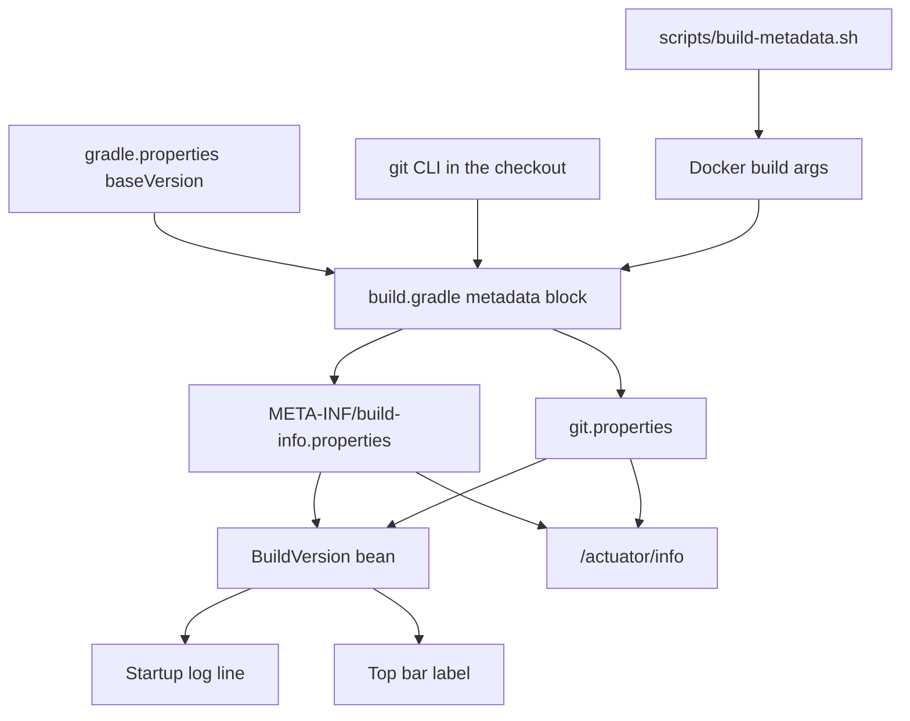

# Build version

Active contributors: ajpahl1008 (AJ Pahl)

Every build of Mockingbird Bank records its version, commit and branch, and the running app reports them in three places: `/actuator/info`, one startup log line, and a small label in the top bar. The goal is that "what is deployed?" gets answered by the app itself rather than by remembering which image tag was pushed.

## Version string

| Build | Version | Example |
| --- | --- | --- |
| Any non-release build | `<baseVersion>-<short sha>` | `0.1.0-09f771a` |
| Same, with uncommitted changes | `<baseVersion>-<short sha>-dirty` | `0.1.0-09f771a-dirty` |
| Tagged release `vX.Y.Z` | `X.Y.Z` | `0.2.0` |
| No git info and no build args | `<baseVersion>-unknown` | `0.1.0-unknown` |

`baseVersion=0.1.0` lives in `gradle.properties`. The short sha is the first seven characters of the full commit hash.

## How it works



### Resolving metadata in Gradle

The top of `build.gradle` (lines 18-55) computes each value with the same rule: use a `-P` property if one was passed, otherwise ask `git`, otherwise fall back to `unknown`. The build never fails for missing metadata.

| Value | `-P` property | Git fallback | Notes |
| --- | --- | --- | --- |
| Commit | `-PgitCommit` | `git rev-parse HEAD` | Short form is `take(7)` |
| Branch | `-PgitBranch` | `git rev-parse --abbrev-ref HEAD` | `HEAD` becomes `detached` |
| Dirty flag | `-PgitDirty` | `git status --porcelain` | Empty output means `false`; a failed call means `unknown` |
| Commit time | `-PgitCommitTime` | `git show -s --format=%ct HEAD` | Epoch seconds; omitted when unavailable |
| Version | `-PappVersion` | `"${baseVersion}-${gitCommitShort}"` plus `-dirty` | |

The `gitOutput` helper returns `null` if there is no `.git` directory, if `git` exits non-zero, or if it cannot be launched. `optionalProperty` treats an empty or blank `-P` value as absent, which matters because the Dockerfile always passes every property, often empty.

### Generated files

- **`META-INF/build-info.properties`**: written by Spring Boot's `springBoot { buildInfo { ... } }` block (lines 153-164). Spring Boot exposes it as a `BuildProperties` bean. The build time is included only when `-PbuildTime` is passed. Otherwise `excludes = ['time']` drops it, because an always-changing timestamp would make `processResources`, and with it every test task, out of date on each run.
- **`git.properties`**: written by the custom `generateGitProperties` task (`WriteProperties`, lines 170-184) to `build/generated/git/git.properties`, then added to `processResources`. It sets `git.commit.id`, `git.commit.id.abbrev`, `git.branch`, `git.dirty` and, when known, `git.commit.time`. Spring Boot exposes it as a `GitProperties` bean. The repo writes this by hand instead of using a git-properties plugin because those plugins need a `.git` directory and the Docker build does not have one.

### Docker builds

`.dockerignore` excludes `.git`, so the Gradle run inside the build stage cannot ask git anything. Instead:

1. `scripts/build-metadata.sh` runs on the host checkout and mirrors the Gradle logic, reading `baseVersion` from `gradle.properties`. It prints `APP_VERSION`, `GIT_COMMIT`, `GIT_BRANCH`, `GIT_DIRTY` and `GIT_COMMIT_TIME` as `KEY=value` lines, or as `--build-arg KEY=value ...` with `--docker-args`. Setting `APP_VERSION` in the environment overrides the computed version.
2. The `Dockerfile` build stage declares those five `ARG`s and forwards them to Gradle as `-PappVersion`, `-PgitCommit`, `-PgitBranch`, `-PgitDirty` and `-PgitCommitTime`. It also passes `-PbuildTime="$(date -u +%Y-%m-%dT%H:%M:%SZ)"`, so image builds are the only builds with a build time.
3. The run stage re-declares `APP_VERSION` and `GIT_COMMIT` and sets the OCI labels `org.opencontainers.image.version` and `org.opencontainers.image.revision`, readable with `docker inspect`.

Every image build path calls the script: `createLocalDockerImage.zsh`, `createDockerHubImage.zsh`, `scripts/k3d-deploy.sh`, `.github/workflows/publish-image.yml` and `.github/workflows/release.yml`. For releases, `release.yml` strips the `v` from the tag and sets the result as `APP_VERSION` for the script. The Dockerfile then passes it on as `-PappVersion`, so tag `v0.2.0` builds as `0.2.0`. See [Docker image](../deployment/docker-image.md) and [Releases](../deployment/releases.md).

A plain `docker build .` without the build args still succeeds. Commit and branch then read `unknown`, and the version becomes `0.1.0-unknown`, because the version falls back to `baseVersion` plus the unknown short sha.

## Runtime: the BuildVersion component

`src/main/java/com/mockingbirdbank/observability/BuildVersion.java` is a `@Component` whose constructor takes `Optional<BuildProperties>` and `Optional<GitProperties>`. Either bean is missing when its file was not generated, for example when the app runs from an IDE without Gradle. The matching values then read `unknown` instead of failing startup.

| Method | Returns |
| --- | --- |
| `version()` | `BuildProperties.getVersion()` or `unknown` |
| `commit()` | `GitProperties.getShortCommitId()` or `unknown` |
| `branch()` | `GitProperties.getBranch()` or `unknown` |
| `buildTime()` | `Optional<Instant>`, present only for image builds |
| `displayVersion()` | The version alone if it already contains the commit (every non-release build) or the commit is unknown. Otherwise `version (commit)`, for example `0.2.0 (09f771a)` for a release. |
| `details()` | `commit 09f771a, branch master`, plus `, built <time>` when known |
| `logRunningVersion()` | `@EventListener(ApplicationReadyEvent.class)`: logs `Mockingbird Bank <version> started (<details>)` at INFO |

The startup line means `kubectl logs` or `docker logs` answers the version question even without HTTP access.

### Top bar label

`src/main/java/com/mockingbirdbank/ui/layout/MainLayout.java` adds a `Span` with id `build-version` under the "Mockingbird Bank" wordmark when `FeatureFlagService.showBuildVersion()` is true. Its text is `displayVersion()` in a small monospace font, and its tooltip (`title`) is `Mockingbird Bank <version> - <details>`. `MainLayout` is only shown after sign-in, which is why the flag defaults to on. Turn it off with `MOCKINGBIRD_FEATURE_FLAGS_SHOW_BUILD_VERSION=false`. See [Feature flags](feature-flags.md).

## /actuator/info

`/actuator/info` is public (`permitAll` in `src/main/java/com/mockingbirdbank/security/SecurityConfig.java`), so `src/main/resources/application.yml` limits what it shows:

```yaml
management:
  info:
    defaults:
      enabled: false   # every contributor off, including any a future Spring Boot adds
    build:
      enabled: true
    git:
      enabled: true
      mode: simple     # branch, short commit, commit time
```

Example:

```
curl localhost:8080/actuator/info
# {"build":{"version":"0.1.0-09f771a",...},"git":{"branch":"master","commit":{"id":"09f771a",...}}}
```

The DAST workflow's ZAP baseline scan flags this endpoint as information disclosure. That finding is expected; see [Security](../security.md).

## Entry points for modification

- Bump the base version: edit `baseVersion` in `gradle.properties`. Both Gradle and `scripts/build-metadata.sh` read it.
- Add a metadata field: resolve it at the top of `build.gradle`, add it to `generateGitProperties` or `buildInfo`, mirror it in `scripts/build-metadata.sh` and the Dockerfile `ARG`/`-P` list, and update the workflows that list build args explicitly (`publish-image.yml`, `release.yml`).
- Change what users see: `MainLayout.buildVersionLabel` and `BuildVersion.displayVersion`.

## Tests

`src/test/java/com/mockingbirdbank/observability/BuildVersionTest.java` builds `BuildProperties` and `GitProperties` from hand-made `Properties` and covers reading all four values, `displayVersion` for a sha-suffixed version and for a release version, `details` without a build time, the all-`unknown` fallback, and the exact startup log message (captured with a Logback `ListAppender`). The Gradle and shell logic has no automated test.

## Key source files

| File | Purpose |
| --- | --- |
| `gradle.properties` | `baseVersion` |
| `build.gradle` | Metadata resolution, `buildInfo`, `generateGitProperties` |
| `scripts/build-metadata.sh` | Host-side metadata for Docker builds |
| `Dockerfile` | Build args to `-P` properties, OCI labels |
| `.dockerignore` | Excludes `.git` from the build context |
| `src/main/resources/application.yml` | `management.info.*` |
| `src/main/java/com/mockingbirdbank/observability/BuildVersion.java` | Runtime accessors and startup log |
| `src/main/java/com/mockingbirdbank/ui/layout/MainLayout.java` | Top bar label |
