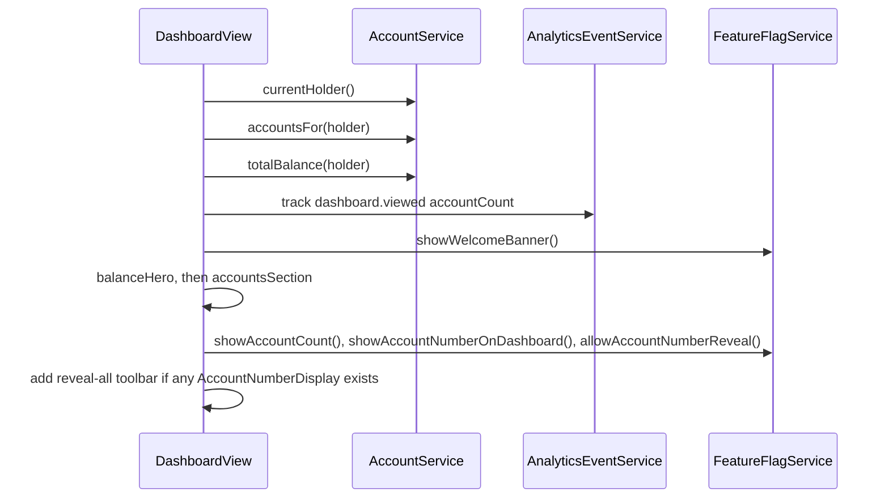

# Dashboard

Active contributors: ajpahl1008 (AJ Pahl)

The dashboard is the landing screen after sign-in. It shows the holder's total assets, their primary account, and one clickable card per account. It is served at both `/` and `/accounts`.

## Purpose

Give the signed-in holder a one-screen summary of every account they own and a link into each account's [transaction history](account-detail.md). The layout follows the "Dashboard" artboard of the design mockup (per the class Javadoc).

## Key abstractions

| Class | File | Role |
| --- | --- | --- |
| `DashboardView` | `src/main/java/com/mockingbirdbank/ui/view/DashboardView.java` | The route. Builds the welcome banner, reveal-all toolbar, balance hero, account count line and accounts grid in its constructor. |
| `AccountCard` | `src/main/java/com/mockingbirdbank/ui/view/AccountCard.java` | One account tile. Extends `Anchor`, so the whole card links to `accounts/{id}`. |
| `AccountNumberDisplay` | `src/main/java/com/mockingbirdbank/ui/view/AccountNumberDisplay.java` | Masked number with an eye button. See [Account number reveal](account-number-reveal.md). |
| `AccountService` | `src/main/java/com/mockingbirdbank/service/AccountService.java` | `currentHolder()`, `accountsFor(holder)`, `totalBalance(holder)`, `revealAccountNumbers()`. |
| `FeatureFlagService` | `src/main/java/com/mockingbirdbank/config/FeatureFlagService.java` | Gates the banner, the account count line, the number line on cards, and the eye buttons. |
| `MainLayout` | `src/main/java/com/mockingbirdbank/ui/layout/MainLayout.java` | Top bar around the view (greeting, dark mode, Sign out). |

## How it works

`DashboardView` is annotated `@Route(value = "accounts", layout = MainLayout.class)`, `@RouteAlias(value = "", layout = MainLayout.class)` and `@PermitAll`. Any authenticated user can open it; Vaadin redirects anonymous users to `/login` (see [Sign-in](sign-in.md)).

All the work happens in the constructor:

The page is assembled top to bottom as:

1. **Welcome banner** (only when `showWelcomeBanner` is on, default off). A navy strip reading "Hi <first name> - you're viewing an early preview of the redesigned dashboard." The first name is `holder.getFullName().split(" ")[0]`.
2. **Reveal-all toolbar** (only when at least one `AccountNumberDisplay` was created). A right-aligned tertiary button labelled "Show account numbers" or "Hide account numbers". The hero and accounts section are built before this check so the view knows whether the toolbar has anything to control.
3. **Balance hero.** Left side: "Total assets" eyebrow, the sum from `totalBalance` formatted with `NumberFormat.getCurrencyInstance(Locale.US)`, and "Across N accounts". Right side: "Account holder" with the full name and, if the holder has any accounts, a "Primary account" number line for `accounts.get(0)`.
4. **Your accounts.** The "Your accounts" heading, then (only when `showAccountCount` is on, default off) a muted line reading "You have N accounts", or "You have 1 account" when the holder has one account, then a wrapping `FlexLayout` of `AccountCard`s. N is `accounts.size()` of the list the constructor already loaded, so the line costs no extra query. The text comes from the package-private `DashboardView.accountCountSummary(int)`, and the line's `Span` has the CSS class `account-count-summary`.

### Primary account

The primary account is the first account returned by `AccountRepository.findByHolderIdOrderByAccountTypeAscIdAsc`. `account_type` is stored as a string (`@Enumerated(EnumType.STRING)`), so `CHECKING` sorts before `SAVINGS`, then by ID. For the seeded holder this is "Everyday Checking". The line is always shown, regardless of `showAccountNumberOnDashboard`.

### Account cards

Each `AccountCard` shows the display name (`Account.getDisplayName()`: nickname, or the enum name if blank), a "Checking" or "Savings" pill, the balance in USD, and "View transactions →". The number line between header and balance depends on two flags:

| `showAccountNumberOnDashboard` | `allowAccountNumberReveal` | Number line on the card |
| --- | --- | --- |
| true (default) | true (default) | `AccountNumberDisplay` with eye button |
| true | false | Plain `Span` with the masked number, for example `•••• 4821` |
| false | either | Omitted entirely (no blank line) |

Because the card is an `<a>`, the eye button inside it calls `preventDefault()` and `stopPropagation()` so a click reveals the number without navigating.

### Reveal-all toolbar

Each `AccountNumberDisplay` the view creates is kept in `numberDisplays` and registers `updateRevealAllToggle` as a reveal listener, so the button label stays in sync as individual eyes are clicked. Clicking the button:

- If every display is revealed, hides them all.
- Otherwise calls `AccountService.revealAccountNumbers()` once and shows each display whose account ID is in the returned map. A `ServiceUnavailableException` (open `accounts` breaker) shows the same "We couldn't show the full account number right now" notification as a single reveal.

The primary account line and the checking card are two separate displays for the same account, so "all revealed" means both. Details in [Account number reveal](account-number-reveal.md).

## Integration points

- **Analytics:** one `dashboard.viewed` event per view construction, with attribute `accountCount`. See [Analytics](../systems/analytics.md).
- **Resilience:** every `AccountService` repository call runs inside the `accounts` circuit breaker. An open breaker during construction surfaces as an unhandled `ServiceUnavailableException`, which `GlobalErrorHandler` tracks. See [Resilience](../systems/resilience.md).
- **Flags:** `showWelcomeBanner`, `showAccountCount`, `showAccountNumberOnDashboard`, `allowAccountNumberReveal`. See [Feature flags](feature-flags.md).
- **Theme:** colors come from `--mb-*` CSS variables in `src/main/frontend/themes/mockingbird/styles.css`, so dark mode applies without code in the view. See [UI](../systems/ui.md).

## Entry points for modification

- New hero or section content: add a builder method in `DashboardView` and `add(...)` it in the constructor.
- New per-card content: extend the `AccountCard` constructor. Keep it an `Anchor`; any new interactive child must stop click propagation the same way the eye button does.
- Optional UI: put it behind a new flag in `src/main/java/com/mockingbirdbank/config/FeatureFlagsProperties.java` (see [Patterns and conventions](../how-to-contribute/patterns-and-conventions.md)).

## Testing

`qa/tests/dashboard.spec.ts` asserts the greeting, "Total assets", "Your accounts" and all three seeded account names after sign-in, then clicks into Everyday Checking. The eye-toggle test checks that the per-card eye reveals without navigating and that "Show all account numbers" / "Hide all account numbers" reveal and re-mask every number. `src/test/java/com/mockingbirdbank/ui/view/DashboardViewTest.java` builds the view with a mocked `AccountService` and checks the `showAccountCount` line: the singular and plural text, a count that needs no `AccountService` calls beyond the constructor's usual `currentHolder`, `accountsFor` and `totalBalance`, and no line at all when the flag is off. The rest of the view has no Java unit test.

## Key source files

| File | Purpose |
| --- | --- |
| `src/main/java/com/mockingbirdbank/ui/view/DashboardView.java` | Route, hero, toolbar, accounts grid |
| `src/main/java/com/mockingbirdbank/ui/view/AccountCard.java` | Account tile |
| `src/main/java/com/mockingbirdbank/ui/view/AccountNumberDisplay.java` | Masked number with eye button |
| `src/main/java/com/mockingbirdbank/service/AccountService.java` | Holder, accounts, total, bulk reveal |
| `src/main/java/com/mockingbirdbank/repository/AccountRepository.java` | `findByHolderIdOrderByAccountTypeAscIdAsc` |
| `src/test/java/com/mockingbirdbank/ui/view/DashboardViewTest.java` | Unit test for the account count line |
| `qa/tests/dashboard.spec.ts` | Browser test |
