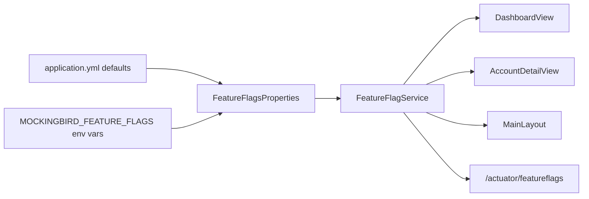

# Feature flags

Active contributors: ajpahl1008 (AJ Pahl)

Mockingbird Bank has four boolean feature flags that switch small, optional pieces of UI on or off per environment. They are plain Spring configuration properties under `mockingbird.feature-flags.*`, read once at startup, with a typed service for call sites and a read-only Actuator endpoint for operators.

## Purpose

Flags let one build behave differently in different environments without a code change. A new flag defaults to the app's current behavior, so adding one changes nothing until someone sets it in a specific environment. The one deliberate exception is `showBuildVersion`, which defaults to on (see [Build version](build-version.md)).

There is no flag server, no per-user targeting and no runtime toggling. Values are bound when the Spring context starts, so changing one means restarting the app with a different environment variable.

## The flags

| Flag | Property | Env var | Default | Where it is read | Effect when on |
| --- | --- | --- | --- | --- | --- |
| `showAccountNumberOnDashboard` | `mockingbird.feature-flags.show-account-number-on-dashboard` | `MOCKINGBIRD_FEATURE_FLAGS_SHOW_ACCOUNT_NUMBER_ON_DASHBOARD` | `true` | `DashboardView.accountsSection` | Each account card shows its account number line. When off, `DashboardView` passes `null` to `AccountCard` and the line is left out entirely. |
| `showWelcomeBanner` | `mockingbird.feature-flags.show-welcome-banner` | `MOCKINGBIRD_FEATURE_FLAGS_SHOW_WELCOME_BANNER` | `false` | `DashboardView` constructor | A navy "Hi Jordan - you're viewing an early preview of the redesigned dashboard." banner above the balance hero. |
| `allowAccountNumberReveal` | `mockingbird.feature-flags.allow-account-number-reveal` | `MOCKINGBIRD_FEATURE_FLAGS_ALLOW_ACCOUNT_NUMBER_REVEAL` | `true` | `DashboardView.accountNumber`, `AccountDetailView.accountHeader` | Masked numbers become an `AccountNumberDisplay` with an eye button, and the dashboard gets its "Show account numbers" toolbar. When off, they are plain masked `Span`s and the toolbar is not added. See [Account number reveal](account-number-reveal.md). |
| `showBuildVersion` | `mockingbird.feature-flags.show-build-version` | `MOCKINGBIRD_FEATURE_FLAGS_SHOW_BUILD_VERSION` | `true` | `MainLayout` constructor | The running version appears under the wordmark in the top bar. See [Build version](build-version.md). |

The defaults are set twice, once as Java field initializers in `src/main/java/com/mockingbirdbank/config/FeatureFlagsProperties.java` and once in `src/main/resources/application.yml`. They agree today. If they ever disagree, the YAML value wins at runtime while unit tests that construct `FeatureFlagsProperties` directly see the Java value.

## Key abstractions

| Class | File | Role |
| --- | --- | --- |
| `FeatureFlagsProperties` | `src/main/java/com/mockingbirdbank/config/FeatureFlagsProperties.java` | `@ConfigurationProperties(prefix = "mockingbird.feature-flags")` bean. One Lombok-generated getter and setter per `boolean` field; the field initializer is the default. |
| `FeatureFlagService` | `src/main/java/com/mockingbirdbank/config/FeatureFlagService.java` | `@Service` facade with one typed accessor per flag (`showWelcomeBanner()`, ...) plus `allFlags()`, which returns a `LinkedHashMap` in declaration order. UI code depends on this, never on the properties bean. |
| `FeatureFlagsEndpoint` | `src/main/java/com/mockingbirdbank/config/FeatureFlagsEndpoint.java` | Actuator endpoint `@Endpoint(id = "featureflags")` with one `@ReadOperation` that returns `allFlags()`. |

## How it works

1. At startup Spring binds `mockingbird.feature-flags.*` into `FeatureFlagsProperties`. An environment variable outranks `application.yml`, so `MOCKINGBIRD_FEATURE_FLAGS_SHOW_WELCOME_BANNER=true` turns the banner on.
2. Views receive `FeatureFlagService` by constructor injection and branch on it while building their components. Vaadin builds a view per navigation, so the value is read at that point, but it never changes after startup.
3. `GET /actuator/featureflags` returns the current values as JSON, for example `{"showAccountNumberOnDashboard":true,"showWelcomeBanner":false,"allowAccountNumberReveal":true,"showBuildVersion":true}`. The endpoint is listed in `management.endpoints.web.exposure.include` and requires an authenticated session in `src/main/java/com/mockingbirdbank/security/SecurityConfig.java`. See [API](../api.md).

### The underscore gotcha

Spring's relaxed binding maps an environment variable to a property by lower-casing it and treating each `_` as a separator. Env vars are all upper case, so the underscores are the only way Spring can recover the word boundaries of the property name. `MOCKINGBIRD_FEATURE_FLAGS_SHOW_WELCOME_BANNER` binds. `MOCKINGBIRD_FEATURE_FLAGS_SHOWWELCOMEBANNER` does not, and it fails silently: the flag keeps its default and nothing is logged. Check `/actuator/featureflags` after setting one. The Javadoc on `FeatureFlagsProperties` calls this out as well.

## Setting a flag per environment

| Where | How |
| --- | --- |
| Local `bootRun` | `MOCKINGBIRD_FEATURE_FLAGS_SHOW_WELCOME_BANNER=true ./gradlew bootRun`, or edit `src/main/resources/application.yml` locally. |
| Docker | `docker run -e MOCKINGBIRD_FEATURE_FLAGS_SHOW_WELCOME_BANNER=true ...`, or add the line to `.env` for `runDockerImage.zsh`. |
| Local k3d | Add a literal to the `mockingbird-dev-app-config` `configMapGenerator` in `k8s/local/kustomization.yaml`. A commented example is already there. Then run `./scripts/k3d-deploy.sh`. See [Local k3d](../deployment/local-k3d.md). |
| LAB cluster | An `env` entry on the app container in the Harness-templated manifests under `k8s/`. See [LAB cluster](../deployment/lab-cluster.md). |

In k3d, kustomize appends a content hash to generated ConfigMap names, so changing a literal produces a new ConfigMap name, which changes the Deployment's pod template and rolls a new pod. Every environment needs a restart to pick up a change, because the values are only read at startup.

## Adding a flag

1. Add a `boolean` field with a Javadoc comment to `src/main/java/com/mockingbirdbank/config/FeatureFlagsProperties.java`. Its default should match what the app does today.
2. Add the kebab-case key with the same default under `mockingbird.feature-flags` in `src/main/resources/application.yml`.
3. Add a typed accessor to `src/main/java/com/mockingbirdbank/config/FeatureFlagService.java` and a matching `flags.put(...)` line in `allFlags()`. Without the second edit the flag works but is invisible at `/actuator/featureflags`.
4. Inject `FeatureFlagService` into the view that needs it and branch on the accessor.
5. Extend `FeatureFlagServiceTest` (default and overridden values) and update the "Feature flags" section of `AGENTS.md`.

The PR template asks whether UI-facing work is behind a flag. See [Patterns and conventions](../how-to-contribute/patterns-and-conventions.md).

## Tests

| Test | File | What it checks |
| --- | --- | --- |
| `FeatureFlagServiceTest.defaultsMatchTodaysActualBehavior` | `src/test/java/com/mockingbirdbank/config/FeatureFlagServiceTest.java` | The Java defaults: three on, `showWelcomeBanner` off. |
| `FeatureFlagServiceTest.reflectsOverriddenProperties` | same | Every accessor follows its property when flipped. |
| `FeatureFlagServiceTest.allFlagsReflectsCurrentValues` | same | `allFlags()` contains all four keys with current values. |
| `FeatureFlagsEndpointTest.flagsDelegatesToFeatureFlagService` | `src/test/java/com/mockingbirdbank/config/FeatureFlagsEndpointTest.java` | The endpoint returns the service's map. |

These are plain unit tests. Nothing tests env-var binding or the view branches directly. The `config` package falls under the 90% per-class JaCoCo gate described in [Testing](../how-to-contribute/testing.md).

## Key source files

| File | Purpose |
| --- | --- |
| `src/main/java/com/mockingbirdbank/config/FeatureFlagsProperties.java` | Flag fields and Java defaults |
| `src/main/java/com/mockingbirdbank/config/FeatureFlagService.java` | Typed accessors and `allFlags()` |
| `src/main/java/com/mockingbirdbank/config/FeatureFlagsEndpoint.java` | `/actuator/featureflags` |
| `src/main/resources/application.yml` | YAML defaults and Actuator exposure |
| `src/main/java/com/mockingbirdbank/ui/view/DashboardView.java` | Reads three of the four flags |
| `src/main/java/com/mockingbirdbank/ui/view/AccountDetailView.java` | Reads `allowAccountNumberReveal` |
| `src/main/java/com/mockingbirdbank/ui/layout/MainLayout.java` | Reads `showBuildVersion` |
| `k8s/local/kustomization.yaml` | Per-deploy overrides for k3d |
