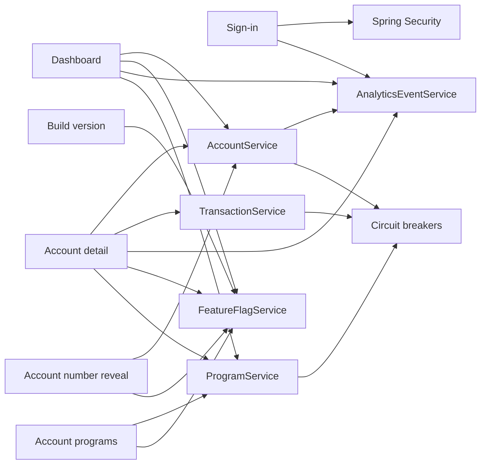

# Features

Mockingbird Bank has a small set of user-visible features, all read-only. A holder signs in, sees a dashboard of their accounts, opens one to read its transactions, and can reveal a full account number on request. Behind a flag, the dashboard and account pages also show the holder's programs and whether each one meets its rules. Two operational features (feature flags and the build version label) change what those screens show without a code change.

## Feature list

| Feature | Summary | Main code |
| --- | --- | --- |
| [Sign-in](sign-in.md) | Vaadin `LoginOverlay` in front of Spring Security form login, BCrypt passwords, `user.login` analytics events, sign-out from the top bar. | `src/main/java/com/mockingbirdbank/ui/view/LoginView.java`, `src/main/java/com/mockingbirdbank/security/SecurityConfig.java` |
| [Dashboard](dashboard.md) | Landing page at `/` and `/accounts`: total assets, primary account line, one card per account, optional welcome banner, account count line and programs section, and a "Show account numbers" toolbar. | `src/main/java/com/mockingbirdbank/ui/view/DashboardView.java` |
| [Account detail](account-detail.md) | `/accounts/{id}`: one of the signed-in holder's own accounts, with its header, current balance, optional program section, and a transaction grid sorted newest first. | `src/main/java/com/mockingbirdbank/ui/view/AccountDetailView.java` |
| [Account number reveal](account-number-reveal.md) | Eye button that fetches one full account number after an ownership check, re-masks after 30 seconds, plus a reveal-all toggle on the dashboard. | `src/main/java/com/mockingbirdbank/ui/view/AccountNumberDisplay.java` |
| [Account programs](account-programs.md) | Regular and Youth Savings programs, evaluated against their rules each time they are shown, with a card per program and a message for every unmet rule. Off by default (`showAccountPrograms`). | `src/main/java/com/mockingbirdbank/service/ProgramService.java`, `src/main/java/com/mockingbirdbank/ui/view/ProgramCard.java` |
| [Feature flags](feature-flags.md) | Six boolean flags under `mockingbird.feature-flags.*`, overridable per environment by env var and visible at `/actuator/featureflags`. | `src/main/java/com/mockingbirdbank/config/FeatureFlagService.java` |
| [Build version](build-version.md) | The running version and commit, shown under the wordmark, in `/actuator/info`, and in a startup log line. | `src/main/java/com/mockingbirdbank/observability/BuildVersion.java` |

The shared top bar (`src/main/java/com/mockingbirdbank/ui/layout/MainLayout.java`) appears on every signed-in screen. It holds the wordmark, the build version label, the "Welcome back" greeting, the dark mode toggle and the Sign out button. The layout itself is covered in [UI](../systems/ui.md).

## Which features touch which systems

| Feature | [Services](../systems/services.md) | [Analytics](../systems/analytics.md) | [Resilience](../systems/resilience.md) | Flags | [Security](../security.md) |
| --- | --- | --- | --- | --- | --- |
| Sign-in | `AccountService.currentHolder` (top bar greeting) | `user.login` | no | no | form login, BCrypt |
| Dashboard | `AccountService`, `ProgramService` | `dashboard.viewed` | `accounts`, `programs` breakers | `showWelcomeBanner`, `showAccountCount`, `showAccountNumberOnDashboard`, `allowAccountNumberReveal`, `showAccountPrograms` | `@PermitAll` route |
| Account detail | `AccountService`, `TransactionService`, `ProgramService` | `account.viewed` | `accounts`, `transactions`, `programs` breakers | `allowAccountNumberReveal`, `showAccountPrograms` | `@PermitAll` route, owner-only `requireAccount` |
| Account programs | `ProgramService` | no | `programs` breaker | `showAccountPrograms` | owner-only evaluation, composite foreign key on program links |
| Account number reveal | `AccountService.revealAccountNumber(s)` | `account_number.revealed` | `accounts` breaker | `allowAccountNumberReveal` | ownership check |
| Build version | none | no | no | `showBuildVersion` | `/actuator/info` is public |

## Where tests cover features

- Browser flow: `qa/tests/dashboard.spec.ts` (Playwright) signs in, checks the dashboard and one account's transactions, signs out, checks a wrong password is rejected, exercises the eye toggles, and checks the build version label position. Run it with `./scripts/run-interactive-qa.sh`.
- Service logic: `src/test/java/com/mockingbirdbank/service/AccountServiceTest.java`, `src/test/java/com/mockingbirdbank/service/TransactionServiceTest.java` and `src/test/java/com/mockingbirdbank/service/ProgramServiceTest.java`.
- Login over HTTP and the seeded programs: `src/test/java/com/mockingbirdbank/ApplicationSmokeTest.java`.
- Program schema constraints: `src/test/java/com/mockingbirdbank/ProgramMigrationTest.java`.

Among the Vaadin views, only `DashboardView` has a unit test (`src/test/java/com/mockingbirdbank/ui/view/DashboardViewTest.java`, for the account count line and the programs section), and the `ProgramCard` component has `src/test/java/com/mockingbirdbank/ui/view/ProgramCardTest.java`. JaCoCo tracks but does not gate coverage on `com.mockingbirdbank.ui.*` (see [Testing](../how-to-contribute/testing.md)).
