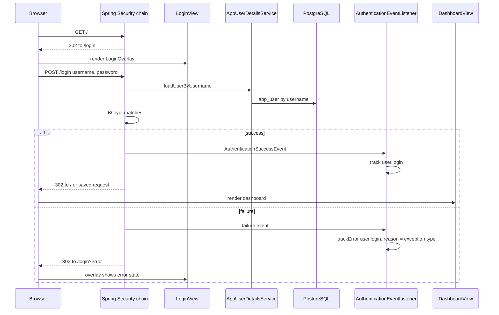

# Sign-in

Active contributors: ajpahl1008 (AJ Pahl)

Sign-in is Spring Security form login behind a Vaadin `LoginOverlay`. Users are stored in the `app_user` table with BCrypt password hashes, every attempt is recorded as a `user.login` analytics event, and the Sign out button in the top bar ends the session. There is no registration or password reset.

## Purpose

Restrict every screen to an authenticated account holder and tell the services who that holder is. `AccountService.currentHolder()` reads the username from the security context and looks up the linked `AccountHolder`; every other feature starts from there.

## Key abstractions

| Class | File | Role |
| --- | --- | --- |
| `LoginView` | `src/main/java/com/mockingbirdbank/ui/view/LoginView.java` | `@Route("login")`, `@AnonymousAllowed`, page title "Sign in \| Mockingbird Bank". A `LoginOverlay` that posts to `login`. |
| `SecurityConfig` | `src/main/java/com/mockingbirdbank/security/SecurityConfig.java` | `SecurityFilterChain` using `VaadinSecurityConfigurer.vaadin()` with `loginView(LoginView.class)`, plus Actuator rules and the `BCryptPasswordEncoder` bean. |
| `AppUserDetailsService` | `src/main/java/com/mockingbirdbank/security/AppUserDetailsService.java` | `UserDetailsService` over `AppUserRepository.findByUsername`; every user gets `ROLE_USER`. |
| `AppUser` | `src/main/java/com/mockingbirdbank/model/AppUser.java` | Username, BCrypt `passwordHash`, one-to-one link to `AccountHolder`. |
| `AuthenticationEventListener` | `src/main/java/com/mockingbirdbank/analytics/AuthenticationEventListener.java` | Turns Spring Security auth events into `user.login` analytics events. |
| `MainLayout` | `src/main/java/com/mockingbirdbank/ui/layout/MainLayout.java` | "Welcome back, <name>" and the Sign out button. |
| `DataInitializer` | `src/main/java/com/mockingbirdbank/config/DataInitializer.java` | Seeds `jordan.ellis` with password `mockingbird` (or `MOCKINGBIRD_DEV_PASSWORD`), BCrypt-encoded. |

## How it works

### Login page

`LoginView` extends `LoginOverlay`. Its constructor sets the title "Mockingbird Bank", the description "Sign in to view your accounts", hides the forgot-password button, sets the form action to `login`, and opens the overlay. The overlay submits a normal HTML form with fields `username` and `password`, which Spring Security's form login filter handles. `beforeEnter` turns on the overlay's error state when the URL has an `error` query parameter.

### Security chain

`SecurityConfig.securityFilterChain` adds two Actuator rules (public `/actuator/health/**` and `/actuator/info`, authenticated `/actuator/featureflags` and `/actuator/profiling`), then applies `VaadinSecurityConfigurer.vaadin()` with `LoginView` as the login view. The configurer sets up form login at `/login`, allows Vaadin's static resources, and denies any request it was not told about. The class Javadoc notes that `VaadinWebSecurity` was removed in Vaadin 25 in favor of this composable style.

Route access then comes from annotations: `LoginView` is `@AnonymousAllowed`; `DashboardView`, `AccountDetailView` and `MainLayout` are `@PermitAll` (any authenticated user). `MainLayout` needs its own `@PermitAll`, because an unannotated parent layout defaults to deny and would block every view inside it. The full rule set is in [Security](../security.md).

### Credentials

`AppUserDetailsService.loadUserByUsername` throws `UsernameNotFoundException` for an unknown name and otherwise returns a Spring `User` with the stored hash and `ROLE_USER`. Passwords are checked with the `BCryptPasswordEncoder` bean. Credentials live in `app_user`, separate from holder PII in `account_holder` (see [Data models](../reference/data-models.md)). The user lookup does not go through a circuit breaker.

### Redirects

| Situation | Result |
| --- | --- |
| Anonymous request to `/accounts` (or any view) | 302 to `/login` (asserted by `ApplicationSmokeTest.unauthenticatedRequestToAccountsRedirectsToLogin`) |
| Successful login with no saved request | 302 to `/`, which is `DashboardView` through `@RouteAlias("")` (asserted by `seededUserCanLogIn`) |
| Wrong password | 302 to `/login?error` (asserted by `wrongPasswordIsRejected` and the Playwright test) |
| Sign out | Back at `/login` (asserted by the Playwright test) |

### Sign out

`MainLayout` holds Vaadin's `AuthenticationContext` in a `transient` field (it is not serializable). The Sign out button calls `authenticationContext.logout()`, which runs Spring Security's logout handlers and invalidates the session; the browser then lands on the login overlay.

### Analytics

`AuthenticationEventListener` listens for `AuthenticationSuccessEvent` and any `AbstractAuthenticationFailureEvent`:

- Success: `track("user.login", {username})`.
- Failure: `trackError("user.login", <exception simple name>, {username})`, for example reason `BadCredentialsException`.

Both increment `product.events` and write a line to `build/logs/analytics-events.log`. See [Analytics](../systems/analytics.md).

## Integration points

- **Services:** `AccountService.currentHolder()` uses `SecurityContextHolder` to map the principal to an `AccountHolder`, and throws `IllegalStateException` if the user has no linked holder. See [Services](../systems/services.md).
- **Seed data:** the demo login is created only on an empty database. See [Persistence](../systems/persistence.md).
- **Log scrubbing:** `ScrubbingMessageConverter` redacts `password=` style pairs in log lines as a safety net.

## Entry points for modification

- Login page text or fields: `LoginView`.
- Access rules for new HTTP paths: `SecurityConfig.securityFilterChain`, before the `VaadinSecurityConfigurer` call. Anything not matched is denied.
- Access rules for new views: annotate the view (`@PermitAll`, `@RolesAllowed`, `@AnonymousAllowed`); views inside `MainLayout` also depend on the layout's annotation.
- Roles: `AppUserDetailsService` hardcodes `ROLE_USER`. Real roles would need a column on `app_user` and a Flyway migration.

## Testing

- `src/test/java/com/mockingbirdbank/ApplicationSmokeTest.java` (Testcontainers): anonymous redirect, seeded login succeeds with the right principal in the session, wrong password redirects to `/login?error`. It deliberately stops at the login redirect; a follow-up Vaadin request 403s under MockMvc because Vaadin's servlet initializes lazily (see the test's comment and `AGENTS.md`).
- `src/test/java/com/mockingbirdbank/security/AppUserDetailsServiceTest.java`: maps stored credentials with `ROLE_USER`; unknown user throws `UsernameNotFoundException`.
- `src/test/java/com/mockingbirdbank/analytics/AuthenticationEventListenerTest.java`: success and failure counters with the exception type as reason.
- `qa/tests/dashboard.spec.ts`: the full browser flow from redirect to sign-out, plus the wrong-password case. Run with `./scripts/run-interactive-qa.sh` (see [Testing](../how-to-contribute/testing.md)).

## Key source files

| File | Purpose |
| --- | --- |
| `src/main/java/com/mockingbirdbank/ui/view/LoginView.java` | Login overlay route |
| `src/main/java/com/mockingbirdbank/security/SecurityConfig.java` | Filter chain, password encoder |
| `src/main/java/com/mockingbirdbank/security/AppUserDetailsService.java` | User lookup |
| `src/main/java/com/mockingbirdbank/analytics/AuthenticationEventListener.java` | `user.login` events |
| `src/main/java/com/mockingbirdbank/ui/layout/MainLayout.java` | Greeting and Sign out |
| `src/main/java/com/mockingbirdbank/config/DataInitializer.java` | Demo login seed |
