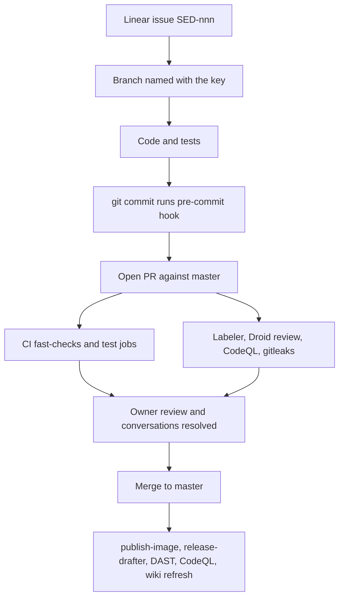

# Development workflow

Every change goes branch, code, local checks, pull request, CI, review, merge. Merging to `master` then triggers image publishing, release-note drafting, the security scans and a wiki refresh. This page walks through each step and the automation attached to it.

## The cycle



## 1. Branch

Start from an issue in the Linear project "Mockingbird Bank" (key `SED`) and put the key in the branch name, as `AGENTS.md` asks. See [How to contribute](index.md#picking-up-work).

## 2. Code and check locally

Follow [Patterns and conventions](patterns-and-conventions.md). While iterating, the fastest loop is:

```bash
./gradlew spotlessApply                                   # fix formatting
./gradlew test --tests "com.mockingbirdbank.service.AccountServiceTest"
./gradlew build                                           # the full definition of done
```

Run the app with `./scripts/dev-up.sh` to see a UI change, and `./scripts/run-interactive-qa.sh` for the browser smoke test. Details are in [Testing](testing.md).

## 3. Commit

### Pre-commit hook

`.githooks/pre-commit` runs on every `git commit`. It is wired up by the `installGitHooks` Gradle task, which `build` depends on, so the first `./gradlew build` in a fresh clone sets `core.hooksPath` to `.githooks`. The hook:

1. Runs `./gradlew spotlessCheck checkstyleMain checkstyleTest -q`. On failure it tells you to run `./gradlew spotlessApply`.
2. Runs `./scripts/validate-agents-md.sh`, which fails if `AGENTS.md` mentions a Gradle task or path that no longer exists.

Tests, PMD and CPD do not run in the hook. CI catches those.

### Message style

Recent history (`git log`) uses:

- An imperative subject in sentence case: `Add ...`, `Fix ...`, `Report ...`.
- The Linear key in parentheses when there is one, then the PR number: `Report the running build version via /actuator/info, startup log and top bar (SED-727) (#2)`.
- A wrapped body that explains what changed and why, often as a short bullet list.
- A `Co-authored-by: factory-droid[bot] <138933559+factory-droid[bot]@users.noreply.github.com>` trailer on AI-assisted commits.

Older commits use `Fix: ...` or `Fix X by Y` for bug fixes, for example `Fix deployment-smoke-test 409 by pinning required_contexts to []`.

## 4. Open the pull request

Fill in `.github/pull_request_template.md`: what and why, how it was verified, and the checklist. On open, several workflows start in parallel:

| Workflow | What it does on a PR |
| --- | --- |
| `.github/workflows/ci.yml` | Two parallel jobs, described below |
| `.github/workflows/labeler.yml` | Adds `area: *` labels from changed paths (`sync-labels: true`, so it also removes stale ones) |
| `.github/workflows/droid-review.yml` | Automated code review plus security review, skipped for drafts |
| `.github/workflows/codeql.yml` | CodeQL `java-kotlin` analysis |
| `.github/workflows/secret-scan.yml` | gitleaks over full history (`fetch-depth: 0`) |

### CI jobs

`ci.yml` cancels superseded runs on the same ref and splits the build in two so lint errors show up quickly:

| Job | Runs | Uploads |
| --- | --- | --- |
| `fast-checks` | `./gradlew spotlessCheck checkstyleMain checkstyleTest pmdMain pmdTest cpdCheck buildHealth validateAgentsMd javadoc` | `build-performance-fast-checks`, `code-quality-fast-checks` |
| `test` | `./gradlew build` with each of those tasks excluded via `-x` (tests, JaCoCo report and verification remain) | `test-report`, `jacoco-report`, `build-performance-test`, `code-quality-test` |

Both use Temurin JDK 21 on `ubuntu-latest`, where Docker is available for Testcontainers. Artifacts are kept 14 days. A third job, `notify-on-failure`, posts to Slack only for failed pushes to `master`, never for PRs.

## 5. Review and merge

`.github/CODEOWNERS` makes the owner a required reviewer on every path, and branch protection on `master` requires the CI check plus resolved conversations. Merged PRs appear on `master` as a single commit whose subject ends with the PR number, for example `(#3)`.

## 6. After merge

A push to `master` starts:

| Workflow | Result |
| --- | --- |
| `.github/workflows/ci.yml` | Same two jobs; Slack alert to `#mbb-ops` on failure if `SLACK_ALERTS_WEBHOOK_URL` is set |
| `.github/workflows/publish-image.yml` | Builds the production image, pushes `ghcr.io/<repo>:latest` and `:sha-<full sha>`, then the `deployment-smoke-test` job records a GitHub Deployment, boots that image against a throwaway Postgres, and marks the deployment `success` only if `/actuator/health` reports `UP` within about 60 seconds |
| `.github/workflows/release-drafter.yml` | Updates the draft GitHub Release |
| `.github/workflows/dast.yml` | OWASP ZAP baseline scan of a production jar; report uploaded as an artifact, never fails the build |
| `.github/workflows/codeql.yml`, `.github/workflows/secret-scan.yml` | Same scans as on the PR |
| `.github/workflows/droid-wiki-refresh.yml` | Regenerates the changed pages of this wiki and opens or updates one "docs: refresh wiki" PR from the `factory/droid-wiki` branch. Review and merge it like any other PR. Pushes that only change `droid-wiki/`, such as that merge, do not start another run. See [Tooling](tooling.md#wiki-refresh) |

The image build passes the output of `scripts/build-metadata.sh` as build args, so the image reports its real version and commit. See [Build version](../features/build-version.md) and [Docker image](../deployment/docker-image.md).

### Release notes

`.github/release-drafter.yml` groups merged PRs by label into Features (`feature`, `enhancement`), Bug Fixes (`fix`, `bug`), Security, Dependencies, and Maintenance (`chore`, `maintenance`, `documentation`). The next version is resolved from labels: `major` bumps major; `minor`, `feature` or `enhancement` bump minor; everything else defaults to patch. `skip-changelog` excludes a PR.

### Cutting a release

```bash
git tag v1.2.3
git push origin v1.2.3
```

`.github/workflows/release.yml` publishes the draft as release `v1.2.3` and pushes an image tagged `1.2.3` (the `v` is stripped) and `latest`. See [Releases](../deployment/releases.md).

## Dependency updates

Dependabot opens weekly PRs for Gradle, both npm projects (root and `qa/`), Docker and GitHub Actions, after a cooldown. They go through the same CI and review as any other PR. See [Tooling](tooling.md#dependabot).
