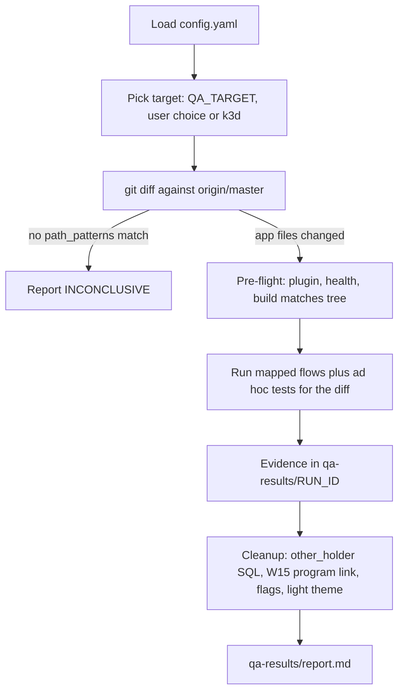
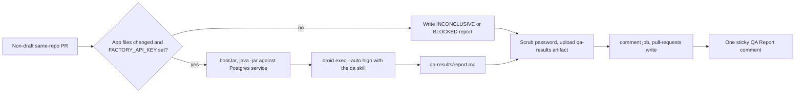

# Functional QA

Droid can test a change the way a user would: sign in, click through the dashboard, reveal an account number, curl the Actuator endpoints. Two Droid skills, `.factory/skills/qa/SKILL.md` and `.factory/skills/qa-web/SKILL.md`, define what to test. `.github/workflows/qa.yml` runs them on pull requests and keeps one "QA Report" comment updated on each PR. All of it arrived in one commit, `36ef6ef` (2026-11-05). `78a2f03` (PR #17, SED-847) added the `youth_holder` persona, the account programs flow W15 and the `SHOW_ACCOUNT_PROGRAMS` flag variant.

This is functional QA only. The skill tells the agent never to run `./gradlew build`, the JUnit suite, linters or the Playwright suite in `qa/`. Those stay where they are (see [Testing](testing.md)). The QA check never fails a PR on a finding: `Functional QA (Droid)` is one of the five required checks on `master`, but the job succeeds whatever QA reports, so the result is in the report, not the check status.

## The pieces

| File | Role |
| --- | --- |
| `.factory/skills/qa/SKILL.md` | The orchestrator (`/qa`). Picks a target, reads the diff, chooses flows, captures evidence, writes the report |
| `.factory/skills/qa/config.yaml` | The one source of truth for targets, personas, the app's `path_patterns` and build command, evidence toggles and cleanup. The workflow reads it with `yq` too |
| `.factory/skills/qa/REPORT-TEMPLATE.md` | Layout of `qa-results/report.md`: results table, optional "Action Required", one collapsed evidence block |
| `.factory/skills/qa/.install-progress.yaml` | Answers recorded by the `install-qa` questionnaire that generated the skills (resume support only) |
| `.factory/skills/qa-web/SKILL.md` | What to test in the web app: how to make sure the running build is the code under test, sign-in details, the seed data for both seeded holders, the path-to-flow map, flows W1 to W15, known failure modes |
| `.factory/skills/qa-web/sql/seed-other-holder.sql`, `.factory/skills/qa-web/sql/cleanup-other-holder.sql` | Add and remove a second, login-less account holder for the cross-account check |
| `.factory/settings.json` | Enables the `droid-control@factory-plugins` plugin (from the `Factory-AI/factory-plugins` marketplace on GitHub) for the project; it drives the browser through `agent-browser` |
| `.github/workflows/qa.yml` | Builds the PR branch, boots it, runs `droid exec` with the skill, posts the comment |

`.gitignore` excludes the output, `qa-results/` and `qa-output.txt`.

## How a run works

1. **Diff scope.** The base is `$QA_DIFF_BASE` or `origin/master`, plus uncommitted and untracked files. A file only counts as app code if it matches `apps.web.path_patterns`: `src/main/java/**`, `src/main/resources/**`, `src/main/frontend/**`, `build.gradle`, `settings.gradle`, `gradle.properties`, `gradle/**`. Changes to `docs/`, `.github/`, `k8s/`, `qa/`, `src/test/`, `.factory/`, `droid-wiki/` or `AGENTS.md` alone produce one INCONCLUSIVE row ("No app code changed") and no flows. An explicit smoke request overrides this.
2. **Flow choice.** The path-to-flow map in `.factory/skills/qa-web/SKILL.md` lists which flows a changed path calls for, and the agent adds adjacent flows plus at least one negative test. Program code (`service/Program*.java`, `ui/view/ProgramCard.java`, `ui/view/ProgramLookup.java`, `model/Program*.java`, `config/BusinessClockConfig.java`) maps to W15 and W13, and `DataInitializer`, `AccountService`, model, repository and migration changes include W15 too. If no flow covers the change, it writes an ad hoc one. The skill's quality gate requires at least half the tests to target the change directly.
3. **Pre-flight.** The plugin is active, `/actuator/health` reports `UP`, and the running build is the code under test. Any failure turns the affected flows into BLOCKED rows with a fix, never a silent skip.
4. **Report.** Results use PASS, FAIL, BLOCKED, FLAKY and INCONCLUSIVE. With `failure_learning: suggest_in_report`, a BLOCKED or FAIL caused by the environment (not the diff) adds a "Suggested Skill Updates" table with copy-ready prompts that append to the skill's "Known Failure Modes".

## Targets

| Target | URL | When | How the build is checked |
| --- | --- | --- | --- |
| `k3d` | `http://mockingbird.localhost:81` | Default for local `/qa` runs | Compares `git.commit.id` from `/actuator/info` with `git rev-parse --short HEAD`, and redeploys with `./scripts/k3d-deploy.sh` if they differ, the version ends in `-dirty`, or app files have uncommitted changes. See [Local k3d](../deployment/local-k3d.md) |
| `local` | `http://localhost:8080` | Fallback when the `k3d-dev-k8s` context or `dev-k8s` cluster is missing | Starts `./scripts/dev-up.sh` itself. If something else already answers on 8080 with a different commit, it reports BLOCKED rather than kill a process it did not start |
| `ci` | `http://localhost:8080` | `QA_TARGET=ci`, set by the workflow | The workflow already built and started the branch's jar; the agent must not rebuild |
| `lab` | none checked in | Never for branch QA | Runs `master`, so it is the wrong code. Read-only smoke checks only, on explicit request; never seed data, restart pods or change flags |

Each target has a `db_access` command in `config.yaml` (`kubectl exec` into `statefulset/postgres`, `docker compose exec`, or `psql` with the `QA_DB_*` variables) used to run the seed and cleanup SQL.

## Personas

| Persona | Who | Password |
| --- | --- | --- |
| `holder` | `jordan.ellis`, the adult holder `src/main/java/com/mockingbirdbank/config/DataInitializer.java` seeds, with three accounts and a Regular program | Whatever `MOCKINGBIRD_DEV_PASSWORD` was when the database was first seeded: a random per-run value on `ci`, always the `AGENTS.md` default on `k3d` (the pod never receives the variable), usually the default on `local` |
| `youth_holder` | `riley.chen`, the customer under 18 that `DataInitializer` also seeds, with one savings account in a Youth Savings program | Same as `holder`: both logins are seeded with the same password |
| `anonymous` | Signed-out visitor | none |
| `other_holder` | "Casey Other (QA)", `qa.other.holder@example.invalid`, one checking account `9000000000017` with $777.77 and a `QA-OTHER-HOLDER-MARKER` transaction | No login; it exists only to be probed |

The seed SQL must run after the app's first start. `DataInitializer` seeds only when `account_holder` is empty, so seeding first would stop Jordan (and Riley) from being created. Both SQL files are idempotent, and the skill runs cleanup even after a failure, because the k3d PVC and the compose volume keep data between runs. For the same reason, if W15 step 3 ran, cleanup runs W15 step 4, which puts back the Vacation Savings program link recorded before step 1 (`cleanup.instructions` in `.factory/skills/qa/config.yaml`).

## Flow menu

| Flow | Persona | Checks |
| --- | --- | --- |
| W1 Signed-out redirect | anonymous | `/`, `/accounts`, `/accounts/1` all land on `/login` |
| W2 Sign in | holder | Lands on `/` with "Welcome back, Jordan Ellis" |
| W3 Wrong password | anonymous | `/login?error`, same message for an unknown username |
| W4 Dashboard content | holder | $24,318.52 across 3 accounts, card order, masked numbers, no full number in the page |
| W5 Account detail | holder | Header, balance, 8 transactions, credit color, back link |
| W6 Account number reveal | holder | Per-card eye, "Show account numbers" toggle, 30-second re-mask, detail header eye |
| W7 Build version | holder | `#build-version` under the wordmark matches `/actuator/info` |
| W8 Dark mode | holder | `theme="dark"`, `localStorage['mbb-theme']`, survives reload |
| W9 Sign out | holder | Session really ends |
| W10 Unknown account | holder | Not-found page for `/accounts/999999999` and `/accounts/not-a-number`, no stack trace |
| W11 Cross-account isolation | holder vs other_holder | `/accounts/<other id>` must show the not-found page; reveal must refuse |
| W12 Actuator access | anonymous, holder | Public health and info, protected `featureflags` and `profiling`, `X-Correlation-Id` echo |
| W13 Feature flag variants | holder | Restart with `MOCKINGBIRD_FEATURE_FLAGS_<NAME>` per target, check the UI, restore |
| W14 Database outage | holder | Requests fail instead of hanging, the `accounts` breaker opens, recovery without restart (`ci` or `local` only) |
| W15 Account programs | holder, youth_holder | With `SHOW_ACCOUNT_PROGRAMS=true`: Jordan's "Regular" card with "Requirements met" linking Everyday Checking and High-Yield Savings, the "Program" section on account pages, an unmet rule after linking Vacation Savings by SQL ("Regular needs exactly one savings account, but 2 are linked." plus the `.program-notice`), then Riley's "Youth Savings" card and the not-found page for one of Jordan's accounts |

The smoke set, used by the workflow's manual dispatch and for broad changes, is W1 to W6, W9 and W12. The expected values come from the seed table in `.factory/skills/qa-web/SKILL.md`; if a diff changes `DataInitializer`, the agent derives them from the new code instead.

W11 expects `/accounts/<other id>` to show the same not-found page as W10, so account IDs cannot be probed. Since `78a2f03`, `AccountService.requireAccount` in `src/main/java/com/mockingbirdbank/service/AccountService.java` returns only accounts the signed-in holder owns, so a page that renders "QA Other Checking", "$777.77" or "QA-OTHER-HOLDER-MARKER" means that check regressed. The skill tells the agent to report it as a high-severity FAIL under "Action Required". Only if the page did render does the agent click its header eye as a second row, which passes when the reveal refuses, because `revealAccountNumber` checks ownership too. W15 step 6 repeats the probe as `youth_holder` against one of Jordan's accounts. See [Security](../security.md#account-detail-ownership-check) and [Account detail](../features/account-detail.md).

W15 needs `SHOW_ACCOUNT_PROGRAMS=true`, so it uses the W13 restart steps first. Its expected values are the seed's (see [Account programs](../features/account-programs.md)).

## Evidence

Everything goes under `qa-results/<RUN_ID>/`. Trimmed accessibility-tree snapshots and curl output are the main evidence, since they render inline in a PR comment. Screenshots, and before/after GIFs built with ImageMagick (`imagemagick: true`), go to the artifact only, and the report names the file rather than embedding it. Cookies, session IDs and passwords never go in evidence.

Video is off: `video_evidence: false` and `droid_control.compose: false`. When turned on, the agent records one video per flow through droid-control's Capture stage, optionally edits it with Compose (the only allowed preset is `factory`, max 60 seconds), and uploads it to GitHub's `user-attachments` endpoint with `QA_EVIDENCE_TOKEN`, which must be a classic PAT with `repo` scope.

## The QA workflow

| Piece | Detail |
| --- | --- |
| Triggers | `pull_request` to `master` (opened, synchronize, reopened, ready_for_review) and `workflow_dispatch` with a `smoke` input that defaults to `true` |
| Who gets a run | Non-draft PRs from this repository, not opened by `dependabot[bot]`. Forks and Dependabot get no secrets, so the job is skipped and no comment is posted |
| Concurrency | `qa-<PR number>`, `cancel-in-progress: true` |
| Permissions | Workflow `contents: read`. Only the separate `comment` job has `pull-requests: write`, so the agent never holds a write token |
| Scope gate | "Decide QA scope" reads `apps.web.path_patterns` with `yq` and matches `git diff --name-only origin/<base>...HEAD` with bash `[[ == ]]`, where `*` also matches `/`. Skill and workflow cannot disagree about what counts as app code |
| Database | `postgres:16-alpine` service with `admin`/`secret`/`mydatabase`, the same values as the `application.yml` fallbacks |
| Password | `openssl rand -hex 16` per run, masked with `::add-mask::`, exported as `MOCKINGBIRD_DEV_PASSWORD` to both the app and the agent |
| Build and boot | `apps.web.build_command` (`./gradlew -Pvaadin.productionMode=true clean bootJar -x test`), then `java -jar` the non-plain jar and poll `/actuator/health` for up to 180 seconds. `MANAGEMENT_TRACING_SAMPLING_PROBABILITY=0.0`, since there is no collector |
| Agent | Installs Droid with `curl -fsSL https://app.factory.ai/cli \| sh`, then `droid exec --auto high` with a prompt that sets the `ci` target and diff base. 18-minute step timeout, 40-minute job timeout |
| No-agent report | If the scope gate, build, boot or CLI install stops the run, a shell step writes a one-row report instead: INCONCLUSIVE for no app changes, BLOCKED with the reason (and the last 80 app log lines when health never came up) otherwise |
| Scrub | Before upload, `sed` replaces the per-run password with `***` in every `.md`, `.json`, `.txt` and `.log` under `qa-results/` and in `qa-output.txt`. The comment job never sees the password |
| Artifact | `qa-results` (results, `app.log`, `qa-output.txt`), kept 14 days |
| Comment | Finds the comment starting with `<!-- qa-report -->` and patches it, or posts a new one. Bodies over 60,000 characters are cut, with open code fences and `
` blocks closed. With no report at all it posts the last 200 lines of agent output |

Every setup and agent step uses `continue-on-error: true`, so the `qa` job normally ends green whatever QA found. The result lives in the comment, not the check status.

The `Protect Master` ruleset requires `Functional QA (Droid)`, so a PR waits for this job to finish (up to the 40-minute timeout) before it can merge, but a FAIL row does not stop the merge. The workflow has no `paths` filter, so every PR gets the check: PRs without app changes end quickly with an INCONCLUSIVE report, and drafts, forks and Dependabot PRs skip the job, which GitHub counts as passing. The header comment in `.github/workflows/qa.yml` still calls the check informational and says not to add it to branch protection; `AGENTS.md` has described it as required since `cf064b0`.

## Running it locally

Type `/qa` in Droid. The skill targets k3d by default, redeploying when the running build does not match the working tree (allow about 15 minutes), and falls back to `./scripts/dev-up.sh`. You need the `droid-control` plugin (Droid installs it from `.factory/settings.json`) and either the k3d cluster or Docker for the compose Postgres. Ask for a smoke run or name flows to skip the diff logic. The report lands in `qa-results/report.md`.

Feature flag variants (W13) restart the app with an override and restore it afterwards: `kubectl set env` plus a rollout on k3d, a restart of `dev-up.sh` on local, and a `java -jar` restart using `QA_APP_JAR` and `QA_APP_PID_FILE` on ci. The variant table in the skill has one row per flag, six in all. The `SHOW_ACCOUNT_COUNT=true` row, added with the flag in `3e172bf`, expects "You have 3 accounts" (`.account-count-summary`) under "Your accounts" for the seeded holder. The `SHOW_ACCOUNT_PROGRAMS=true` row, added in `78a2f03`, expects "Your programs" below "Your accounts" and a "Program" section on account pages (then run W15); with the default `false`, neither appears and the dashboard shows no program notice. W12 now expects six flags in `/actuator/featureflags`. See [Feature flags](../features/feature-flags.md).

## Known failure modes

`.factory/skills/qa-web/SKILL.md` keeps a list the agent reads on every run. The ones most likely to bite a person too:

- The `LoginOverlay` inputs live inside a web component, and Vaadin routes on the client, so wait for text rather than page loads.
- The first page in dev mode (`bootRun`) can take 90 seconds while the frontend compiles.
- Seeding `other_holder` into an empty database stops Jordan from being seeded.
- Account cards are links, so clicking anywhere but the eye button navigates.
- Every restart, rollout or flag change signs you out, because Vaadin sessions live in memory.
- A k3d or local database first seeded before `78a2f03` has no `riley.chen` login, no programs and no dates of birth, because `DataInitializer` never reseeds. The skill reports the affected W15 steps BLOCKED rather than FAIL and leaves the judgement to the `ci` run on a new database.
- On k3d or local, a Vacation Savings program link other than `NULL` recorded before W15 step 1 may be left over from an interrupted run. The skill reports W15 steps 1 to 4 BLOCKED with the recorded value, still runs steps 5 and 6, and does not suggest a reset or clearing the link by hand.

## Key source files

| File | Purpose |
| --- | --- |
| `.factory/skills/qa/SKILL.md` | Orchestrator steps, evidence and report rules |
| `.factory/skills/qa/config.yaml` | Targets, personas, path patterns, toggles |
| `.factory/skills/qa-web/SKILL.md` | Target checks, seed data, path-to-flow map, flows W1 to W15 |
| `.factory/skills/qa-web/sql/seed-other-holder.sql` | Cross-account test data |
| `.factory/skills/qa-web/sql/cleanup-other-holder.sql` | Removes it again |
| `.factory/settings.json` | Enables `droid-control` |
| `.github/workflows/qa.yml` | PR workflow and sticky comment |

Related: [Testing](testing.md), [Account programs](../features/account-programs.md), [Feature flags](../features/feature-flags.md), [Tooling](tooling.md#github-workflows), [Security](../security.md#ci-and-repository-controls), [Configuration](../reference/configuration.md#ci-secrets).
