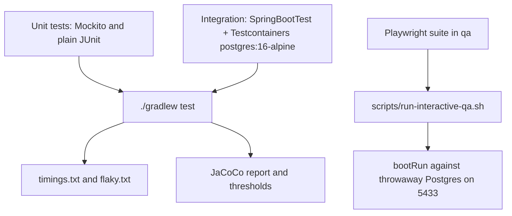

# Testing

The suite has 17 JUnit classes (60 test methods) under `src/test/java/com/mockingbirdbank/`, mirroring the main packages, plus a 4-test Playwright suite in `qa/` that drives a real browser. `./gradlew test` runs the JUnit side and needs Docker for the Testcontainers-backed classes.

## Test layers



### Unit tests

Most classes are plain JUnit 5 or `@ExtendWith(MockitoExtension.class)` tests that construct the class under test directly. They reuse production constants rather than copying them, for example `ResilienceConfig.defaultConfig()` and `DataInitializer.DEV_USERNAME`. Entities (`AccountTest`, `TransactionTest`) are tested without Spring at all.

### Integration tests

Two classes boot the full Spring context with `@SpringBootTest` against a real `postgres:16-alpine` started by Testcontainers (`@Testcontainers`, `@Container @ServiceConnection`). Flyway migrates the empty container database and `DataInitializer` seeds it, as in a real first start.

- `src/test/java/com/mockingbirdbank/ApplicationSmokeTest.java` uses MockMvc to check `/actuator/health`, that `/actuator/info` is public and limited to build and git fields, that seeding created one holder with three accounts, that `/accounts` redirects anonymous users to `/login`, and that form login succeeds or fails as expected.
- `src/test/java/com/mockingbirdbank/service/AccountTransactionQueryPerformanceTest.java` is the N+1 guard. It enables Hibernate statistics, seeds 6 accounts with 2 transactions each, clears the session, loads the accounts and touches every `transactions` collection, then asserts fewer than 6 prepared statements ran. Removing `@BatchSize` from `Account.transactions` makes it fail. See [Persistence](../systems/persistence.md).

### Circuit breaker behavior

`src/test/java/com/mockingbirdbank/resilience/CircuitBreakerBehaviorTest.java` builds `AccountService` and `TransactionService` with a real `CircuitBreakerRegistry.of(ResilienceConfig.defaultConfig())` and a repository mock that always throws `DataAccessResourceFailureException`. The first 10 calls reach the repository; the 11th fails fast with `ServiceUnavailableException` and the repository call count stays at 10. It does not test the half-open recovery after 10 seconds. See [Resilience](../systems/resilience.md).

### The login smoke test stops early on purpose

`ApplicationSmokeTest.seededUserCanLogIn` asserts that login redirects to `/` and that the session holds an authenticated `jordan.ellis` principal. It deliberately does not follow up with `GET /accounts`. Under MockMvc, Vaadin's servlet initializes lazily on the first real dispatch, so `RequestUtil.isSecuredFlowRoute()` treats the route as unsecured and the default-deny rule returns 403 even for an authenticated request. This is a test-harness artifact, recorded as a "Known non-issue" in `AGENTS.md`. Do not "fix" it by asserting 200.

### Browser QA with Playwright

`./scripts/run-interactive-qa.sh` exercises the real frontend:

1. Starts a throwaway Postgres container `mockingbird-qa-postgres` on port 5433 (image `postgres:17.2`), so it never touches a database on 5432. A shared database with unrelated tables would trip Flyway's `baseline-on-migrate` and skip V1.
2. Runs `./gradlew bootRun` against it and waits up to 180 seconds for `/actuator/health` to report `UP`.
3. Runs `npx playwright test` in `qa/` (Chromium only, `retries: 0`, base URL from `QA_BASE_URL`, default `http://localhost:8080`).
4. Stops the app and removes the container on exit, printing the last 80 app log lines on failure.

The four tests in `qa/tests/dashboard.spec.ts`:

| Test | Checks |
| --- | --- |
| signing in shows the seeded accounts and their transactions | Redirect to `/login`, greeting, three account cards, account detail rows, sign-out |
| a wrong password is rejected | URL becomes `/login?error` |
| eye toggles reveal and re-mask full account numbers | Per-card eye and the "Show all account numbers" toggle |
| the build version shows directly under the wordmark | `#build-version` text format, tooltip, position under the wordmark |

One-time setup: `cd qa && npm install && npx playwright install chromium`. The suite is not run by CI.

## Running tests

```bash
./gradlew test                                                        # everything, Docker required
./gradlew test --tests "com.mockingbirdbank.service.AccountServiceTest"
./gradlew test --tests "com.mockingbirdbank.service.AccountServiceTest.requireAccountThrowsForUnknownId"
./gradlew jacocoTestReport                                            # HTML coverage report
./scripts/run-interactive-qa.sh                                       # browser suite
```

Console output lists every test as PASSED, FAILED or SKIPPED with full exception traces (`testLogging` in `build.gradle`). The HTML report is `build/reports/tests/test/index.html`.

## Retries and flaky tests

The `org.gradle.test-retry` plugin (1.6.2) re-runs a failed test up to 2 more times (`maxRetries = 2`). If more than 10 tests fail (`maxFailures = 10`) retries stop, since that points to a real break. `failOnPassedAfterRetry = false` means a test that fails and then passes does not fail the build.

To keep that instability visible, `build.gradle` records every attempt's result per test and writes `build/reports/tests/test/flaky.txt` after each run. It lists any test whose attempts disagreed, or says "No flaky tests detected in this run". A Gradle warning `FLAKY TEST(S) DETECTED` is also logged.

## Timings

Every run writes `build/reports/tests/test/timings.txt`, all test methods sorted slowest first, and logs the slowest one. Any test over 10,000 ms logs a `SLOW TEST` warning. The build never fails on time; the Testcontainers classes legitimately spend seconds on container startup.

## Coverage gates

JaCoCo 0.8.12 runs as part of `check`. `jacocoTestReport` writes XML and HTML (`build/reports/jacoco/test/html/index.html`), and `jacocoTestCoverageVerification` enforces two rules:

| Rule | Scope | Minimum |
| --- | --- | --- |
| Project-wide line coverage | Everything | 30% |
| Per-class line coverage | `com.mockingbirdbank.model.*`, `service.*`, `security.*`, `config.*`, `analytics.*`, `resilience.*`, `observability.*` | 90% |

`com.mockingbirdbank.ui.*`, `com.mockingbirdbank.repository.*` and `Application` are outside the per-class rule. UI code still counts toward the 30% floor. The reasoning, in `build.gradle`, is that Vaadin views are declarative and not meaningfully unit-testable without a browser fixture. A new class in a gated package needs at least 90% line coverage or the build fails.

## Test classes

| Class | Kind | Covers |
| --- | --- | --- |
| `src/test/java/com/mockingbirdbank/ApplicationSmokeTest.java` | Integration | Context boot, health, info, seeding, login redirect, form login |
| `src/test/java/com/mockingbirdbank/service/AccountTransactionQueryPerformanceTest.java` | Integration | N+1 guard on `Account.transactions` |
| `src/test/java/com/mockingbirdbank/resilience/CircuitBreakerBehaviorTest.java` | Unit, real breaker | Both breakers trip after 10 failures and fail fast |
| `src/test/java/com/mockingbirdbank/service/AccountServiceTest.java` | Mockito | `currentHolder`, `totalBalance`, `requireAccount`, reveal ownership checks, reveal-all, reveal when breaker is open |
| `src/test/java/com/mockingbirdbank/service/TransactionServiceTest.java` | Mockito | `forAccount` delegates to the newest-first query |
| `src/test/java/com/mockingbirdbank/model/AccountTest.java` | JUnit | Masking, short or missing numbers, display name fallback |
| `src/test/java/com/mockingbirdbank/model/TransactionTest.java` | JUnit | `isCredit` for positive, negative and null amounts |
| `src/test/java/com/mockingbirdbank/security/AppUserDetailsServiceTest.java` | Mockito | User mapping with `ROLE_USER`, unknown user |
| `src/test/java/com/mockingbirdbank/analytics/AnalyticsEventServiceTest.java` | JUnit + `SimpleMeterRegistry` | Counter tags, accumulation, correlation ID in event lines |
| `src/test/java/com/mockingbirdbank/analytics/AuthenticationEventListenerTest.java` | JUnit | Login success and failure events |
| `src/test/java/com/mockingbirdbank/analytics/GlobalErrorHandlerTest.java` | JUnit | Session error handler tracks then delegates |
| `src/test/java/com/mockingbirdbank/observability/CorrelationIdFilterTest.java` | JUnit | Generate, reuse, MDC cleared on exception |
| `src/test/java/com/mockingbirdbank/observability/ProfilingEndpointTest.java` | JUnit | Real JFR file written, status, double start, stop with nothing running |
| `src/test/java/com/mockingbirdbank/observability/BuildVersionTest.java` | JUnit | Version, commit, branch, display format, missing metadata, startup log |
| `src/test/java/com/mockingbirdbank/config/FeatureFlagServiceTest.java` | JUnit | Defaults, overrides, `allFlags()` |
| `src/test/java/com/mockingbirdbank/config/FeatureFlagsEndpointTest.java` | JUnit | Endpoint delegates to the service |
| `src/test/java/com/mockingbirdbank/config/logging/ScrubbingMessageConverterTest.java` | JUnit | Password, token, Bearer header, card numbers, null and empty input |

## Known gaps

- No JUnit tests for anything in `com.mockingbirdbank.ui`. `AccountNumberDisplay` has no unit test, and its 30-second auto-hide is not covered by Playwright either.
- `CircuitBreakerBehaviorTest` checks tripping only, not recovery through half-open, although `AGENTS.md` says it verifies both.
- Nothing tests that `/accounts/{id}` refuses another holder's account. `AccountService.requireAccount` has no ownership check, so such a test would fail today. See [Security](../security.md).
- The Playwright suite runs only on demand. The post-publish smoke test in `.github/workflows/publish-image.yml` checks only that the image boots and is healthy.
- The QA script uses `postgres:17.2` while Testcontainers, `docker-compose.yml` and k3d use `postgres:16-alpine`.

See [Debugging](debugging.md) for reading test failures, and [Tooling](tooling.md) for the Gradle wiring.
