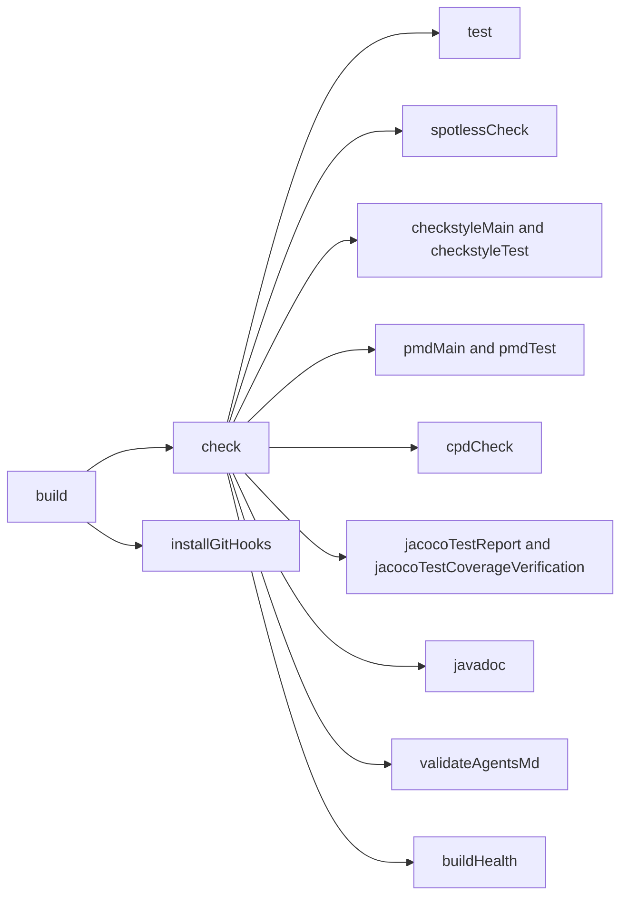
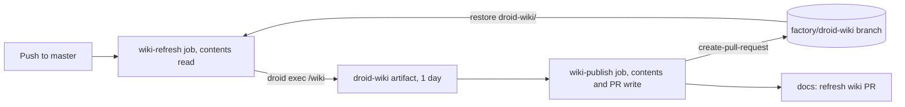

# Tooling

Nearly all quality tooling is Gradle-driven and runs inside `./gradlew build`, so a green local build means CI's checks will pass too. This page lists the Gradle plugins and custom tasks in `build.gradle`, the lint configs, the helper scripts, the local environment files and every GitHub workflow.

## Gradle plugins

| Plugin | Version | Used for |
| --- | --- | --- |
| `org.springframework.boot` | 4.1.1 | `bootRun`, `bootJar`, `buildInfo()` |
| `io.spring.dependency-management` | 1.1.6 | BOM imports (Vaadin 25.3.0, Testcontainers 2.0.5) |
| `com.vaadin` | 25.3.0 | Frontend build; `vaadin.productionMode` defaults to `false` |
| `com.diffplug.spotless` | 7.0.2 | google-java-format 1.25.2, AOSP style, unused imports, trailing whitespace, final newline |
| `checkstyle` | tool 10.20.2 | `config/checkstyle/checkstyle.xml` |
| `pmd` | tool 7.7.0 | `config/pmd/dead-code.xml` only |
| `de.aaschmid.cpd` | 3.5 (PMD 7.7.0) | Duplicate detection, `minimumTokenCount = 75`, main and test sources |
| `jacoco` | tool 0.8.12 | Coverage report and thresholds |
| `org.gradle.test-retry` | 1.6.2 | Up to 2 retries per failed test |
| `com.autonomousapps.dependency-analysis` | 3.19.2 | `buildHealth`: unused or misdeclared dependencies fail the build |

The Java toolchain is pinned to 21. `gradle.properties` sets `org.gradle.jvmargs=-Xmx1g` and `baseVersion=0.1.0`.

## What `check` runs

`build` depends on `check` and `installGitHooks`. `check` is wired to:

## Custom tasks and build hooks

| Task or hook | What it does |
| --- | --- |
| `generateGitProperties` | Writes `build/generated/git/git.properties` (commit, short commit, branch, dirty flag, commit time) and feeds it into `processResources`. Written by hand because git-properties plugins need `.git`, which the Docker build lacks. Values come from `-PgitCommit` and friends, then `git`, then `unknown` |
| `springBoot.buildInfo` | Writes `META-INF/build-info.properties`. Build time is recorded only when `-PbuildTime` is passed (the `Dockerfile` does), so local test runs stay up to date |
| `installGitHooks` | Runs `git config core.hooksPath .githooks` when both `.githooks/` and `.git/` exist |
| `validateAgentsMd` | Runs `scripts/validate-agents-md.sh` and fails the build if it reports a missing task or path |
| `javadoc` | Builds `build/docs/javadoc` with `-Xdoclint:all,-missing`; broken `@link`/`@see` references fail the build |
| Test timing hook | Writes `build/reports/tests/test/timings.txt`, warns on tests over 10 s |
| Flaky test hook | Writes `build/reports/tests/test/flaky.txt` |
| Build performance hook | Writes `build/reports/build-performance/summary.txt`: total time and the 30 slowest tasks; warns if the build exceeds 5 minutes |
| Code quality hook | Writes `build/reports/code-quality/summary.txt`: Checkstyle, PMD and CPD counts and project-wide line coverage, each marked "not run this build" when its task did not run in this invocation |
| Harness Test Intelligence | Adds `HARNESS_JAVA_AGENT` to test JVM args when set, and disables "no matching tests" failures |

The two summary files are computed by regex over each tool's XML report rather than an XML parser, because JaCoCo's XML references an external DTD.

### validate-agents-md.sh

`scripts/validate-agents-md.sh` keeps `AGENTS.md` honest. It extracts every `./gradlew <task>` mention and checks each with `./gradlew help --task`, then checks every backticked path containing `/` exists, skipping `build/...` outputs and paths starting with `/` (HTTP routes). It runs from `validateAgentsMd`, the pre-commit hook and CI's `fast-checks` job. If you add a task or path to `AGENTS.md`, it has to exist.

## Lint configuration

### Checkstyle

`config/checkstyle/checkstyle.xml` runs at `error` severity, so any hit fails the build, except TODO markers:

| Area | Rules |
| --- | --- |
| File | No tabs, newline at end, line length 160 (imports and package exempt), file length 400 lines |
| Naming | Standard type, method, member, parameter and variable names; constants may also be `log` or `logger`; lowercase package names |
| Imports | No redundant, unused or star imports |
| Size and complexity | Method length 150, at most 8 parameters, cyclomatic complexity 15, NPath 200 |
| Coding | `EqualsHashCode`, simplified boolean expressions and returns, no `==` on strings, one statement per line, braces required, empty catch blocks need a comment |
| Debt | `TODO`, `FIXME`, `XXX` reported as warnings (`maxWarnings = Integer.MAX_VALUE`) |

### PMD

`config/pmd/dead-code.xml` deliberately covers only dead code, to avoid overlapping Checkstyle: unused local variables, private fields, private methods and formal parameters, unused assignments, useless overriding methods, and empty catch blocks.

## Scripts

| Script | Purpose |
| --- | --- |
| `scripts/dev-up.sh` | `docker compose up -d --wait`, then `exec ./gradlew bootRun`. Postgres keeps its volume between runs |
| `scripts/run-interactive-qa.sh` | Throwaway Postgres on 5433, `bootRun`, Playwright suite, full teardown. See [Testing](testing.md#browser-qa-with-playwright) |
| `scripts/build-metadata.sh` | Prints `APP_VERSION`, `GIT_COMMIT`, `GIT_BRANCH`, `GIT_DIRTY`, `GIT_COMMIT_TIME` as `KEY=value` lines, or `--build-arg` flags with `--docker-args`. Honors an `APP_VERSION` override |
| `scripts/k3d-deploy.sh` | Build, import and deploy to the local k3d cluster, plus `status`, `logs`, `down`. See [Local k3d](../deployment/local-k3d.md) |
| `scripts/validate-agents-md.sh` | Described above |
| `scripts/bootstrap-lab-db.sql` | Creates the dedicated LAB database. See [LAB cluster](../deployment/lab-cluster.md) |
| `createLocalDockerImage.zsh`, `runDockerImage.zsh`, `createDockerHubImage.zsh` | Local arm64 image, run with `.env`, multi-arch push to Docker Hub. See [Docker image](../deployment/docker-image.md) |

## Local environment

### docker-compose.yml

`docker-compose.yml` defines one `postgres` service: `postgres:16-alpine` on `5432`, database `mydatabase`, user `admin`/`secret` (matching the defaults in `src/main/resources/application.yml`), a named volume `mockingbird-postgres-data`, and a `pg_isready` healthcheck. It is not used by CI or tests, which use Testcontainers.

### Dev container

| File | Role |
| --- | --- |
| `.devcontainer/devcontainer.json` | Merges the root `docker-compose.yml` with `.devcontainer/docker-compose.yml`, service `app`, Node 20 and docker-outside-of-docker features, forwards 8080 and 5432, marks `/workspace` as a git safe directory and warms the Gradle wrapper |
| `.devcontainer/Dockerfile` | `mcr.microsoft.com/devcontainers/java:1-21-bookworm`, with the broken Yarn apt source removed |
| `.devcontainer/docker-compose.yml` | The `app` service: mounts the repo at `/workspace`, publishes 8080, waits for a healthy `postgres`, points the datasource at `postgres:5432`, and sets `TESTCONTAINERS_HOST_OVERRIDE=host.docker.internal` so Testcontainers can reach sibling containers |

### Agent skill

`.factory/skills/run-mockingbird-bank-locally/SKILL.md` is a Factory Droid skill that walks an agent through starting Postgres (compose or dev container), `build` and `bootRun`, signing in as `jordan.ellis`, running the interactive QA script and the individual lint tasks. It describes the QA run as login, dashboard, detail, sign-out and wrong password; the spec also covers the reveal toggles and the version label.

## GitHub workflows

| Workflow | Triggers | Purpose |
| --- | --- | --- |
| `.github/workflows/ci.yml` | Push and PR to `master` | `fast-checks` (lint, `buildHealth`, `validateAgentsMd`, Javadoc) and `test` (full build minus those) in parallel; Slack alert on `master` failure |
| `.github/workflows/codeql.yml` | Push and PR to `master`, Mondays 03:17 UTC | CodeQL `java-kotlin` with autobuild |
| `.github/workflows/secret-scan.yml` | Push and PR to `master` | gitleaks over full history; fails the check on a hit |
| `.github/workflows/dast.yml` | Push to `master`, Mondays 04:23 UTC, manual | Production jar against `postgres:17`, OWASP ZAP baseline on `/login`, report artifact kept 30 days, never fails |
| `.github/workflows/publish-image.yml` | Push to `master` | Push image to GHCR as `latest` and `sha-<sha>`, record a GitHub Deployment, boot-and-health smoke test, Slack alert on failure |
| `.github/workflows/release-drafter.yml` | Push to `master` | Update the draft release notes from PR labels |
| `.github/workflows/release.yml` | Tag `v*.*.*` | Publish the draft release, push image tagged with the version (no `v`) and `latest` |
| `.github/workflows/labeler.yml` | `pull_request_target` opened, synchronize, reopened | Sync `area: *` labels from `.github/labeler.yml` |
| `.github/workflows/stale.yml` | Daily 06:00 UTC, manual | Mark issues and PRs stale after 60 days, close 14 days later; drafts and `priority: high`, `pinned`, `security` exempt |
| `.github/workflows/droid-review.yml` | PR opened, ready for review, reopened | Factory Droid automatic code and security review on non-draft PRs |
| `.github/workflows/droid.yml` | Comments, reviews, issues and PRs mentioning `@droid` | Ad hoc Droid run |
| `.github/workflows/droid-wiki-refresh.yml` | Push to `master` that changes something outside `droid-wiki/`, one run at a time | Regenerate this wiki with `droid exec "/wiki"`, push the pages to the `factory/droid-wiki` branch and open or update one "docs: refresh wiki" PR. See [Wiki refresh](#wiki-refresh) |

### Wiki refresh

`.github/workflows/droid-wiki-refresh.yml` (added in `3b03ecd`, PR #4, changed in `2b3e914`, PR #5, and limited to non-wiki pushes in `f97b7a4`, PR #8) keeps the Factory Wiki in step with `master`. It splits the work into a read-only job that runs the agent and a write job that publishes the result, so the agent never holds push or PR permissions.

| Piece | Detail |
| --- | --- |
| Concurrency | Group `droid-wiki-refresh` with `cancel-in-progress: false`, fixed for the whole repository, so pushes during a run queue instead of starting parallel generations |
| Trigger | `push` to `master`, with `paths-ignore: droid-wiki/**`, so merging the wiki PR does not start another run |
| Checkout | `actions/checkout@v6` in both jobs, the only workflow on v6. The `wiki-refresh` job sets `fetch-depth: 0`, because `/wiki` diffs against the commit the previous wiki was generated from to rewrite only the affected pages |
| Restore | `git fetch origin factory/droid-wiki` then `git checkout FETCH_HEAD -- droid-wiki`, which copies the previous pages into the working tree without switching branches. If the branch does not exist yet, the run generates the whole wiki |
| Generate | Installs Droid with `curl -fsSL https://app.factory.ai/cli \| sh` and runs `droid exec --auto high "/wiki"` with `FACTORY_API_KEY` |
| Hand-off | Uploads `droid-wiki/` as the `droid-wiki` artifact, including the hidden `.wiki-meta.json` (which makes the next run incremental) and excluding `droid-wiki/video/**` and `droid-wiki/images/**` |
| Publish | `peter-evans/create-pull-request`, pinned by SHA (v8.1.1), commits to branch `factory/droid-wiki` against the default branch with label `droid-wiki`. Uses `FACTORY_WIKI_PR_TOKEN` when set, otherwise `github.token` |
| Failure handling | The publish step has `continue-on-error: true`; a later step turns a rejected push or PR into a `::warning::` annotation instead of failing the run |

Two consequences are easy to miss. A PR opened with the `GITHUB_TOKEN` fallback does not trigger other workflows, so required checks never run on it; that is why the workflow asks for a fine-grained `FACTORY_WIKI_PR_TOKEN` (contents and pull-requests write on this repository only). Merging the wiki PR is itself a push to `master`; the `paths-ignore` filter keeps it from starting another refresh run that would only recount the merged pages and open a new PR. The `pull_request` guards on the hand-off and publish steps are defensive: the workflow currently triggers only on `push`.

The token matters for the publish step. The first runs on `master` generated the wiki but could not push the rolling branch ("could not read Username for 'https://github.com'"). The cause was an invalid `FACTORY_WIKI_PR_TOKEN`, not the checkout version, although `2b3e914` (PR #5) moved both jobs to checkout v6 while chasing it. See [pitfalls](../background/pitfalls.md#a-bad-factory_wiki_pr_token-looks-like-a-missing-credential).

## Dependabot

`.github/dependabot.yml` checks weekly, with a cooldown so new releases age before they are proposed:

| Ecosystem | Directory | Default | Major | Minor | Patch | Extra labels |
| --- | --- | --- | --- | --- | --- | --- |
| Gradle | `/` | 5 days | 14 | 7 | 3 | `gradle` |
| npm | `/` | 5 days | 14 | 7 | 3 | `frontend` |
| npm | `/qa` | 5 days | 14 | 7 | 3 | `qa` |
| Docker | `/` | 5 days | 14 | n/a | n/a | `docker` |
| GitHub Actions | `/` | 5 days | n/a | n/a | n/a | `ci` |

Every update also gets the `dependencies` label. Gradle updates to JUnit, Mockito, Spotless, CPD and test-retry are grouped into one `test-and-quality-tooling` PR.

Related: [Development workflow](development-workflow.md), [Patterns and conventions](patterns-and-conventions.md), [Dependencies](../reference/dependencies.md).
