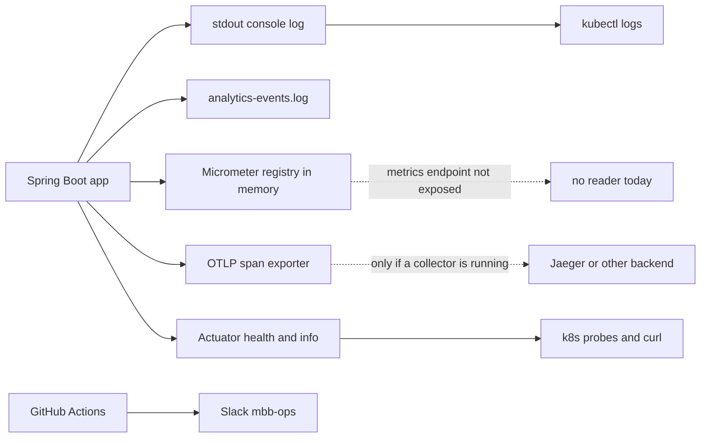

# Monitoring

Mockingbird Bank produces five kinds of runtime signal: health and build info over Actuator, a console log, a separate analytics event log, in-memory Micrometer metrics, and OpenTelemetry traces. CI and the image pipeline add a sixth, Slack alerts in `#mbb-ops`. Only health, info and the logs are readable out of the box; metrics and traces need a small change or an external collector first.

The code behind these signals is described in [Observability](../systems/observability.md), [Analytics](../systems/analytics.md) and [Resilience](../systems/resilience.md). This section is about reading them.

## Signal map

| Signal | Where it lives | How to access | Caveats |
| --- | --- | --- | --- |
| Health | `/actuator/health` (public) | `curl http://<host>/actuator/health` | Returns only `{"status":"UP"}` or `DOWN`. `management.endpoint.health.show-details` is not set, so the `db` component and its error are not shown. |
| Liveness and readiness | `/actuator/health/liveness`, `/actuator/health/readiness` | Used by k3d probes in `k8s/local/app.yaml` | `k8s/local/kustomization.yaml` sets `MANAGEMENT_ENDPOINT_HEALTH_PROBES_ENABLED=true`. The LAB manifest `k8s/03-app.yaml` only has a readiness probe on `/actuator/health`. |
| Build version | `/actuator/info` (public), startup log line, top bar | `curl http://<host>/actuator/info` | Limited to build and git basics. See [Build version](../features/build-version.md). |
| Application log | stdout (Logback `CONSOLE` appender) | `kubectl logs`, terminal for `bootRun` | Every line carries `[correlationId,traceId,spanId]`. No file appender for it. See [Logging](logging.md). |
| Analytics events | `build/logs/analytics-events.log` relative to the working directory, also copied to stdout | `grep` the file, or grep `kubectl logs` for `event=` | In the image the working directory is `/app` (`Dockerfile`), and nothing mounts a volume there, so the file is lost with the pod. |
| Product and breaker metrics | In-memory Micrometer registry | Not reachable today | `metrics` is not in `management.endpoints.web.exposure.include`. See [Metrics](metrics.md). |
| Traces | OTLP exporter, default `http://localhost:4318/v1/traces` | Jaeger or another collector | Nothing listens on that address in either cluster. Sampling is `0.0` in k3d. See [Tracing](tracing.md). |
| Feature flags | `/actuator/featureflags` | Authenticated session | Read-only. See [Feature flags](../features/feature-flags.md). |
| JFR profiling | `/actuator/profiling` | Authenticated session, `GET`/`POST`/`DELETE` | Writes `.jfr` files to the pod's filesystem. See [Observability](../systems/observability.md#profiling-with-jfr). |
| CI and image smoke test failures | Slack `#mbb-ops` | Slack | `master` pushes only, and only if `SLACK_ALERTS_WEBHOOK_URL` is set. See [Alerting](alerting.md). |
| Deployments | GitHub Deployments, environment `production` | `gh api repos/<owner>/<repo>/deployments` | Records the CI smoke test of each published image, not the LAB rollout. |
| DAST findings | `zap-baseline-report` workflow artifact | Actions run page | Never fails the build and never alerts. |

Both `/actuator/health/**` and `/actuator/info` are `permitAll` in `src/main/java/com/mockingbirdbank/security/SecurityConfig.java`. The featureflags and profiling endpoints need a signed-in session; there is no API token, so in practice that means a browser signed in through the Vaadin login view. The [API](../api.md) page lists every endpoint.

## Signal flow



Analytics events go to both the file and the console because the `com.mockingbirdbank.analytics.events` logger has `additivity="true"` in `src/main/resources/logback-spring.xml`.

## Is it healthy?

These commands come from `docs/runbooks/README.md`, with the k3d equivalents added. LAB runs in namespace `mockingbird-bank` behind the MetalLB address in `k8s/03-app.yaml`; k3d runs in `mockingbird-bank-dev` on context `k3d-dev-k8s` (see [Local k3d](../deployment/local-k3d.md) and [LAB cluster](../deployment/lab-cluster.md)).

```bash
# LAB
kubectl -n mockingbird-bank get pods                              # Running, READY 1/1, restarts not climbing
kubectl -n mockingbird-bank describe pod -l app=mockingbird-app   # probe failures, OOMKilled, events
kubectl -n mockingbird-bank logs deploy/mockingbird-app --tail=200
curl -s http://<service-ip>/actuator/health | jq                  # {"status":"UP"}
curl -s http://<service-ip>/actuator/info | jq                    # the build you expect?

# k3d
./scripts/k3d-deploy.sh status
curl -s http://mockingbird.localhost:81/actuator/health
curl -s http://mockingbird.localhost:81/actuator/info
```

Checklist:

1. The pod is `Running` and `READY 1/1`, and the restart count is not rising.
2. `/actuator/health` returns `{"status":"UP"}`. The readiness probe hits the full health endpoint, which includes the database check, so a `DOWN` here usually means Postgres. Follow `docs/runbooks/database-down.md`.
3. `/actuator/info` reports the version and commit you meant to deploy.
4. The log contains `Mockingbird Bank <version> started (...)` and no `APPLICATION FAILED TO START`.
5. Recent log lines with `outcome=error` are few and have the reasons you expect. See the grep recipes in [Logging](logging.md#grep-recipes).

## Pages in this section

| Page | Covers |
| --- | --- |
| [Logging](logging.md) | Log pattern, scrubbing, the analytics event file, kubectl recipes |
| [Metrics](metrics.md) | `product.events`, breaker meters, JVM/HTTP meters, and how to expose them |
| [Tracing](tracing.md) | OpenTelemetry export, sampling, local Jaeger, trace and correlation IDs |
| [Alerting](alerting.md) | Slack alerts, what is not alerted, mapping to runbooks |

The runbooks themselves live in `docs/runbooks/`.
