# Lore

Mockingbird Bank went from an empty repository to a scaffolded app, a LAB Kubernetes deployment and a full CI, security and observability toolchain in under 41 hours (2026-09-26 21:21 to 2026-09-28 13:27, US Eastern). After that came a quiet month and a run of tracked feature PRs in November, the largest of them account programs on 2026-11-13. All dates below come from `git log` on `master`; numbers are in [by the numbers](by-the-numbers.md).

```mermaid
graph LR
    A["Sep 26: scaffold"] --> B["Sep 27: hardening day"]
    B --> C["Sep 28: tooling sprint"]
    C --> D["Oct 1: dark mode"]
    D --> E["Oct 22: auth tests"]
    E --> F["Nov 3: SED-649 reveal"]
    F --> G["Nov 4: SED-727 version and k3d"]
    G --> H["Nov 4: wiki refresh CI"]
    H --> I["Nov 4: checkout v6 bump"]
    I --> J["Nov 4: first wiki PR"]
    J --> K["Nov 4: skip wiki-only pushes"]
    K --> L["Nov 4: second wiki PR"]
    L --> M["Nov 5: Droid functional QA"]
    M --> N["Nov 7: README titles, PR rules"]
    N --> O["Nov 7: rolling wiki PR"]
    O --> P["Nov 7: review on every push"]
    P --> Q["Nov 7: SED-791 account count"]
    Q --> R["Nov 13: SED-847 account programs"]
```

## Era 1: the scaffold (2026-09-26)

One commit, `57f6ca0` "Initial scaffold: Vaadin + Spring Boot read-only account dashboard", added 29 files and 1,004 lines on the evening of Saturday 2026-09-26. It already had most of what a user sees today:

- The four entities (`Account`, `AccountHolder`, `Transaction`, `AccountType`) and three repositories.
- `AccountService`, `TransactionService`, `DashboardView`, `AccountDetailView`, `AccountCard`, `MainLayout` and the inline-SVG `BirdMark`.
- `DataInitializer` with the seeded demo data, including the "Direct Deposit - Bespin Engineering" transactions.
- An in-cluster Postgres for Kubernetes (`k8s/01-postgres-secret.yaml`, `k8s/02-postgres.yaml`) and a 53-line `build.gradle`.

There was no login, no tests, and the schema came from Hibernate's `ddl-auto: update`.

## Era 2: the hardening day (2026-09-27)

Sunday 2026-09-27 has 24 of the repository's 52 commits, from 10:11 to 22:05. In rough order:

**Container scripts, morning.** `44ea180` (10:11) added `scripts/create-postgres-container.zsh`, and `098c960` deleted it six minutes later as "removed uneeded script". The root-level `createLocalDockerImage.zsh`, `createDockerHubImage.zsh` and `runDockerImage.zsh` arrived at 10:22 (`1f167d7`). `ef23e06` (10:58) fixed a port mismatch in `runDockerImage.zsh` (8090 vs the app's 8080), added `.dockerignore` and `.env.example`, and moved the datasource settings to explicit env-var overrides.

**Tests, login and schema, late morning.** `13d5c67` (11:17) added the first unit tests and the boot smoke test. `60f9881` (11:48) added Spring Security form login. `b64da02` (12:11) replaced `ddl-auto: update` with Flyway. Its message says `V1__init_schema.sql` mirrors what Hibernate had been generating, and that `baseline-on-migrate` exists for databases created before that day. Thirty seconds later `ce54a61` moved the checked-in k8s Postgres secret to a gitignored `.example` template. `66878eb` (12:32) committed the Gradle wrapper (9.5.1) and dropped the Dockerfile's `gradle:8.14-jdk21` base image.

**The LAB deployment, afternoon and evening.** `bee950d` (15:37) added Harness Test Intelligence hooks to `build.gradle`. `278a4eb` (16:16) pointed the manifests at an external LAB Postgres and deleted the in-cluster StatefulSet and its secret template. `b3f9fd0` (18:09) added `k8s/values.yaml` after finding that Harness only resolves `<+...>` expressions in a values file. `b809e47` (19:14) moved the app to a dedicated `mockingbirdbank` database: the first target already contained unrelated tables, so `baseline-on-migrate` marked V1 as applied and the app's own tables were never created. `scripts/bootstrap-lab-db.sql` dates from this commit. `47b5026` (19:24) switched the Service from ClusterIP to LoadBalancer, and `39aca95` (19:39) pinned the MetalLB IP. See [LAB cluster](deployment/lab-cluster.md).

**Quality and security, night.** In one hour, starting at 21:06:

| Time | Commit | Change |
|---|---|---|
| 21:06 | `0eb91ef` | Spotless, Checkstyle, PMD, CPD, the N+1 query guard, the first `AGENTS.md` |
| 21:10 | `3cc3a4a` | Per-test timing report |
| 21:25 | `9d42417` | Test retry and flaky-test report |
| 21:30 | `b144ea8` | JaCoCo coverage thresholds |
| 21:41 | `a3627de` | Playwright interactive QA suite in `qa/` |
| 21:57 | `00b53d6` | CI, CodeQL, gitleaks, ZAP DAST, Dependabot, CODEOWNERS, log scrubbing |
| 22:02 | `0d6ece3` | Allow-list a fake token that gitleaks flagged |
| 22:05 | `1282c95` | Turn off ZAP issue filing in the DAST workflow |

`00b53d6` is also when `DataInitializer` stopped logging the seeded demo password in plain text.

## Era 3: the tooling sprint (2026-09-28)

Monday morning opened with the repository's only Dependabot commit (`77317b7`, 07:57, Playwright 1.49.1 to 1.63.0). Then came a series of large batch commits, each named after a category of tooling:

- `1215ae5` (08:30): `docker-compose.yml` and the dev container. The commit message lists three bugs found while running it for real, including a Yarn apt source signed with a rotated key.
- `a8e08e8` (09:19): CI split into "Fast checks" and "Build and test", Dependency Analysis `buildHealth`, build-performance summaries, Droid review workflows, GHCR publishing, release-drafter, tag releases and the [feature flags](features/feature-flags.md).
- `1ab9d0f` (09:31): wired `jacocoTestReport` into `check`, after a CI annotation showed the HTML report had never been generated.
- `d263f9d` (09:56): issue and PR templates, labels, the stale-bot and `AnalyticsEventService`.
- `25c37cd` (13:18): circuit breakers, OpenTelemetry tracing, correlation IDs, the profiling endpoint, Slack alerting and the runbooks. At 1,181 added lines it was the largest code commit until PR #17 in November.
- `e1eaad1` (13:23) and `979d4da` (13:27): a second gitleaks false positive, and a 409 from the GitHub Deployments API that the first one had caused.

## Era 4: feature work (October and November 2026)

| Date | Commit | Change |
|---|---|---|
| 2026-10-01 | `1b43df4` | Dark mode toggle in `MainLayout`, semantic `--mb-*` CSS variables. The message quotes a request from the `#mbb-feedback` channel. |
| 2026-10-22 | `48ceede` | Unit tests for `AppUserDetailsService.loadUserByUsername` |
| 2026-11-03 | `09f771a` | SED-649: eye toggles to reveal full account numbers ([account number reveal](features/account-number-reveal.md)) |
| 2026-11-04 | `736990a` | SED-727: build version in `/actuator/info`, the startup log and the top bar ([build version](features/build-version.md)) |
| 2026-11-04 | `5fbf51f` | Local k3d deployment with its own in-cluster Postgres ([local k3d](deployment/local-k3d.md)) |
| 2026-11-04 | `3b03ecd` | `.github/workflows/droid-wiki-refresh.yml`, which regenerates this wiki on every push to `master` and proposes the pages as a PR ([tooling](how-to-contribute/tooling.md#wiki-refresh)) |
| 2026-11-04 | `2b3e914` | Both checkout steps in the wiki refresh moved from `actions/checkout@v4` to `@v6`, after the first run generated the wiki but could not push the rolling branch. It did not fix the push: the real cause was an invalid `FACTORY_WIKI_PR_TOKEN` secret, and replacing it did ([pitfalls](background/pitfalls.md#a-bad-factory_wiki_pr_token-looks-like-a-missing-credential)) |
| 2026-11-04 | `33ecb9c` | The first "docs: refresh wiki" PR (#6), which committed `droid-wiki/` to `master`. Before merge it picked up a round of review fixes to five pages, among them the CSRF exemption for `/login` and Dependabot's security-update cooldown bypass |
| 2026-11-04 | `f97b7a4` | PR #8 added `paths-ignore: droid-wiki/**` to the wiki refresh trigger. Merging #6 had started a run that only recounted the merged pages and opened yet another wiki PR ([tooling](how-to-contribute/tooling.md#wiki-refresh)) |
| 2026-11-04 | `7474d45` | The second "docs: refresh wiki" PR (#7), an incremental refresh that rewrote seven pages for PR #8 |
| 2026-11-05 | `36ef6ef` | Droid functional QA: the `qa` and `qa-web` skills under `.factory/skills/`, the `droid-control` plugin in `.factory/settings.json`, and `.github/workflows/qa.yml`, which boots each PR branch and keeps a sticky "QA Report" comment. Generated with the `install-qa` questionnaire, whose answers sit in `.factory/skills/qa/.install-progress.yaml` ([functional QA](how-to-contribute/functional-qa.md)) |
| 2026-11-07 | `db8ce7c`, `fcb7009`, `9327d84` | PRs #10 to #12 retitled `README.md` three times in under an hour: "Mockingbird Bank Retail Website", back to "Mockingbird Bank", then "Mockingbird Bank - Retail" |
| 2026-11-07 | `e6df51c` | PR #13 added a "Pull requests" section to `AGENTS.md`: enable auto-merge on non-feature PRs right away, and on Linear-tracked feature PRs only after an `approved` label and a version-only bump ([auto-merge](how-to-contribute/index.md#auto-merge)) |
| 2026-11-07 | `e3e97cb` | PR #14 made the wiki PR a rolling one that stays open and is never merged. The PR body changed from "Review and merge" to "Do not merge it", and `AGENTS.md` excludes it from auto-merge. `droid-wiki/` on `master` has stayed at the #7 copy since ([the rolling wiki PR](how-to-contribute/tooling.md#the-rolling-wiki-pr)) |
| 2026-11-07 | `cf064b0` | PR #15 made `.github/workflows/droid-review.yml` run on every push to a PR (`synchronize`), because `droid-review` had become a required check and a PR whose head moved could never get a passing result. The same commit rewrote `AGENTS.md` to describe the `Protect Master` ruleset: a PR and five status checks required, the branch up to date with `master`, and no bypass actors. It also stopped calling the QA check informational ([review and merge gates](how-to-contribute/index.md#review-and-merge-gates)) |
| 2026-11-07 | `3e172bf` | PR #16, SED-791: the fifth feature flag, `showAccountCount` (default off), which adds a "You have N accounts" line to the dashboard, plus `DashboardViewTest`, the first unit test for a Vaadin view. It was the first Linear-tracked feature PR to land under the #13 rule: its last commit, "Bump baseVersion to 0.2.0", is the version-only bump, and it edited the affected `droid-wiki/` pages on `master` directly ([dashboard](features/dashboard.md), [feature flags](features/feature-flags.md)) |

The November commits are the first to arrive as numbered PRs: #1 to #8 on 2026-11-03 and 2026-11-04, #10 to #16 on 2026-11-07, then #17 on 2026-11-13. No #9 reached `master`. #7, a wiki PR, landed 17 minutes after #8; it was most likely the extra PR opened by the run that merging #6 started, then refreshed again after #8 and the first to carry Linear `SED-` keys. `36ef6ef` has no PR number, so it was pushed to `master` directly, which the branch protection of the time allowed for admins. The `Protect Master` ruleset that `AGENTS.md` describes since `cf064b0` has no bypass actors, so that route is now closed. Dependabot's commit from September is also labelled "(#1)". GitHub numbers issues and PRs in one sequence per repository, so the two "#1"s probably come from different repositories, for example an earlier copy of this one. That is a guess; the git history does not say.

## Era 5: account programs (2026-11-13)

`78a2f03` (PR #17, SED-847, Friday 2026-11-13) is the largest code change since the September sprint: 79 files, 2,651 added lines, 2,114 of them outside `droid-wiki/`. It is one squash commit of 31, most of them review rounds that tightened the error handling and the QA steps. It added:

- The second Flyway migration, `src/main/resources/db/migration/V2__account_programs.sql`, the first schema change since `b64da02` replaced `ddl-auto: update` on 2026-09-27. It adds `program_participation`, a per-account program link with a composite foreign key that keeps an account out of another customer's program, `account.currency` and a nullable `account_holder.date_of_birth`.
- `ProgramService` with the Regular and Youth Savings rules, evaluated read-only on every page view, and `BusinessClockConfig`, whose `Clock` puts "today" in America/New_York so ages do not depend on the server's time zone.
- `ProgramCard` and `ProgramLookup` on the dashboard and account pages, behind the sixth feature flag, `showAccountPrograms` (default off). `ProgramLookup` turns a failed program read into an "unavailable" message and a `programs.unavailable` event instead of a broken page.
- A second seeded login, `riley.chen`, a customer who is 15 on the day the database is seeded, with one savings account in a Youth Savings program. Jordan Ellis got a date of birth and a Regular program.
- Owner-only account pages: `AccountService.requireAccount` now treats another customer's account ID as not found.

Like PR #16, its last commit is the version-only bump ("Bump baseVersion to 0.3.0"), so the app now builds as `0.3.0-<sha>`. See [account programs](features/account-programs.md).
## Longest-standing pieces

These date from the scaffold on 2026-09-26 and are still in place:

- The data model and its three original repositories (`src/main/java/com/mockingbirdbank/model/`). PR #17 extended `Account` and `AccountHolder` and added two model classes next to them, but replaced none.
- `src/main/java/com/mockingbirdbank/ui/layout/BirdMark.java`, changed only once since (a Spotless reformat in `0eb91ef`).
- The dashboard and account detail views, although `DashboardView.java` (9 commits) and `AccountDetailView.java` (7) are among the most-changed files.
- The first seeded demo holder, Jordan Ellis, and the Bespin Engineering direct deposits in `DataInitializer`. Jordan was the only holder until `riley.chen` joined on 2026-11-13.

## Replaced and removed

| What | Replaced by | When | Commit |
|---|---|---|---|
| `scripts/create-postgres-container.zsh` | Nothing at first; `docker-compose.yml` arrived the next day | 2026-09-27, six minutes after it was added | `098c960` |
| Hibernate `ddl-auto: update` | Flyway migrations, Hibernate set to `validate` | 2026-09-27 | `b64da02` |
| Checked-in `k8s/01-postgres-secret.yaml` | A gitignored `.example` template | 2026-09-27 | `ce54a61` |
| Gradle from the build image (`gradle:8.14-jdk21`) | The committed Gradle 9.5.1 wrapper | 2026-09-27 | `66878eb` |
| In-cluster Postgres StatefulSet for k8s | The external LAB Postgres | 2026-09-27 | `278a4eb` |
| The `metamanagement` LAB database | A dedicated `mockingbirdbank` database | 2026-09-27 | `b809e47` |
| ClusterIP Service for the LAB deploy | LoadBalancer with a pinned MetalLB IP | 2026-09-27 | `47b5026`, `39aca95` |
| Logging the demo password at seed time | A log line pointing at `AGENTS.md` | 2026-09-27 | `00b53d6` |
| One CI job ("Build, test, and static analysis") | Two parallel jobs | 2026-09-28 | `a8e08e8` |
| `AccountService.requireAccount` returning any account ID | An owner-only lookup that treats another customer's account as not found | 2026-11-13 | `78a2f03` |

Two details are easy to misread:

- The in-cluster Postgres came back on 2026-11-04 (`5fbf51f`), but only for the local k3d flow in `k8s/local/`. The LAB manifests in `k8s/` still use the external database, and the local Service is ClusterIP behind a Traefik Ingress.
- `VaadinWebSecurity` was never used in this repository. `SecurityConfig` was written with `VaadinSecurityConfigurer` from its first commit (`60f9881`). The only trace of the older class is a Javadoc comment explaining that Vaadin 25 removed it.
