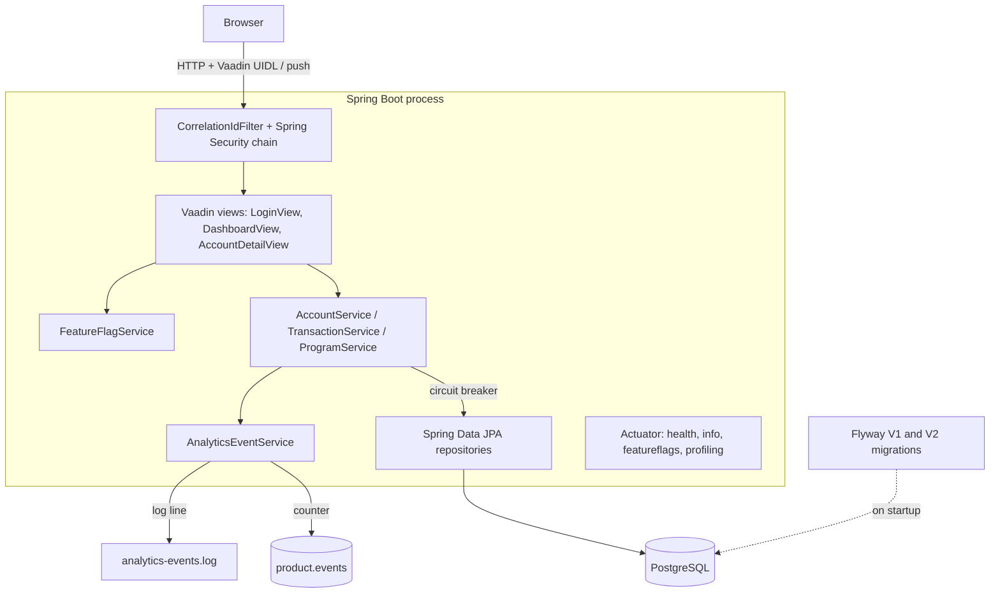
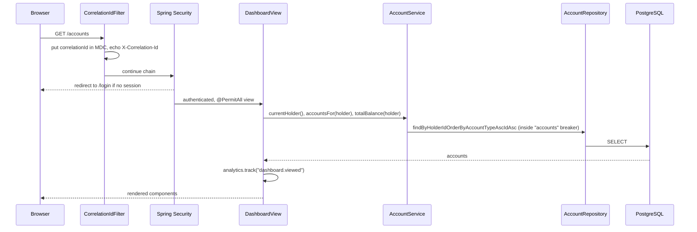
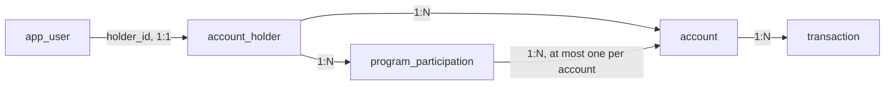
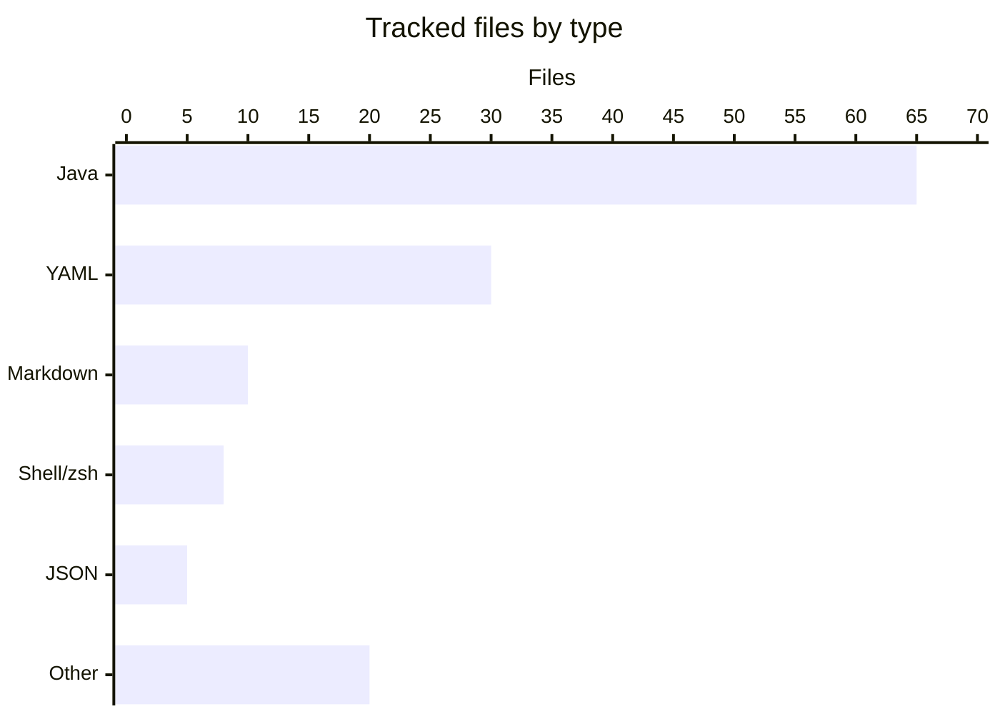

# Architecture

Mockingbird Bank is one Spring Boot process. It renders a Vaadin UI on the server, calls three application services in-process, and reads from a single PostgreSQL database through Spring Data JPA. There are no other backing services, queues, or caches.

## Components

| Layer | Package | Responsibility |
| --- | --- | --- |
| UI | `com.mockingbirdbank.ui` | Vaadin routes and components. Views call services directly; there is no REST API between UI and backend. See [UI](../systems/ui.md). |
| Security | `com.mockingbirdbank.security` | Form login, BCrypt passwords, route access rules. See [Security](../security.md). |
| Services | `com.mockingbirdbank.service` | The only business logic: resolve the signed-in holder, list accounts, sum balances, load one owned account, reveal numbers with an ownership check, and evaluate account programs against their rules. See [Services](../systems/services.md). |
| Persistence | `com.mockingbirdbank.model`, `com.mockingbirdbank.repository` | JPA entities and repositories over the Flyway schema. See [Persistence](../systems/persistence.md). |
| Resilience | `com.mockingbirdbank.resilience` | One shared circuit breaker config; each service owns a named breaker. See [Resilience](../systems/resilience.md). |
| Analytics | `com.mockingbirdbank.analytics` | Product events and user-facing errors as a Micrometer counter plus a dedicated log file. See [Analytics](../systems/analytics.md). |
| Observability | `com.mockingbirdbank.observability` | Correlation IDs, JFR profiling endpoint, build version. See [Observability](../systems/observability.md). |
| Config | `com.mockingbirdbank.config` | Feature flags, demo data seeding, the business clock, log scrubbing. See [Feature flags](../features/feature-flags.md). |

## Request lifecycle

A page view goes through the servlet filter chain, Vaadin routing and access control, then a view constructor that calls services.

`AccountService.currentHolder()` in `src/main/java/com/mockingbirdbank/service/AccountService.java` reads the username from `SecurityContextHolder` and looks up the matching `AppUser`, whose `holder` is the `AccountHolder` whose accounts are shown. Every repository call in the three services runs through `protectedCall`, which wraps it in a Resilience4j breaker and converts an open breaker into `ServiceUnavailableException`.

## Data model

Five tables. `src/main/resources/db/migration/V1__init_schema.sql` creates the first four, and `src/main/resources/db/migration/V2__account_programs.sql` adds `program_participation` plus new columns on `account_holder` and `account`. Hibernate runs with `ddl-auto: validate`, so it only checks the mappings.

Login credentials (`app_user`) are kept apart from holder PII (`account_holder`). Details in [Data models](../reference/data-models.md).

## Deployment shapes

The same jar runs in four places:

| Where | How | Database |
| --- | --- | --- |
| Laptop | `./gradlew bootRun` or `./scripts/dev-up.sh` | `docker compose` Postgres on 5432 |
| Dev container | `.devcontainer/` | Compose Postgres service `postgres:5432` |
| Local Kubernetes | `./scripts/k3d-deploy.sh` into k3d context `k3d-dev-k8s` | In-cluster `postgres:16-alpine` StatefulSet |
| LAB cluster | Harness-templated `k8s/*.yaml`, MetalLB LoadBalancer | External LAB Postgres |

The app keeps Vaadin UI state in server memory, so every deployment runs a single replica. Scaling out would need sticky sessions. See [Deployment](../deployment/index.md).

## Codebase shape

By file count the repository is mostly configuration and automation around a small application:

Java splits into 42 main source files and 23 test files. See [By the numbers](../by-the-numbers.md) for line counts.

## Design choices worth knowing

- **No REST layer.** Vaadin Flow views call Spring beans directly. The only HTTP API is Actuator (see [API](../api.md)).
- **Flyway owns the schema.** It replaced `ddl-auto=update` with `baseline-on-migrate: true` so older databases keep working.
- **Failures are signals.** Login failures, 404'd accounts, denied reveals and unhandled UI exceptions all go through `AnalyticsEventService`.
- **Logs are scrubbed centrally.** `logback-spring.xml` routes every message through `ScrubbingMessageConverter`.

The reasoning behind these is in [Design decisions](../background/design-decisions.md).
