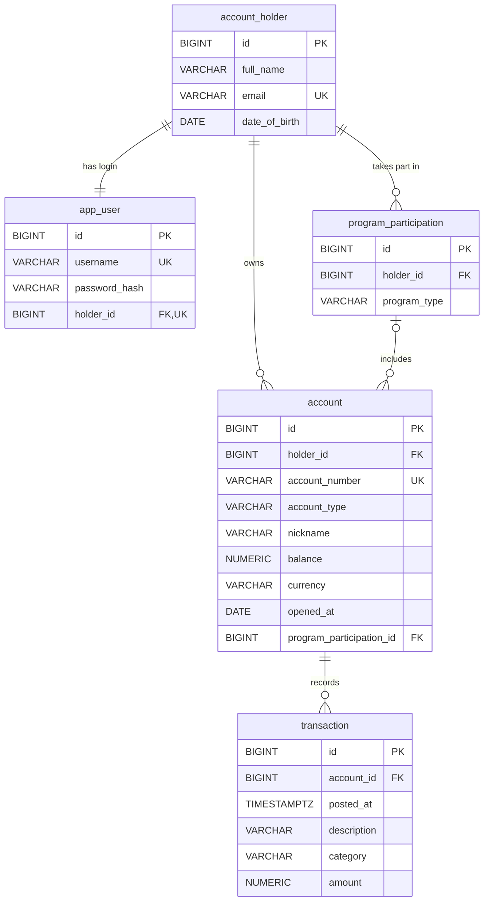

# Data models

Column-level reference for the five tables created by `src/main/resources/db/migration/V1__init_schema.sql` and `src/main/resources/db/migration/V2__account_programs.sql`, and the JPA entities in `src/main/java/com/mockingbirdbank/model/` that map onto them. For how the persistence layer behaves (Flyway ownership, `ddl-auto: validate`, the N+1 guard, repositories) see [Persistence](../systems/persistence.md).

## Entity relationships

All primary keys are `BIGINT GENERATED BY DEFAULT AS IDENTITY`, mapped as `Long id` with `@GeneratedValue(strategy = GenerationType.IDENTITY)`. Column names follow Spring's default snake_case naming of the Java field names. Every entity uses Lombok `@Getter`, `@Setter` and `@NoArgsConstructor`.

## account_holder

Entity `AccountHolder` in `src/main/java/com/mockingbirdbank/model/AccountHolder.java`. Personal data for the person who owns accounts.

| Column | SQL type | Constraints | Entity field | Java type | Notes |
| --- | --- | --- | --- | --- | --- |
| `id` | `BIGINT` identity | PK | `id` | `Long` | |
| `full_name` | `VARCHAR(255)` | `NOT NULL` | `fullName` | `String` | Shown as "Welcome back, ..." in the top bar |
| `email` | `VARCHAR(255)` | `NOT NULL UNIQUE` | `email` | `String` | |
| `date_of_birth` | `DATE` | nullable (added in V2) | `dateOfBirth` | `LocalDate` | `null` when unknown, as for every holder created before V2. The Youth Savings age rule treats `null` as not met. Set through the three-argument constructor `AccountHolder(fullName, email, dateOfBirth)` |
| (none) | | | `accounts` | `List<Account>` | `@OneToMany(mappedBy = "holder", cascade = ALL, orphanRemoval = true)`, lazy |

## app_user

Entity `AppUser` in `src/main/java/com/mockingbirdbank/model/AppUser.java`. Login credentials, kept in a separate table from `account_holder` so authentication data and personal data don't mix.

| Column | SQL type | Constraints | Entity field | Java type | Notes |
| --- | --- | --- | --- | --- | --- |
| `id` | `BIGINT` identity | PK | `id` | `Long` | |
| `username` | `VARCHAR(255)` | `NOT NULL UNIQUE` | `username` | `String` | Looked up by `AppUserRepository.findByUsername` |
| `password_hash` | `VARCHAR(255)` | `NOT NULL` | `passwordHash` | `String` | BCrypt hash; the raw password is never stored |
| `holder_id` | `BIGINT` | `NOT NULL UNIQUE`, FK to `account_holder(id)` | `holder` | `AccountHolder` | `@OneToOne(optional = false)`, eager. The unique constraint makes it one login per holder |

## account

Entity `Account` in `src/main/java/com/mockingbirdbank/model/Account.java`.

| Column | SQL type | Constraints | Entity field | Java type | Notes |
| --- | --- | --- | --- | --- | --- |
| `id` | `BIGINT` identity | PK | `id` | `Long` | Appears in the URL `/accounts/{id}` |
| `holder_id` | `BIGINT` | `NOT NULL`, FK to `account_holder(id)` | `holder` | `AccountHolder` | `@ManyToOne(optional = false)`, eager |
| `account_number` | `VARCHAR(255)` | `NOT NULL UNIQUE` | `accountNumber` | `String` | Full number stored in plain text; masked in the UI, revealed on request |
| `account_type` | `VARCHAR(255)` | `NOT NULL` | `accountType` | `AccountType` | `@Enumerated(EnumType.STRING)`; no database check constraint |
| `nickname` | `VARCHAR(255)` | nullable | `nickname` | `String` | Display name such as "Vacation Savings" |
| `balance` | `NUMERIC(14, 2)` | `NOT NULL` | `balance` | `BigDecimal` | Stored value, not computed from transactions |
| `currency` | `VARCHAR(3)` | `NOT NULL DEFAULT 'USD'`, check `account_currency_iso_code` (`^[A-Z]{3}$`), added in V2 | `currency` | `String` | ISO 4217 code of the balance; Java default `Account.USD`. Existing rows became `USD` |
| `opened_at` | `DATE` | `NOT NULL` | `openedAt` | `LocalDate` | |
| `program_participation_id` | `BIGINT` | nullable, indexed, added in V2. Composite FK `(program_participation_id, holder_id)` to `program_participation (id, holder_id)` (`account_program_participation_same_holder`) | `programParticipation` | `ProgramParticipation` | `@ManyToOne(fetch = LAZY)`. `null` means no program. One column, so an account is in at most one program. The composite key makes the database reject a link to another customer's participation |
| (none) | | | `transactions` | `List<Transaction>` | `@OneToMany(mappedBy = "account", cascade = ALL, orphanRemoval = true)`, lazy, `@BatchSize(size = 20)` |

## program_participation

Entity `ProgramParticipation` in `src/main/java/com/mockingbirdbank/model/ProgramParticipation.java`. Created by `V2__account_programs.sql`. One customer's participation in one program. Whether it meets the program's rules is never stored; `ProgramService` evaluates it each time (see [Account programs](../features/account-programs.md)).

| Column | SQL type | Constraints | Entity field | Java type | Notes |
| --- | --- | --- | --- | --- | --- |
| `id` | `BIGINT` identity | PK | `id` | `Long` | |
| `holder_id` | `BIGINT` | `NOT NULL`, FK to `account_holder(id)`, indexed | `holder` | `AccountHolder` | `@ManyToOne(optional = false)`, eager |
| `program_type` | `VARCHAR(255)` | `NOT NULL`, check `program_participation_known_type`: `REGULAR` or `YOUTH_SAVINGS` | `programType` | `ProgramType` | `@Enumerated(EnumType.STRING)` |
| (none) | | `UNIQUE (id, holder_id)` (`program_participation_id_holder_key`) | | | Target of the composite foreign key from `account` |
| (none) | | | `accounts` | `List<Account>` | `@OneToMany(mappedBy = "programParticipation")`, lazy, `@OrderBy("accountType ASC, id ASC")`, `@BatchSize(size = 20)` |
## transaction

Entity `Transaction` in `src/main/java/com/mockingbirdbank/model/Transaction.java`.

| Column | SQL type | Constraints | Entity field | Java type | Notes |
| --- | --- | --- | --- | --- | --- |
| `id` | `BIGINT` identity | PK | `id` | `Long` | |
| `account_id` | `BIGINT` | `NOT NULL`, FK to `account(id)` | `account` | `Account` | `@ManyToOne(optional = false)`, eager |
| `posted_at` | `TIMESTAMP WITH TIME ZONE` | `NOT NULL` | `postedAt` | `OffsetDateTime` | Sort key for the account detail grid (newest first) |
| `description` | `VARCHAR(255)` | `NOT NULL` | `description` | `String` | |
| `category` | `VARCHAR(255)` | nullable | `category` | `String` | Free text, not an enum |
| `amount` | `NUMERIC(14, 2)` | `NOT NULL` | `amount` | `BigDecimal` | Signed: negative is a debit, positive is a credit |

## Enum values

`AccountType` in `src/main/java/com/mockingbirdbank/model/AccountType.java`, stored by name in `account.account_type`:

| Value | Used for |
| --- | --- |
| `CHECKING` | Checking accounts |
| `SAVINGS` | Savings accounts |

Because the column holds the string, `AccountRepository.findByHolderIdOrderByAccountTypeAscIdAsc` sorts `CHECKING` before `SAVINGS` alphabetically.

`ProgramType` in `src/main/java/com/mockingbirdbank/model/ProgramType.java`, stored by name in `program_participation.program_type` and limited to these values by a check constraint:

| Value | Display name | Rules |
| --- | --- | --- |
| `REGULAR` | Regular | Exactly one checking and one savings account; the savings balance is USD and over $100.00 |
| `YOUTH_SAVINGS` | Youth Savings | Exactly one savings account, no checking; the customer is under 18 |

## Constraints and indexes

| Kind | Where |
| --- | --- |
| Primary keys | `id` on all five tables |
| Unique | `account_holder.email`, `app_user.username`, `app_user.holder_id`, `account.account_number`, `program_participation (id, holder_id)` |
| Check | `account.currency` matches `^[A-Z]{3}$`; `program_participation.program_type` is `REGULAR` or `YOUTH_SAVINGS` |
| Foreign keys | `app_user.holder_id`, `account.holder_id` to `account_holder.id`; `transaction.account_id` to `account.id`; `program_participation.holder_id` to `account_holder.id`; `account (program_participation_id, holder_id)` to `program_participation (id, holder_id)`, which is only checked when `program_participation_id` is not null. No `ON DELETE` action, so the database rejects deleting a parent that still has children |
| Indexes | Those PostgreSQL creates for primary keys and unique constraints, plus `program_participation_holder_idx` on `program_participation.holder_id` and `account_program_participation_idx` on `account.program_participation_id` (both from V2). `account.holder_id` and `transaction.account_id` have no index of their own |

Deletes cascade only at the JPA level (`CascadeType.ALL` with `orphanRemoval` on `AccountHolder.accounts` and `Account.transactions`). `AppUser` has no cascade, so deleting a holder through JPA would hit the `app_user.holder_id` foreign key. The app is read-only and never deletes anything today.

## Derived and display methods

These are computed in Java and have no column.

| Method | File | Returns |
| --- | --- | --- |
| `Account.getMaskedNumber()` | `src/main/java/com/mockingbirdbank/model/Account.java` | `"•••• "` plus the last four digits, or `"••••"` if the number is null or shorter than four characters |
| `Account.getDisplayName()` | `src/main/java/com/mockingbirdbank/model/Account.java` | The nickname if non-blank, otherwise the enum name (`CHECKING` or `SAVINGS`) |
| `Transaction.isCredit()` | `src/main/java/com/mockingbirdbank/model/Transaction.java` | `true` when `amount` is positive |

## Seed data

`src/main/java/com/mockingbirdbank/config/DataInitializer.java` inserts this on startup when `account_holder` is empty. [Persistence](../systems/persistence.md#seeding) covers when it runs. Jordan Ellis is seeded first, so Jordan's accounts keep IDs 1 to 3 on a fresh database.

| Table | Rows | Content |
| --- | --- | --- |
| `account_holder` | 2 | Jordan Ellis, `jordan.ellis@example.com`, born 1988-04-23; Riley Chen, `riley.chen@example.com`, born 15 years before the seed date in America/New_York |
| `app_user` | 2 | `jordan.ellis` and `riley.chen`, each a BCrypt hash of `MOCKINGBIRD_DEV_PASSWORD` or the default `mockingbird` |
| `program_participation` | 2 | `REGULAR` for Jordan Ellis, `YOUTH_SAVINGS` for Riley Chen |
| `account` | 4 | See below. All are `USD` |
| `transaction` | 28 | The same 8 rows for each of Jordan's accounts, and 4 youth rows for Riley's |

| Holder | Nickname | Number | Type | Balance | Opened | Program |
| --- | --- | --- | --- | --- | --- | --- |
| Jordan Ellis | Everyday Checking | `1000000004821` | `CHECKING` | 4,318.52 | 2021-03-12 | Regular |
| Jordan Ellis | High-Yield Savings | `2000000007743` | `SAVINGS` | 18,200.00 | 2022-01-05 | Regular |
| Jordan Ellis | Vacation Savings | `2000000000092` | `SAVINGS` | 1,800.00 | 2023-06-20 | none |
| Riley Chen | Youth Savings | `2000000005317` | `SAVINGS` | 245.50 | 2024-09-03 | Youth Savings |

Vacation Savings is deliberately outside any program, because Regular takes exactly one savings account. Both seeded programs meet their rules.

Transactions per Jordan Ellis account, dated relative to startup time in UTC:

| Days ago | Description | Category | Amount |
| --- | --- | --- | --- |
| 0 | Trader Joe's | Groceries | -86.42 |
| 1 | Direct Deposit - Bespin Engineering | Income | 3,200.00 |
| 2 | Green Valley Utilities | Utilities | -142.10 |
| 4 | Transfer to Savings | Transfer | -500.00 |
| 6 | Blue Bottle Coffee | Dining | -6.75 |
| 9 | Rent - Meridian Apartments | Housing | -1,450.00 |
| 12 | Amazon | Shopping | -58.19 |
| 14 | Direct Deposit - Bespin Engineering | Income | 3,200.00 |

The eight amounts net to +4,156.54 per account, which does not match any seeded balance.

Transactions on Riley Chen's Youth Savings account:

| Days ago | Description | Category | Amount |
| --- | --- | --- | --- |
| 1 | Birthday gift | Income | 50.00 |
| 5 | Weekly allowance | Income | 20.00 |
| 8 | Corner Bookstore | Shopping | -12.99 |
| 12 | Weekly allowance | Income | 20.00 |
## flyway_schema_history

Flyway creates and owns a fifth table, `flyway_schema_history`, recording which migrations have run. No entity maps to it. On an empty database it gets one row each for `V1__init_schema.sql` and `V2__account_programs.sql`. On a non-empty schema without this table, `spring.flyway.baseline-on-migrate: true` writes a baseline row for version 1 instead and V1 never runs, which is how the first LAB database ended up without the app's tables (see [Pitfalls](../background/pitfalls.md)). New schema changes go in new `V3__...` files; never edit an applied migration.
