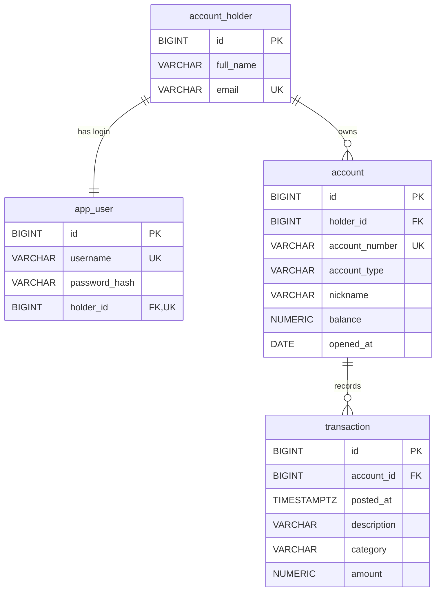

# Data models

Column-level reference for the four tables created by `src/main/resources/db/migration/V1__init_schema.sql` and the JPA entities in `src/main/java/com/mockingbirdbank/model/` that map onto them. For how the persistence layer behaves (Flyway ownership, `ddl-auto: validate`, the N+1 guard, repositories) see [Persistence](../systems/persistence.md).

## Entity relationships

All primary keys are `BIGINT GENERATED BY DEFAULT AS IDENTITY`, mapped as `Long id` with `@GeneratedValue(strategy = GenerationType.IDENTITY)`. Column names follow Spring's default snake_case naming of the Java field names. Every entity uses Lombok `@Getter`, `@Setter` and `@NoArgsConstructor`.

## account_holder

Entity `AccountHolder` in `src/main/java/com/mockingbirdbank/model/AccountHolder.java`. Personal data for the person who owns accounts.

| Column | SQL type | Constraints | Entity field | Java type | Notes |
| --- | --- | --- | --- | --- | --- |
| `id` | `BIGINT` identity | PK | `id` | `Long` | |
| `full_name` | `VARCHAR(255)` | `NOT NULL` | `fullName` | `String` | Shown as "Welcome back, ..." in the top bar |
| `email` | `VARCHAR(255)` | `NOT NULL UNIQUE` | `email` | `String` | |
| (none) | | | `accounts` | `List<Account>` | `@OneToMany(mappedBy = "holder", cascade = ALL, orphanRemoval = true)`, lazy |

## app_user

Entity `AppUser` in `src/main/java/com/mockingbirdbank/model/AppUser.java`. Login credentials, kept in a separate table from `account_holder` so authentication data and personal data don't mix.

| Column | SQL type | Constraints | Entity field | Java type | Notes |
| --- | --- | --- | --- | --- | --- |
| `id` | `BIGINT` identity | PK | `id` | `Long` | |
| `username` | `VARCHAR(255)` | `NOT NULL UNIQUE` | `username` | `String` | Looked up by `AppUserRepository.findByUsername` |
| `password_hash` | `VARCHAR(255)` | `NOT NULL` | `passwordHash` | `String` | BCrypt hash; the raw password is never stored |
| `holder_id` | `BIGINT` | `NOT NULL UNIQUE`, FK to `account_holder(id)` | `holder` | `AccountHolder` | `@OneToOne(optional = false)`, eager. The unique constraint makes it one login per holder |

## account

Entity `Account` in `src/main/java/com/mockingbirdbank/model/Account.java`.

| Column | SQL type | Constraints | Entity field | Java type | Notes |
| --- | --- | --- | --- | --- | --- |
| `id` | `BIGINT` identity | PK | `id` | `Long` | Appears in the URL `/accounts/{id}` |
| `holder_id` | `BIGINT` | `NOT NULL`, FK to `account_holder(id)` | `holder` | `AccountHolder` | `@ManyToOne(optional = false)`, eager |
| `account_number` | `VARCHAR(255)` | `NOT NULL UNIQUE` | `accountNumber` | `String` | Full number stored in plain text; masked in the UI, revealed on request |
| `account_type` | `VARCHAR(255)` | `NOT NULL` | `accountType` | `AccountType` | `@Enumerated(EnumType.STRING)`; no database check constraint |
| `nickname` | `VARCHAR(255)` | nullable | `nickname` | `String` | Display name such as "Vacation Savings" |
| `balance` | `NUMERIC(14, 2)` | `NOT NULL` | `balance` | `BigDecimal` | Stored value, not computed from transactions |
| `opened_at` | `DATE` | `NOT NULL` | `openedAt` | `LocalDate` | |
| (none) | | | `transactions` | `List<Transaction>` | `@OneToMany(mappedBy = "account", cascade = ALL, orphanRemoval = true)`, lazy, `@BatchSize(size = 20)` |

## transaction

Entity `Transaction` in `src/main/java/com/mockingbirdbank/model/Transaction.java`.

| Column | SQL type | Constraints | Entity field | Java type | Notes |
| --- | --- | --- | --- | --- | --- |
| `id` | `BIGINT` identity | PK | `id` | `Long` | |
| `account_id` | `BIGINT` | `NOT NULL`, FK to `account(id)` | `account` | `Account` | `@ManyToOne(optional = false)`, eager |
| `posted_at` | `TIMESTAMP WITH TIME ZONE` | `NOT NULL` | `postedAt` | `OffsetDateTime` | Sort key for the account detail grid (newest first) |
| `description` | `VARCHAR(255)` | `NOT NULL` | `description` | `String` | |
| `category` | `VARCHAR(255)` | nullable | `category` | `String` | Free text, not an enum |
| `amount` | `NUMERIC(14, 2)` | `NOT NULL` | `amount` | `BigDecimal` | Signed: negative is a debit, positive is a credit |

## Enum values

`AccountType` in `src/main/java/com/mockingbirdbank/model/AccountType.java`, stored by name in `account.account_type`:

| Value | Used for |
| --- | --- |
| `CHECKING` | Checking accounts |
| `SAVINGS` | Savings accounts |

Because the column holds the string, `AccountRepository.findByHolderIdOrderByAccountTypeAscIdAsc` sorts `CHECKING` before `SAVINGS` alphabetically.

## Constraints and indexes

| Kind | Where |
| --- | --- |
| Primary keys | `id` on all four tables |
| Unique | `account_holder.email`, `app_user.username`, `app_user.holder_id`, `account.account_number` |
| Foreign keys | `app_user.holder_id`, `account.holder_id` to `account_holder.id`; `transaction.account_id` to `account.id`. No `ON DELETE` action, so the database rejects deleting a parent that still has children |
| Indexes | Only those PostgreSQL creates for primary keys and unique constraints. `account.holder_id` and `transaction.account_id` have no index of their own |

Deletes cascade only at the JPA level (`CascadeType.ALL` with `orphanRemoval` on `AccountHolder.accounts` and `Account.transactions`). `AppUser` has no cascade, so deleting a holder through JPA would hit the `app_user.holder_id` foreign key. The app is read-only and never deletes anything today.

## Derived and display methods

These are computed in Java and have no column.

| Method | File | Returns |
| --- | --- | --- |
| `Account.getMaskedNumber()` | `src/main/java/com/mockingbirdbank/model/Account.java` | `"•••• "` plus the last four digits, or `"••••"` if the number is null or shorter than four characters |
| `Account.getDisplayName()` | `src/main/java/com/mockingbirdbank/model/Account.java` | The nickname if non-blank, otherwise the enum name (`CHECKING` or `SAVINGS`) |
| `Transaction.isCredit()` | `src/main/java/com/mockingbirdbank/model/Transaction.java` | `true` when `amount` is positive |

## Seed data

`src/main/java/com/mockingbirdbank/config/DataInitializer.java` inserts this on startup when `account_holder` is empty. [Persistence](../systems/persistence.md#seeding) covers when it runs.

| Table | Rows | Content |
| --- | --- | --- |
| `account_holder` | 1 | Jordan Ellis, `jordan.ellis@example.com` |
| `app_user` | 1 | `jordan.ellis`, BCrypt hash of `MOCKINGBIRD_DEV_PASSWORD` or the default `mockingbird` |
| `account` | 3 | See below |
| `transaction` | 24 | The same 8 rows for each account |

| Nickname | Number | Type | Balance | Opened |
| --- | --- | --- | --- | --- |
| Everyday Checking | `1000000004821` | `CHECKING` | 4,318.52 | 2021-03-12 |
| High-Yield Savings | `2000000007743` | `SAVINGS` | 18,200.00 | 2022-01-05 |
| Vacation Savings | `2000000000092` | `SAVINGS` | 1,800.00 | 2023-06-20 |

Transactions per account, dated relative to startup time in UTC:

| Days ago | Description | Category | Amount |
| --- | --- | --- | --- |
| 0 | Trader Joe's | Groceries | -86.42 |
| 1 | Direct Deposit - Bespin Engineering | Income | 3,200.00 |
| 2 | Green Valley Utilities | Utilities | -142.10 |
| 4 | Transfer to Savings | Transfer | -500.00 |
| 6 | Blue Bottle Coffee | Dining | -6.75 |
| 9 | Rent - Meridian Apartments | Housing | -1,450.00 |
| 12 | Amazon | Shopping | -58.19 |
| 14 | Direct Deposit - Bespin Engineering | Income | 3,200.00 |

The eight amounts net to +4,156.54 per account, which does not match any seeded balance.

## flyway_schema_history

Flyway creates and owns a fifth table, `flyway_schema_history`, recording which migrations have run. No entity maps to it. On an empty database it gets one row for `V1__init_schema.sql`. On a non-empty schema without this table, `spring.flyway.baseline-on-migrate: true` writes a baseline row for version 1 instead and V1 never runs, which is how the first LAB database ended up without the app's tables (see [Pitfalls](../background/pitfalls.md)). New schema changes go in new `V2__...` files; never edit V1.
