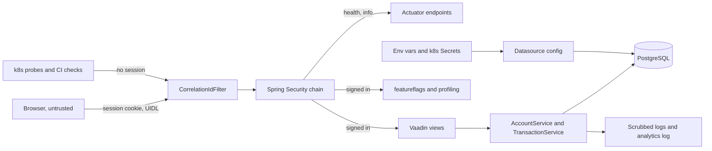

# Security

Mockingbird Bank is a read-only dashboard behind Spring Security form login. Every page except the login screen needs a session, credentials are stored as BCrypt hashes apart from customer data, and full account numbers only reach the browser through an ownership-checked reveal. The main open problem is that the account detail page does not check ownership, described under [Known gap](#known-gap-account-detail-has-no-ownership-check).

The sign-in flow itself is covered in [Sign-in](features/sign-in.md), and the HTTP surface in [API](api.md). This page is about trust boundaries and controls.

## Trust boundaries

| Boundary | What crosses it | Control |
| --- | --- | --- |
| Internet or LAN to app | All HTTP | Spring Security filter chain; default deny for anything not matched |
| Anonymous to signed in | Form login | BCrypt password check, session cookie |
| Signed-in user to another holder's data | Account IDs in URLs and reveal calls | Ownership check on reveal only; none on account detail |
| App to database | JDBC | Credentials from env vars or k8s Secrets |
| App to logs | Log messages, analytics events | `ScrubbingMessageConverter` on every message |
| Contributor to `master` | Pull requests | CI, CodeQL, gitleaks, CODEOWNERS, branch protection |

## Authentication

| Piece | File | Behavior |
| --- | --- | --- |
| Filter chain | `src/main/java/com/mockingbirdbank/security/SecurityConfig.java` | Adds the Actuator rules, then applies `VaadinSecurityConfigurer.vaadin()` with `loginView(LoginView.class)`. The configurer sets up form login at `/login`, permits Vaadin's static resources, and denies everything else that has no rule. |
| Password encoder | same | `BCryptPasswordEncoder` bean, default strength. |
| User lookup | `src/main/java/com/mockingbirdbank/security/AppUserDetailsService.java` | Loads `AppUser` by username; unknown names throw `UsernameNotFoundException`. Every user gets exactly one authority, `ROLE_USER`. |
| Login page | `src/main/java/com/mockingbirdbank/ui/view/LoginView.java` | `LoginOverlay` posting to `login`; forgot-password button hidden. |
| Sign out | `src/main/java/com/mockingbirdbank/ui/layout/MainLayout.java` | `AuthenticationContext.logout()`. |

There is no registration, password reset, lockout, rate limiting, MFA, or "remember me". Failed attempts are counted in analytics (`user.login` with outcome `error`) but nothing acts on them. `SecurityConfig` does not change CSRF settings itself, but `VaadinSecurityConfigurer.loginView(...)` exempts the `/login` URL from CSRF checks, so the login form post needs no CSRF token. Vaadin's own internal requests are also exempt, because Vaadin applies its own CSRF protection to them. Every other state-changing request, such as `POST` and `DELETE /actuator/profiling`, still needs a valid Spring Security CSRF token.

Sessions are the servlet container's in-memory HTTP sessions. Both Kubernetes deployments run one replica, which `k8s/local/app.yaml` explains is because Vaadin UI state lives in that session.

## Authorization

### Routes

Vaadin checks access annotations on each route and on its parent layout:

| Class | Annotation | Effect |
| --- | --- | --- |
| `src/main/java/com/mockingbirdbank/ui/view/LoginView.java` | `@AnonymousAllowed` | Reachable without a session |
| `src/main/java/com/mockingbirdbank/ui/view/DashboardView.java` | `@PermitAll` | Any signed-in user |
| `src/main/java/com/mockingbirdbank/ui/view/AccountDetailView.java` | `@PermitAll` | Any signed-in user |
| `src/main/java/com/mockingbirdbank/ui/layout/MainLayout.java` | `@PermitAll` | Required: an unannotated parent layout counts as `@DenyAll`, which would block every view inside it, as the class Javadoc explains |

`@PermitAll` means "authenticated", not "authorized for this data". With a single role, every signed-in user can reach every page; per-holder separation has to happen in the services.

### Actuator

Rules from `SecurityConfig.securityFilterChain`:

| Path | Rule |
| --- | --- |
| `/actuator/health/**`, `/actuator/info` | `permitAll()` |
| `/actuator/featureflags`, `/actuator/profiling` | `authenticated()` |
| Anything else | Denied by `VaadinSecurityConfigurer` |

`/actuator/info` is public on purpose and limited to build and git fields (`management.info.defaults.enabled: false` in `src/main/resources/application.yml`). The `.github/workflows/dast.yml` ZAP scan is expected to flag it as information disclosure; `AGENTS.md` notes this as accepted. Any signed-in account holder can start and stop JFR recordings through `/actuator/profiling`, because there is no admin role. See [API](api.md#actuator-endpoints).

### Data ownership in services

`AccountService.currentHolder()` maps the principal's username to an `AccountHolder` through `AppUserRepository.findByUsername`. From there:

| Method | Scoped to the signed-in holder? |
| --- | --- |
| `accountsFor(holder)` | Yes, when called with `currentHolder()`, which every caller does |
| `totalBalance(holder)` | Yes, same |
| `revealAccountNumbers()` | Yes, only queries the holder's own accounts |
| `revealAccountNumber(id)` | Yes, explicit `isOwnedBy` check |
| `requireAccount(id)` | **No** |
| `TransactionService.forAccount(id)` | **No** |

## Data separation

Login credentials and customer data live in different tables:

- `app_user` (`src/main/java/com/mockingbirdbank/model/AppUser.java`): `username`, BCrypt `passwordHash`, and a unique one-to-one `holder_id`. The Javadoc states the raw password is never stored or logged.
- `account_holder`: full name and email, the PII.
- `account`: the full `accountNumber` is stored as-is. The Javadoc says it is "only ever masked in the UI".

Credentials can therefore be changed or audited without touching PII, and a query over holders never returns password hashes. See [Data models](reference/data-models.md).

## Account number masking and reveal

`Account.getMaskedNumber()` returns `•••• ` plus the last four digits (or `••••` for short values), and that is what every view renders by default. The full number reaches the browser only when the user clicks an eye button (`src/main/java/com/mockingbirdbank/ui/view/AccountNumberDisplay.java`) or the dashboard's reveal-all toggle, and only while the `allowAccountNumberReveal` flag is on.

`AccountService.revealAccountNumber(id)`:

1. Resolves the current holder.
2. Loads the account by ID.
3. Keeps it only if `isOwnedBy` matches holder IDs (and both IDs are non-null).
4. Otherwise records `account_number.revealed` with reason `forbidden` and throws `AccessDeniedException("Account not available")`.

A missing account and someone else's account fail in exactly the same way, with the same exception, message and analytics reason, so the reveal cannot be used to discover which account IDs exist. A successful reveal records an event with `accountId` and `scope`; the number itself is never an event attribute or log argument. The UI drops the number again after 30 seconds, on a second click, or when the component is detached. Details in [Account number reveal](features/account-number-reveal.md).

## Known gap: account detail has no ownership check

`AccountDetailView.setParameter` calls `AccountService.requireAccount(accountId)`, which is just `accountRepository.findById` wrapped in the circuit breaker, and then `TransactionService.forAccount(accountId)`, which is `findByAccountIdOrderByPostedAtDesc`. Neither compares the account's holder with `currentHolder()`.

**Impact.** This is an insecure direct object reference (IDOR). Any signed-in user can type `/accounts/{id}` with another holder's account ID and see that account's nickname or type, masked number, opening date, current balance, and full transaction history. Account IDs are sequential database identities, so they are easy to guess. The eye button on that page would still refuse to reveal the full number, because the reveal path does check ownership. The outcome also differs (a page renders for a foreign account, a not-found for a missing one), so unlike the reveal, this path does leak which IDs exist.

**Why it has not bitten yet.** `src/main/java/com/mockingbirdbank/config/DataInitializer.java` seeds a single holder and there is no registration, so today every account belongs to the only user. It becomes exploitable as soon as a second holder exists.

**Suggested fix.**

1. Add an owned-account lookup in `AccountService`, either by reusing the `revealAccountNumber` pattern (`findById` then `filter(isOwnedBy(..., currentHolder()))`) or by adding a repository method such as `findByIdAndHolderId`.
2. Throw the same `IllegalArgumentException` for "missing" and "not yours", so `AccountDetailView` keeps turning both into `NotFoundException` and the two cases stay indistinguishable.
3. Load transactions only after that check succeeds, or give `TransactionService.forAccount` the same guard so it cannot be called with an unchecked ID from a future view.
4. Add cases to `src/test/java/com/mockingbirdbank/service/AccountServiceTest.java` mirroring the existing reveal tests (own account, foreign account, unknown ID).

`docs/runbooks/error-spike.md` already blames `account.viewed` errors on "the account-ownership check in `AccountService`", which describes the intended state rather than the current one.

## Log scrubbing

`src/main/resources/logback-spring.xml` replaces the `%msg` and `%m` conversion words with `src/main/java/com/mockingbirdbank/config/logging/ScrubbingMessageConverter.java`, so every formatted message, in both the console log and the analytics event file, passes through three regexes in this order:

| Pattern | Matches | Becomes |
| --- | --- | --- |
| `AUTH_HEADER` | `Authorization: Bearer <token>` or `Authorization: Basic <creds>`, case-insensitive | `Authorization: Bearer ***REDACTED***` |
| `KEY_VALUE_SECRET` | `password`, `passwd`, `pwd`, `secret`, `token`, `api_key`/`api-key`/`apikey`, `access_token`, `refresh_key`, `refresh_token` followed by `=` or `:` and a value (optionally quoted), case-insensitive | `<key>=***REDACTED***` |
| `CARD_NUMBER` | 13 to 19 digits, optionally separated by single spaces or dashes | `***REDACTED***` |

The header pattern runs first so that `Authorization: Bearer x` is not half-handled by the key/value pattern. The card pattern also catches the seeded 13-digit account numbers if one were ever logged by accident. The class Javadoc calls this a safety net, not a substitute for not logging secrets.

Limits worth knowing:

- Only the message is scrubbed. MDC values in the level pattern (`correlationId`, `traceId`, `spanId`) and exception stack traces are written by other converters and are not passed through it.
- The key list is fixed. A secret logged under another name, such as `credential=` or `jdbcUrl` with an embedded password, is not caught.
- Over-redaction is accepted: any long numeric ID will be masked too.

`src/test/java/com/mockingbirdbank/config/logging/ScrubbingMessageConverterTest.java` covers the patterns. See [Logging](how-to-monitor/logging.md).

## Request headers and usernames in logs

- **Usernames.** `src/main/java/com/mockingbirdbank/analytics/AuthenticationEventListener.java` writes `username=<name>` on every login attempt, including failures, to `build/logs/analytics-events.log`, which rolls daily and keeps 30 days. A user who types their password into the username field leaves it in that file, and the scrubber only catches it if it happens to look like a `key=value` secret or a long digit string.
- **Correlation IDs.** `src/main/java/com/mockingbirdbank/observability/CorrelationIdFilter.java` trusts any non-blank incoming `X-Correlation-Id` with no length or character check, puts it in MDC, writes it into every log line for that request, and echoes it in the response. A client can therefore inject arbitrary text, including very long values or characters that confuse log parsers, into the logs. Capping the length and restricting it to a safe character set, falling back to a fresh UUID otherwise, would close this. See [Observability](systems/observability.md).

## Secrets handling

| Where | What | Notes |
| --- | --- | --- |
| `src/main/resources/application.yml` | `SPRING_DATASOURCE_URL`, `_USERNAME`, `_PASSWORD` with defaults `localhost:5432/mydatabase`, `admin`, `secret` | Local development fallback only, per the comment above them. Anything shared must set the env vars. |
| `docker-compose.yml` | Postgres with the same `admin`/`secret` values | Local only. |
| `.env.example` | Template for `runDockerImage.zsh` with the same local values | The real `.env` is gitignored, as the file header says. |
| `k8s/01-app-db-secret.yaml` | `Secret` `mockingbird-db-credentials` | Go-templated from `k8s/values.yaml`, where `dbPassword` is `<+secrets.getValue("postgres-lab-secret")>`. Harness resolves it from its secret manager at deploy time, so the real password is never in git. See [LAB cluster](deployment/lab-cluster.md). |
| `k8s/local/kustomization.yaml` | `secretGenerator` `mockingbird-dev-db` | Throwaway credentials for the k3d-only database, labelled LOCAL DEV ONLY. See [Local k3d](deployment/local-k3d.md). |
| `MOCKINGBIRD_DEV_PASSWORD` | Demo login password | Read by `DataInitializer`; defaults to `mockingbird`. |
| GitHub secrets | `FACTORY_API_KEY`, `FACTORY_WIKI_PR_TOKEN` (optional), `QA_EVIDENCE_TOKEN` (optional), `SLACK_ALERTS_WEBHOOK_URL` | Used by the Droid, QA, wiki refresh and alerting workflows. See [Configuration](reference/configuration.md#ci-secrets). |

### The demo seed

`DataInitializer` runs on every startup and seeds the demo holder, login and accounts whenever `account_holder` is empty. It is not tied to a profile, so it also runs against a fresh LAB or k3d database. Anyone who knows the documented default password can sign in to a new environment unless `MOCKINGBIRD_DEV_PASSWORD` was set before its first start. The password is BCrypt-encoded before saving, and the startup log line names only the username and the env var, never the password. Before commit `00b53d6` it logged the password in plain text. The class Javadoc still says to "swap for a proper migration tool", although Flyway already manages the schema.

## CI and repository controls

| Control | Where | What it does |
| --- | --- | --- |
| CodeQL | `.github/workflows/codeql.yml` | `java-kotlin` analysis with autobuild on push and PR to `master`, plus weekly (Monday 03:17 UTC). Results go to the Security tab. |
| gitleaks | `.github/workflows/secret-scan.yml` | `gitleaks/gitleaks-action@v2` over full history (`fetch-depth: 0`) on push and PR; a finding fails the check. There is no `.gitleaks.toml` or `.gitleaksignore`, so default rules apply; two test-fixture false positives were handled with an inline `gitleaks:allow` marker (`0d6ece3`) and a lower-entropy test value (`e1eaad1`). |
| GitHub secret scanning and push protection | Repository settings | Enabled, per `AGENTS.md`. Not visible in the repo itself. |
| DAST | `.github/workflows/dast.yml` | Builds a production-mode jar, starts it against a Postgres service, waits for health, and runs a ZAP baseline scan against `/login` on push to `master`, weekly, and on demand. `fail_action: false`, so findings never fail the build; the report is uploaded as `zap-baseline-report` for 30 days. Being unauthenticated, it only sees the login page and public endpoints. |
| Dependabot | `.github/dependabot.yml` | Weekly updates for Gradle, root npm, `qa/` npm, Docker and GitHub Actions, with cooldowns before a new release is proposed: 3 days for patch, 7 for minor, 14 for major, 5 by default (Docker sets only default and major; Actions only default). |
| CODEOWNERS | `.github/CODEOWNERS` | `* @ajpahl1008`: the owner must review every path. |
| Branch protection | Repository settings | Per `AGENTS.md`: CI must pass, no force-push or deletion, conversations resolved. Admins can bypass. |
| Droid review | `.github/workflows/droid-review.yml` | `Factory-AI/droid-action@main` with `automatic_review: true` and `automatic_security_review: true` on non-draft PRs. Needs `FACTORY_API_KEY`. |
| Wiki refresh | `.github/workflows/droid-wiki-refresh.yml` | Workflow-level `permissions: contents: read`; only the `wiki-publish` job gets `contents: write` and `pull-requests: write`, so the job that runs `droid exec --auto high "/wiki"` over the repository cannot push or open PRs. The PR step uses `peter-evans/create-pull-request` pinned to a commit SHA. Two weaker spots: Droid is installed with an unpinned `curl -fsSL https://app.factory.ai/cli \| sh`, and the optional `FACTORY_WIKI_PR_TOKEN` is a PAT that should stay scoped to this repository with contents and pull-requests write only. See [Tooling](how-to-contribute/tooling.md#wiki-refresh). |
| Functional QA | `.github/workflows/qa.yml` | Workflow-level `permissions: contents: read`; only the `comment` job gets `pull-requests: write`, and it never sees `FACTORY_API_KEY` or the per-run demo password. The `qa` job runs `droid exec --auto high` only for non-draft PRs from this repository (forks and `dependabot[bot]` are skipped), so the skill files that steer the agent come from trusted branches. The per-run demo password is random (`openssl rand -hex 16`), masked in logs, and replaced with `***` in every result file before the artifact upload. Droid is installed with the same unpinned `curl \| sh` as the wiki refresh, and `QA_EVIDENCE_TOKEN` is a classic `repo`-scope PAT exposed to the agent step, so leave it unset while `video_evidence` is off. See [Functional QA](how-to-contribute/functional-qa.md#the-qa-workflow). |

### Reporting vulnerabilities

`.github/ISSUE_TEMPLATE/config.yml` sets `blank_issues_enabled: false` and adds a "Report a security vulnerability" contact link to `https://github.com/ajpahl1008/mockingbird-bank/security/advisories/new`, asking reporters to use a private advisory instead of a public issue. There is no `SECURITY.md`, even though `docs/runbooks/error-spike.md` refers to one.

## Key source files

| File | Purpose |
| --- | --- |
| `src/main/java/com/mockingbirdbank/security/SecurityConfig.java` | Filter chain, Actuator rules, BCrypt |
| `src/main/java/com/mockingbirdbank/security/AppUserDetailsService.java` | User lookup, `ROLE_USER` |
| `src/main/java/com/mockingbirdbank/service/AccountService.java` | `currentHolder`, ownership-checked reveal, unchecked `requireAccount` |
| `src/main/java/com/mockingbirdbank/service/TransactionService.java` | Unchecked `forAccount` |
| `src/main/java/com/mockingbirdbank/model/AppUser.java` | Credentials kept apart from PII |
| `src/main/java/com/mockingbirdbank/config/logging/ScrubbingMessageConverter.java` | Log redaction |
| `src/main/resources/logback-spring.xml` | Converter wiring, analytics log retention |
| `src/main/java/com/mockingbirdbank/observability/CorrelationIdFilter.java` | Unvalidated correlation header |
| `src/main/java/com/mockingbirdbank/analytics/AuthenticationEventListener.java` | Usernames in the analytics log |
| `src/main/java/com/mockingbirdbank/config/DataInitializer.java` | Demo seed and password handling |
| `k8s/01-app-db-secret.yaml`, `k8s/values.yaml` | Harness-resolved DB credentials |
| `.github/workflows/secret-scan.yml`, `.github/workflows/codeql.yml`, `.github/workflows/dast.yml` | Security scans |
