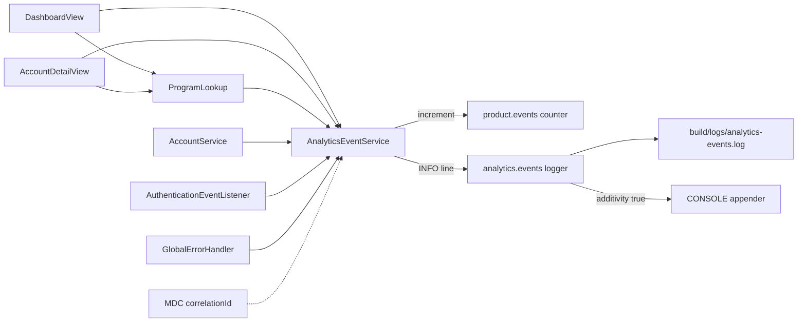

# Analytics

Active contributors: ajpahl1008 (AJ Pahl)

`AnalyticsEventService` records what real users did and which failures they hit. Each call increments one Micrometer counter and writes one `key=value` line to a dedicated log file, so product usage and user-facing errors can be counted without an external analytics platform.

## Purpose

The test suite can't tell you which screens people open, and the application log mixes user-facing failures with framework noise. The analytics package gives both signals one API:

- `track(event, attributes)` for a successful product interaction.
- `trackError(event, reason, attributes)` for a failure a user hit, with a short, low-cardinality `reason`.

Two components feed it with no call-site code: `AuthenticationEventListener` for every login attempt and `GlobalErrorHandler` for unhandled exceptions in Vaadin sessions.

## Directory layout

```
src/main/java/com/mockingbirdbank/analytics/
  AnalyticsEventService.java        track / trackError API
  AuthenticationEventListener.java  Spring Security login events -> user.login
  GlobalErrorHandler.java           Vaadin session ErrorHandler -> ui.unhandled_exception
src/test/java/com/mockingbirdbank/analytics/
  AnalyticsEventServiceTest.java
  AuthenticationEventListenerTest.java
  GlobalErrorHandlerTest.java
```

Three main classes (188 lines) and three test classes (226 lines). The package sits under the 90% per-class JaCoCo line-coverage gate in `build.gradle`.

## Key abstractions

| Type | File | Role |
| --- | --- | --- |
| `AnalyticsEventService` | `src/main/java/com/mockingbirdbank/analytics/AnalyticsEventService.java` | `@Service` with `track` and `trackError`; both go through a private `record` method. |
| `AuthenticationEventListener` | `src/main/java/com/mockingbirdbank/analytics/AuthenticationEventListener.java` | `@EventListener` methods for `AuthenticationSuccessEvent` and `AbstractAuthenticationFailureEvent`. |
| `GlobalErrorHandler` | `src/main/java/com/mockingbirdbank/analytics/GlobalErrorHandler.java` | `VaadinServiceInitListener` that installs a session `ErrorHandler`, tracks the error, then delegates to Vaadin's `DefaultErrorHandler`. |
| `ANALYTICS_EVENTS` appender | `src/main/resources/logback-spring.xml` | Rolling file sink for the `com.mockingbirdbank.analytics.events` logger. |

## How it works



### The counter

`record` builds a Micrometer counter named `product.events` and registers it on the injected `MeterRegistry` each call. Micrometer returns the existing counter when name and tags match, so repeated calls accumulate (`repeatedCallsAccumulateOnTheSameCounter` checks this).

| Tag | Value |
| --- | --- |
| `event` | The event name, for example `dashboard.viewed`. |
| `outcome` | `success` from `track`, `error` from `trackError`. |
| `reason` | The `reason` argument, or the literal `n/a` for `track`. |

Attributes are not tags. They go only to the log line, which keeps counter cardinality bounded even though attributes carry IDs. The metric is described in [Metrics](../how-to-monitor/metrics.md).

### The log line

After incrementing the counter, `record` assembles an ordered map and logs it at INFO on the `com.mockingbirdbank.analytics.events` logger as space-separated `key=value` pairs, in this order:

1. `event`
2. `outcome`
3. `reason` (only for errors)
4. `correlationId` (only if `CorrelationIdFilter` put one in MDC for the current request)
5. every attribute, in the attribute map's iteration order

Values are not quoted or escaped. The appender pattern adds an ISO-8601 timestamp, so a denied reveal looks like this in the file:

```
2026-11-04T10:15:32.118-05:00 event=account_number.revealed outcome=error reason=forbidden correlationId=3f2a9c1e-... accountId=42
```

`Map.of` gives no ordering guarantee, so the order of multiple attributes can vary between runs.

### Logback routing

`src/main/resources/logback-spring.xml` declares a `RollingFileAppender` named `ANALYTICS_EVENTS`:

| Setting | Value |
| --- | --- |
| File | `build/logs/analytics-events.log` (relative to the working directory) |
| Rollover | Daily, `build/logs/analytics-events.%d{yyyy-MM-dd}.log.gz` |
| Retention | `maxHistory` 30 |
| Pattern | `%d{yyyy-MM-dd'T'HH:mm:ss.SSSXXX} %msg%n` |

The `com.mockingbirdbank.analytics.events` logger is set to INFO with `additivity="true"`, so every event line also reaches the root `CONSOLE` appender. Because `%msg` is remapped to `ScrubbingMessageConverter` for the whole config, event lines are scrubbed the same way as application logs. See [Logging](../how-to-monitor/logging.md).

## Event catalog

Every `track`/`trackError` call in `src/main`:

| Event | Outcome | Reason | Attributes | Emitted by |
| --- | --- | --- | --- | --- |
| `dashboard.viewed` | success | `n/a` | `accountCount` | `DashboardView` constructor, `src/main/java/com/mockingbirdbank/ui/view/DashboardView.java:62` |
| `account.viewed` | success | `n/a` | `accountId` | `AccountDetailView.setParameter`, `src/main/java/com/mockingbirdbank/ui/view/AccountDetailView.java:72` |
| `account.viewed` | error | `not_found` | `accountId` | `AccountDetailView.setParameter` when `requireAccount` throws `IllegalArgumentException` (a missing account or another holder's account), `src/main/java/com/mockingbirdbank/ui/view/AccountDetailView.java:68` |
| `account_number.revealed` | success | `n/a` | `accountId`, `scope=single` | `AccountService.revealAccountNumber`, `src/main/java/com/mockingbirdbank/service/AccountService.java:94` |
| `account_number.revealed` | success | `n/a` | `scope=all`, `accountCount` | `AccountService.revealAccountNumbers`, `src/main/java/com/mockingbirdbank/service/AccountService.java:107` |
| `account_number.revealed` | error | `forbidden` | `accountId` | `AccountService.revealAccountNumber` when the account is missing or owned by someone else, `src/main/java/com/mockingbirdbank/service/AccountService.java:88` |
| `user.login` | success | `n/a` | `username` | `AuthenticationEventListener.onSuccess` |
| `user.login` | error | exception simple class name, for example `BadCredentialsException` | `username` | `AuthenticationEventListener.onFailure` |
| `programs.unavailable` | error | exception simple class name: `ServiceUnavailableException` for an open `programs` breaker, otherwise the database exception, for example `DataAccessResourceFailureException` | none | `ProgramLookup.orUnavailable` when the dashboard's or account page's program section shows the "unavailable" message, `src/main/java/com/mockingbirdbank/ui/view/ProgramLookup.java:53` |
| `ui.unhandled_exception` | error | exception simple class name | none | `GlobalErrorHandler.handle` |

The reveal event never includes the account number itself. The [account number reveal](../features/account-number-reveal.md) page covers the feature side.

## Automatic sources

### AuthenticationEventListener

Spring Security publishes `AuthenticationSuccessEvent` or a subclass of `AbstractAuthenticationFailureEvent` for every login attempt, whichever `AuthenticationProvider` handled it. The listener forwards them as `user.login`. On failure the reason is `event.getException().getClass().getSimpleName()`, and the username is passed through `String.valueOf`, so a null name logs as `null` instead of throwing. The [sign-in](../features/sign-in.md) page describes the login flow.

### GlobalErrorHandler

`GlobalErrorHandler` is a Spring `@Component` implementing `VaadinServiceInitListener`. In `serviceInit` it adds a session-init listener that calls `session.setErrorHandler(this::handle)` on every new `VaadinSession`. `handle` tracks `ui.unhandled_exception` with the throwable's simple class name as the reason, then calls `DefaultErrorHandler.error(errorEvent)`. Vaadin's normal behavior, logging the stack trace and showing the internal-error notification, is unchanged.

## Integration points

- **Correlation IDs**: reads `MDC.get(CorrelationIdFilter.MDC_KEY)` from `src/main/java/com/mockingbirdbank/observability/CorrelationIdFilter.java`. See [Observability](observability.md).
- **Micrometer**: the `MeterRegistry` bean from Spring Boot Actuator. `build.gradle` declares `io.micrometer:micrometer-core` directly because this class compiles against `Counter` and `MeterRegistry`.
- **Circuit breaker metrics** land in the same `MeterRegistry` under `resilience4j.circuitbreaker.*`. See [Resilience](resilience.md).
- **Runbook**: `docs/runbooks/error-spike.md` starts from `product.events?tag=outcome:error` to find which event and reason is spiking.

## Tests

| Test | What it checks |
| --- | --- |
| `src/test/java/com/mockingbirdbank/analytics/AnalyticsEventServiceTest.java` | Counter tags for `track` and `trackError`, accumulation across calls, `correlationId=` present when MDC has one and absent when it doesn't (captured with a logback `ListAppender`). |
| `src/test/java/com/mockingbirdbank/analytics/AuthenticationEventListenerTest.java` | Success maps to `user.login`/`success`; a `BadCredentialsException` failure maps to `reason=BadCredentialsException`. |
| `src/test/java/com/mockingbirdbank/analytics/GlobalErrorHandlerTest.java` | Drives the captured session-init listener and error handler with Mockito and checks `ui.unhandled_exception` with `reason=IllegalStateException`. |
| `src/test/java/com/mockingbirdbank/service/AccountServiceTest.java` | Verifies the `account_number.revealed` success and `forbidden` calls against a mocked `AnalyticsEventService`. |
| `src/test/java/com/mockingbirdbank/ui/view/ProgramLookupTest.java` | `programs.unavailable` with the exception's simple name as the reason for an open breaker and each database error type; no event when the lookup succeeds or an unrelated exception propagates. |

All use `SimpleMeterRegistry`; none need Spring or Docker.

## Entry points for modification

- **New product event**: inject `AnalyticsEventService` through the constructor and call `track("area.verb", Map.of(...))`. Keep IDs in attributes, not in the event name.
- **New error**: call `trackError` with a fixed, short reason string. Passing an exception message as the reason creates one counter series per message.
- **Export to a metrics backend**: add the matching Micrometer registry dependency. Call sites don't change.
- **Change file location or retention**: edit the `ANALYTICS_EVENTS` appender in `src/main/resources/logback-spring.xml`.

## Key source files

| File | Purpose |
| --- | --- |
| `src/main/java/com/mockingbirdbank/analytics/AnalyticsEventService.java` | Counter plus log line for every event |
| `src/main/java/com/mockingbirdbank/analytics/AuthenticationEventListener.java` | Login success and failure events |
| `src/main/java/com/mockingbirdbank/analytics/GlobalErrorHandler.java` | Unhandled Vaadin exceptions |
| `src/main/resources/logback-spring.xml` | `ANALYTICS_EVENTS` appender and logger |
| `src/main/resources/application.yml` | Actuator exposure (`management.endpoints.web.exposure.include`) |
| `docs/runbooks/error-spike.md` | Operator steps when error events spike |
