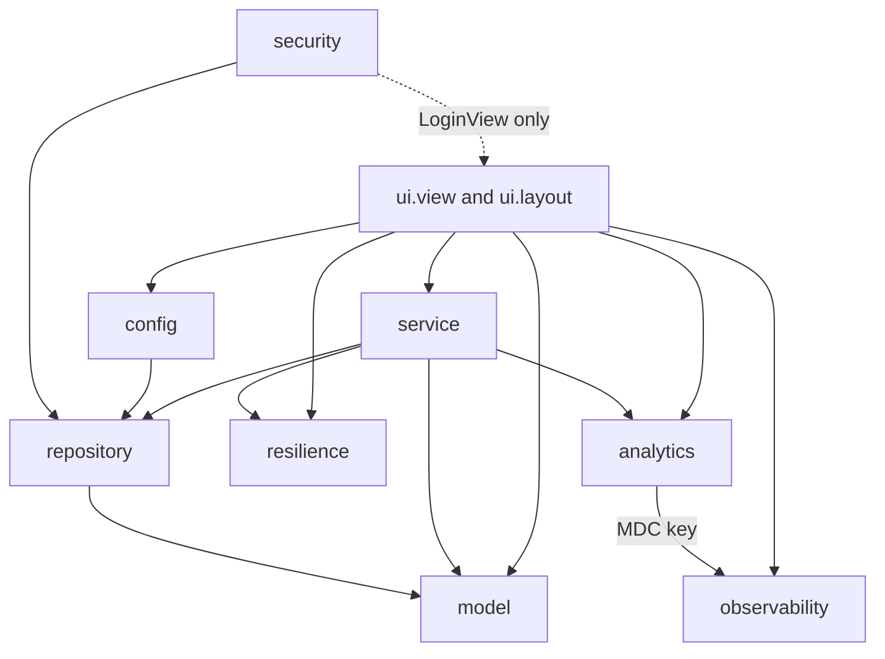

# Systems

Active contributors: ajpahl1008 (AJ Pahl)

The application code lives in nine packages under `src/main/java/com/mockingbirdbank/`, organized by layer rather than by feature. This page maps each package to its page in the wiki and shows which packages are allowed to depend on which.

## Package map

| Package | Main files | Main lines | Test files | Test lines | What it holds | Covered in |
| --- | --- | --- | --- | --- | --- | --- |
| `com.mockingbirdbank` (root) | 1 | 15 | 1 | 130 | `Application` entry point with `@Theme("mockingbird")` | [UI](ui.md) |
| `ui` (`layout/`, `view/`) | 7 | 836 | 0 | 0 | Vaadin routes, the shared top bar, account cards, the number reveal component | [UI](ui.md) |
| `service` | 2 | 172 | 3 | 352 | `AccountService`, `TransactionService` | [Services](services.md) |
| `model` | 5 | 247 | 2 | 109 | JPA entities and the `AccountType` enum | [Persistence](persistence.md) |
| `repository` | 4 | 36 | 0 | 0 | Spring Data JPA interfaces | [Persistence](persistence.md) |
| `security` | 2 | 86 | 1 | 57 | `SecurityConfig`, `AppUserDetailsService` | [Security](../security.md) |
| `analytics` | 3 | 188 | 3 | 226 | Product events, error tracking, login listener, Vaadin error handler | [Analytics](analytics.md) |
| `resilience` | 2 | 59 | 1 | 79 | Circuit breaker config, `ServiceUnavailableException` | [Resilience](resilience.md) |
| `observability` | 3 | 212 | 3 | 248 | Correlation IDs, JFR profiling endpoint, `BuildVersion` | [Observability](observability.md) |
| `config` (incl. `config/logging/`) | 5 | 307 | 3 | 125 | Feature flags, `DataInitializer` seeding, `ScrubbingMessageConverter` | [Feature flags](../features/feature-flags.md), [Persistence](persistence.md#seeding), [Security](../security.md) |
| **Total** | **34** | **2,158** | **17** | **1,326** | | |

Counts come from `git ls-files` on `src/main/java` and `src/test/java` at HEAD `5fbf51f`.

The test-to-code ratio is 0.61 by lines (1,326 test lines for 2,158 main lines) and 0.5 by files. That average hides a split: the `ui` package has 836 lines and no unit tests at all, while `service` has twice as many test lines as main lines. The UI is left out of the JaCoCo per-class gate on purpose; see [UI](ui.md#testing-and-coverage) and [Testing](../how-to-contribute/testing.md).

## Layering

Arrows show actual `import com.mockingbirdbank.*` dependencies between packages in `src/main/java`.

The rules the code follows:

- Views call services, never repositories. Both `AccountService` and `TransactionService` wrap every repository call in a circuit breaker, so a view that went straight to a repository would skip that protection.
- `model` and `repository` depend on nothing else in the app.
- `config.DataInitializer` and `security.AppUserDetailsService` use repositories directly. Both run outside a user-facing request path (startup seeding and login lookup), so they do not go through the services.
- `security` imports `ui.view.LoginView` because `VaadinSecurityConfigurer` needs the login view class. This is the only dependency that points back up toward the UI.
- `analytics.AnalyticsEventService` reads `CorrelationIdFilter.MDC_KEY` from `observability` so event lines carry the same correlation ID as the request's log lines.

Nothing enforces these rules at build time (there is no ArchUnit test). They hold because the codebase is small and reviewed by one owner. See [Patterns and conventions](../how-to-contribute/patterns-and-conventions.md).

## Pages in this section

- [UI](ui.md): Vaadin routes, `MainLayout`, theme and dark mode.
- [Services](services.md): the two application services and the `protectedCall` pattern.
- [Persistence](persistence.md): entities, repositories, Flyway, the N+1 guard and demo seeding.
- [Analytics](analytics.md): `AnalyticsEventService` and its two automatic feeds.
- [Resilience](resilience.md): the `accounts` and `transactions` circuit breakers.
- [Observability](observability.md): correlation IDs, profiling and build version at code level.

For how these pieces fit together at runtime, see [Architecture](../overview/architecture.md).
