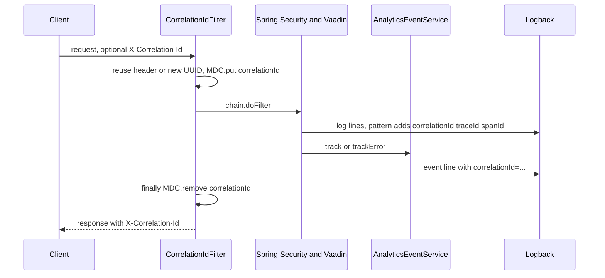

# Observability

Active contributors: ajpahl1008 (AJ Pahl)

The `com.mockingbirdbank.observability` package holds three small components: a servlet filter that tags every request with a correlation ID, a custom Actuator endpoint that starts and stops JDK Flight Recorder recordings, and the `BuildVersion` bean. Tracing and HTTP/JVM metrics come from Spring Boot starters with no code in this package. This page covers the code; the how-to-monitor pages cover operating it.

## Purpose

The package answers three questions about a running instance without extra infrastructure:

- Which log lines and analytics events belong to the same request? (`CorrelationIdFilter`)
- What is the JVM spending its time on right now? (`ProfilingEndpoint`)
- Which build is this? (`BuildVersion`)

## Directory layout

```
src/main/java/com/mockingbirdbank/observability/
  BuildVersion.java          version, commit, branch; startup log line
  CorrelationIdFilter.java   X-Correlation-Id -> MDC and response header
  ProfilingEndpoint.java     /actuator/profiling, JFR start/stop
src/test/java/com/mockingbirdbank/observability/
  BuildVersionTest.java
  CorrelationIdFilterTest.java
  ProfilingEndpointTest.java
```

Three main classes and three test classes, one test class per production class. The package is under the 90% per-class JaCoCo line-coverage gate.

## Key abstractions

| Class | File | Role |
| --- | --- | --- |
| `CorrelationIdFilter` | `src/main/java/com/mockingbirdbank/observability/CorrelationIdFilter.java` | `OncePerRequestFilter` at `Ordered.HIGHEST_PRECEDENCE`. Puts the ID in SLF4J MDC under `correlationId` and sets the `X-Correlation-Id` response header. |
| `ProfilingEndpoint` | `src/main/java/com/mockingbirdbank/observability/ProfilingEndpoint.java` | `@Endpoint(id = "profiling")` with read, write and delete operations over one JFR `Recording`. |
| `BuildVersion` | `src/main/java/com/mockingbirdbank/observability/BuildVersion.java` | Reads `BuildProperties`/`GitProperties`, backs the top bar label, logs the version on `ApplicationReadyEvent`. Covered in [Build version](../features/build-version.md). |

## How it works

### Correlation IDs and MDC



1. `CorrelationIdFilter` reads `X-Correlation-Id`. If it is missing or blank, it generates `UUID.randomUUID()`. An incoming value is reused as-is, so a load balancer or upstream service can supply its own.
2. It puts the ID in MDC and sets it as a response header before calling the rest of the chain. Running at highest precedence means it wraps Spring Security, so even a rejected login request gets an ID.
3. `logging.pattern.level` in `src/main/resources/application.yml` is `'%5p [%X{correlationId:-},%X{traceId:-},%X{spanId:-}]'`. Every log line written on the request thread carries the correlation ID, plus the trace and span IDs that Micrometer Tracing puts in MDC for traced operations. Lines written outside a request, such as startup logging, have empty slots.
4. `AnalyticsEventService` (`src/main/java/com/mockingbirdbank/analytics/AnalyticsEventService.java`) reads `MDC.get(CorrelationIdFilter.MDC_KEY)` directly and adds `correlationId=<id>` to its structured event line when present. That is how a `trackError` from `AccountDetailView` or `GlobalErrorHandler` can be matched to the application log lines from the same request. See [Analytics](analytics.md).
5. The filter removes the key in a `finally` block. MDC is thread-local and servlet threads are pooled, so a leaked ID would otherwise appear on the next request's lines.

MDC is per thread. Work handed to another thread, such as a Vaadin push or an executor task, would not see the ID. The app does neither today.

### Profiling with JFR

| Request | Operation | Result |
| --- | --- | --- |
| `GET /actuator/profiling` | `status()` | `{"recording": false}` or `{"recording": true, "name": ..., "startTime": ...}` |
| `POST /actuator/profiling` | `start()` | Creates the output directory, starts a `Recording` with JFR's built-in `default` configuration named `mockingbird-bank-<epoch millis>`, and returns `started`, `name` and `file`. If one is already running, returns `{"error": "A recording is already running - stop it first."}`. |
| `DELETE /actuator/profiling` | `stop()` | Stops and closes the recording, which writes the `.jfr` file, and returns `stopped` and `file`. With nothing running, returns `{"error": "No recording is running."}`. |

- The output directory is `mockingbird.profiling.output-dir`, defaulting to `${java.io.tmpdir}/mockingbird-bank-jfr`. It is not set in `application.yml`; pass it as a property or as `MOCKINGBIRD_PROFILING_OUTPUT_DIR`.
- At most one recording exists per instance, held in an `AtomicReference`. The "already running" and "nothing running" cases come back as a normal 200 body, not an HTTP error. A failure to create the directory or load the JFR configuration throws `IllegalStateException`.
- The file stays on the instance's filesystem. In a container it is lost when the pod restarts unless copied out first, for example with `kubectl cp`.
- The endpoint requires an authenticated session (`src/main/java/com/mockingbirdbank/security/SecurityConfig.java`). Recordings are never started automatically.

Open the file in JDK Mission Control or VisualVM.

### What comes from starters

These need no code in this package but feed the same signals:

- **Tracing**: `spring-boot-starter-opentelemetry` in `build.gradle` creates a span per incoming HTTP request and exports via OTLP to `management.opentelemetry.tracing.export.otlp.endpoint` (default `http://localhost:4318/v1/traces`). Sampling is `management.tracing.sampling.probability`, default `1.0`. `k8s/local/kustomization.yaml` sets it to `0.0` because the k3d cluster has no collector. The starter's OTLP metrics exporter is disabled in `application.yml`.
- **Metrics**: Actuator and Micrometer provide JVM and HTTP metrics. `AnalyticsEventService` adds `product.events` and `src/main/java/com/mockingbirdbank/resilience/ResilienceConfig.java` adds `resilience4j.circuitbreaker.*`. `metrics` is not in `management.endpoints.web.exposure.include`, so `/actuator/metrics` is not reachable over HTTP as configured.
- **Log scrubbing**: every message passes through `ScrubbingMessageConverter` in `src/main/java/com/mockingbirdbank/config/logging/`, wired by `src/main/resources/logback-spring.xml`. See [Logging](../how-to-monitor/logging.md).

## Integration points

| Consumer | Uses |
| --- | --- |
| `src/main/java/com/mockingbirdbank/analytics/AnalyticsEventService.java` | `CorrelationIdFilter.MDC_KEY` |
| `src/main/resources/application.yml` | `%X{correlationId}` in the log pattern; endpoint exposure for `profiling` |
| `src/main/java/com/mockingbirdbank/security/SecurityConfig.java` | Requires authentication for `/actuator/profiling` |
| `src/main/java/com/mockingbirdbank/ui/layout/MainLayout.java` | `BuildVersion` for the top bar label |

## Entry points for modification

- Rename the header or MDC key: change the `HEADER` and `MDC_KEY` constants in `CorrelationIdFilter`, and the `%X{correlationId:-}` pattern in `application.yml`, which uses the literal string.
- Validate or length-limit incoming IDs: in `CorrelationIdFilter.doFilterInternal`. Today any non-blank caller value is trusted and logged verbatim.
- Use a different JFR profile: `Configuration.getConfiguration("default")` in `ProfilingEndpoint.start`. JDKs also ship `profile`, which has higher overhead.
- New custom Actuator endpoint: follow `ProfilingEndpoint` or `FeatureFlagsEndpoint`, then add its id to `management.endpoints.web.exposure.include` and a matcher in `SecurityConfig`. See [API](../api.md).

## Tests

| Test class | Covers |
| --- | --- |
| `src/test/java/com/mockingbirdbank/observability/CorrelationIdFilterTest.java` | Generates an ID when none is sent, and the header matches what MDC held during the chain; reuses an incoming ID; clears MDC even when the chain throws. |
| `src/test/java/com/mockingbirdbank/observability/ProfilingEndpointTest.java` | Start then stop writes a real non-empty `.jfr` file to a `@TempDir`; status tracks the recording; a second start and a stop with nothing running both return `error`. |
| `src/test/java/com/mockingbirdbank/observability/BuildVersionTest.java` | See [Build version](../features/build-version.md#tests). |
| `src/test/java/com/mockingbirdbank/analytics/AnalyticsEventServiceTest.java` | Event lines include `correlationId=` only when MDC holds one. |

## Operating it

- [Logging](../how-to-monitor/logging.md): log files, the pattern, and finding every line for one correlation ID.
- [Metrics](../how-to-monitor/metrics.md): what is counted and how to read it.
- [Tracing](../how-to-monitor/tracing.md): running Jaeger locally and pointing the exporter at it.

## Key source files

| File | Purpose |
| --- | --- |
| `src/main/java/com/mockingbirdbank/observability/CorrelationIdFilter.java` | Correlation ID filter |
| `src/main/java/com/mockingbirdbank/observability/ProfilingEndpoint.java` | JFR endpoint |
| `src/main/java/com/mockingbirdbank/observability/BuildVersion.java` | Build metadata bean |
| `src/main/resources/application.yml` | Log pattern, endpoint exposure, tracing settings |
| `src/main/resources/logback-spring.xml` | Appenders and scrubbing converter |
| `src/main/java/com/mockingbirdbank/analytics/AnalyticsEventService.java` | Reads the correlation ID from MDC |
