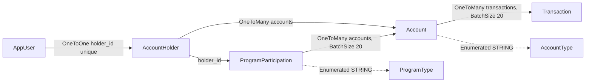

# Persistence

Active contributors: ajpahl1008 (AJ Pahl)

Five JPA entities map onto five PostgreSQL tables created by two Flyway migrations. Hibernate only validates the mapping; Flyway owns the schema. On an empty database, `DataInitializer` seeds two demo holders, each with a login, accounts and one program.

## Purpose

Store account holders, their login, their accounts, each account's transactions and the holders' program participations, and give the services simple derived queries to read them. Column-level details (types, nullability, constraints) are in [Data models](../reference/data-models.md); this page covers how the layer behaves.

## Directory layout

```
src/main/java/com/mockingbirdbank/
  model/        Account, AccountHolder, AccountType, AppUser, ProgramParticipation, ProgramType, Transaction
  repository/   AccountHolderRepository, AccountRepository, AppUserRepository, ProgramParticipationRepository, TransactionRepository
  config/       DataInitializer (seeding), BusinessClockConfig (business date)
src/main/resources/
  application.yml               jpa + flyway settings
  db/migration/V1__init_schema.sql
  db/migration/V2__account_programs.sql
```

`model` has 7 files (365 lines) and 2 test files (`AccountTest`, `TransactionTest`). `repository` has 5 interfaces (46 lines) and no tests of its own; they are exercised by the Testcontainers tests and mocked in the service tests.

## Key abstractions

| Entity | Table | File | Notes |
| --- | --- | --- | --- |
| `AccountHolder` | `account_holder` | `src/main/java/com/mockingbirdbank/model/AccountHolder.java` | `fullName`, unique `email`, nullable `dateOfBirth` (`LocalDate`); `@OneToMany accounts` (cascade all, orphan removal) |
| `AppUser` | `app_user` | `src/main/java/com/mockingbirdbank/model/AppUser.java` | Unique `username`, BCrypt `passwordHash`; `@OneToOne holder` with a unique `holder_id` |
| `Account` | `account` | `src/main/java/com/mockingbirdbank/model/Account.java` | `@ManyToOne holder`; unique full `accountNumber`; `AccountType` stored as a string; `balance` `NUMERIC(14,2)`; `currency` (ISO code, default `USD`); `openedAt` date; lazy `@ManyToOne programParticipation` (nullable); `@OneToMany transactions` with `@BatchSize(size = 20)` |
| `Transaction` | `transaction` | `src/main/java/com/mockingbirdbank/model/Transaction.java` | `@ManyToOne account`; `postedAt` `OffsetDateTime`; signed `amount` (negative is a debit) |
| `ProgramParticipation` | `program_participation` | `src/main/java/com/mockingbirdbank/model/ProgramParticipation.java` | `@ManyToOne holder`; `ProgramType` stored as a string; `@OneToMany(mappedBy = "programParticipation") accounts` with `@OrderBy("accountType ASC, id ASC")` and `@BatchSize(size = 20)` |
| `AccountType` | (enum) | `src/main/java/com/mockingbirdbank/model/AccountType.java` | `CHECKING`, `SAVINGS` |
| `ProgramType` | (enum) | `src/main/java/com/mockingbirdbank/model/ProgramType.java` | `REGULAR`, `YOUTH_SAVINGS`, each with a display name |

Login credentials sit in `app_user`, apart from the holder's personal data in `account_holder`. The Javadoc on `AppUser` describes this as keeping the two concerns from mixing.

Display helpers live on the entities: `Account.getMaskedNumber()` returns `"•••• "` plus the last four digits (or just `"••••"` for numbers shorter than four), `Account.getDisplayName()` falls back to the enum name when the nickname is blank, and `Transaction.isCredit()` is true for a positive amount.



## Repositories

All five extend `JpaRepository<Entity, Long>`. Four add one derived query each:

| Repository | Derived query | Used by |
| --- | --- | --- |
| `AccountRepository` | `findByHolderIdOrderByAccountTypeAscIdAsc(Long holderId)` | `AccountService.accountsFor` |
| `TransactionRepository` | `findByAccountIdOrderByPostedAtDesc(Long accountId)` | `TransactionService.forAccount` |
| `AppUserRepository` | `Optional<AppUser> findByUsername(String username)` | `AccountService.currentHolder`, `AppUserDetailsService` |
| `ProgramParticipationRepository` | `findByHolderIdOrderByIdAsc(Long holderId)` | `ProgramService.evaluationsFor`; `DataInitializer` uses `save()` |
| `AccountHolderRepository` | none | `DataInitializer` (`count()`, `save()`) |

`OrderByAccountTypeAsc` sorts by the stored string, so `CHECKING` comes before `SAVINGS` alphabetically, which is also the enum's declaration order. Inherited methods in use are `findById` (in `AccountService`, which then checks ownership), `save` and `count` (in `DataInitializer`). Services wrap every repository call in a circuit breaker; see [Services](services.md).

## How it works

### Schema ownership: Flyway

`src/main/resources/db/migration/V1__init_schema.sql` creates `account_holder`, `account`, `transaction` and `app_user` with identity primary keys and foreign keys. Its header comment says it captures exactly what Hibernate's `ddl-auto=update` used to create, and that later changes go in new `V2__`, `V3__` files. Never edit V1.

`src/main/resources/db/migration/V2__account_programs.sql` adds account programs without changing existing rows' meaning. It adds a nullable `account_holder.date_of_birth`, an `account.currency` column (`VARCHAR(3)`, `NOT NULL DEFAULT 'USD'`, checked against `^[A-Z]{3}$`), the `program_participation` table (with a check on `program_type` and `UNIQUE (id, holder_id)`), and a nullable `account.program_participation_id`. That link has a composite foreign key `(program_participation_id, holder_id)` to `program_participation (id, holder_id)`, so the database rejects linking an account to another customer's program, and being a single column it allows at most one program per account. Existing accounts become USD with no program, and existing holders have no date of birth. Nothing is backfilled or enrolled. Column details are in [Data models](../reference/data-models.md).

Two settings in `src/main/resources/application.yml` make this work:

- `spring.jpa.hibernate.ddl-auto: validate`. Hibernate checks at startup that every entity maps onto an existing column of a compatible type and fails startup otherwise. It never alters the schema.
- `spring.flyway.baseline-on-migrate: true`. Databases created before Flyway already have these four tables but no `flyway_schema_history`. With this flag, Flyway marks version 1 as applied on a non-empty schema instead of failing with "relation already exists". An empty database (Testcontainers, the k3d Postgres) still runs V1 normally.

A new column therefore needs both a migration and an entity change in the same commit, or `validate` will stop the app from starting. The runbook `docs/runbooks/app-wont-start.md` covers that failure mode, and [Pitfalls](../background/pitfalls.md) lists related traps.

### Open-in-view disabled

`spring.jpa.open-in-view: false` means the Hibernate session ends when the `@Transactional(readOnly = true)` service method returns. Vaadin views get detached entities. `@ManyToOne` and `@OneToOne` associations are eager by default, so `Account.holder` and `AppUser.holder` are loaded, but touching `Account.transactions` or `AccountHolder.accounts` from a view would throw `LazyInitializationException`. `Account.programParticipation` is explicitly lazy too. Views use `TransactionService.forAccount()` and `ProgramService` instead; `ProgramService` initializes `ProgramParticipation.accounts` inside its own transaction.

### N+1 guard

`Account.transactions` carries `@BatchSize(size = 20)`. When code iterates several accounts and touches each lazy `transactions` collection inside one session, Hibernate fetches up to 20 accounts' transactions in one `WHERE account_id IN (...)` query rather than one query per account.

`src/test/java/com/mockingbirdbank/service/AccountTransactionQueryPerformanceTest.java` is the regression guard. It boots Spring against a `postgres:16-alpine` Testcontainer with `hibernate.generate_statistics=true`, seeds 6 accounts with 2 transactions each, clears the session, loads the accounts and sums `getTransactions().size()`. It asserts that the prepared statement count is less than 6 (the account count). Removing `@BatchSize` makes the count grow with the number of accounts and fails the test. `AGENTS.md` asks for `@BatchSize` on any new collection that may be iterated across parents.

No current view iterates `Account.transactions`; the guard protects future code. `ProgramParticipation.accounts` uses the same `@BatchSize` so that loading several participations' accounts in `ProgramService.evaluationsFor` stays one query.

### Seeding

`src/main/java/com/mockingbirdbank/config/DataInitializer.java` is a `CommandLineRunner`. It does nothing if `account_holder` has any row. Otherwise it seeds two holders, Jordan Ellis first, so Jordan's account IDs are the same as before the second holder existed:

| Record | Values |
| --- | --- |
| Holder | Jordan Ellis, `jordan.ellis@example.com`, born 1988-04-23 |
| Login | username `jordan.ellis`, password from `MOCKINGBIRD_DEV_PASSWORD` or `mockingbird`, BCrypt-encoded through the `PasswordEncoder` bean |
| Program | A `REGULAR` participation |
| Everyday Checking | `1000000004821`, CHECKING, $4,318.52, opened 2021-03-12, in the Regular program |
| High-Yield Savings | `2000000007743`, SAVINGS, $18,200.00, opened 2022-01-05, in the Regular program |
| Vacation Savings | `2000000000092`, SAVINGS, $1,800.00, opened 2023-06-20, in no program (Regular takes exactly one savings account) |
| Holder | Riley Chen, `riley.chen@example.com`, born `YOUTH_AGE_AT_SEED` (15) years before the seed date in the business time zone (`LocalDate.now(businessClock)`) |
| Login | username `riley.chen`, same password source |
| Program | A `YOUTH_SAVINGS` participation |
| Youth Savings | `2000000005317`, SAVINGS, $245.50, opened 2024-09-03, in the Youth Savings program |

Each of Jordan's accounts gets the same 8 transactions (`ADULT_TRANSACTIONS`), dated 0 to 14 days before startup (UTC): groceries, rent, utilities, a transfer, coffee, shopping and two "Direct Deposit - Bespin Engineering" credits. Riley's account gets 4 (`YOUTH_TRANSACTIONS`): a birthday gift, two weekly allowances and a bookstore purchase. The seeded transactions do not add up to the seeded balances; balances are stored values, not computed from history. Every seeded account is USD, and both seeded programs meet their rules.

Riley's date of birth is relative so that a freshly seeded database always has a customer under 18. On a database seeded more than three years ago, Riley is 18 and Youth Savings shows as not met.

The usernames and the env var name are `public static final` constants (`DEV_USERNAME`, `YOUTH_USERNAME`, `DEV_PASSWORD_ENV`, `DEV_PASSWORD_DEFAULT`) so `ApplicationSmokeTest` can log in with them without copying values. The startup log line names both users and the env var but never the password.

Seeding runs in every environment where the database is empty, including LAB. See [Getting started](../overview/getting-started.md) for the demo logins.

## Integration points

- [Services](services.md) are the only request-time callers of the account, transaction and program participation repositories.
- `AppUserDetailsService` (in `security`) reads `AppUserRepository` for login; see [Security](../security.md).
- Datasource settings come from `SPRING_DATASOURCE_*` env vars with local defaults; see [Configuration](../reference/configuration.md).

## Entry points for modification

- **New column or table:** add the next migration, `src/main/resources/db/migration/V3__<description>.sql`, update the entity, and run `./gradlew test` so `ddl-auto: validate` checks the pair against a real Postgres.
- **New query:** prefer a derived query method on the repository, then call it from a service through `protectedCall`.
- **New collection association:** add `@BatchSize` and consider extending the N+1 test.
- **Different demo data:** edit `DataInitializer`, then reset the database (`docker compose down -v`, or `./scripts/k3d-deploy.sh down --purge-db`), because seeding only runs on an empty one.

## Key source files

| File | Why read it |
| --- | --- |
| `src/main/resources/db/migration/V1__init_schema.sql` | The original four tables |
| `src/main/resources/db/migration/V2__account_programs.sql` | Programs, currency and date of birth, with the cross-customer constraint |
| `src/main/java/com/mockingbirdbank/model/ProgramParticipation.java` | Program participation and its accounts |
| `src/main/resources/application.yml` | `ddl-auto`, `open-in-view`, `baseline-on-migrate` and their comments |
| `src/main/java/com/mockingbirdbank/model/Account.java` | `@BatchSize` comment and masking logic |
| `src/main/java/com/mockingbirdbank/model/AppUser.java` | Why credentials are a separate table |
| `src/main/java/com/mockingbirdbank/config/DataInitializer.java` | Seed data |
| `src/test/java/com/mockingbirdbank/service/AccountTransactionQueryPerformanceTest.java` | N+1 regression guard |
| `src/test/java/com/mockingbirdbank/ProgramMigrationTest.java` | V1 data surviving V2, and the V2 constraints, against a real Postgres |
