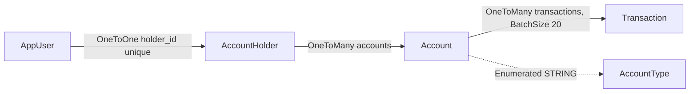

# Persistence

Active contributors: ajpahl1008 (AJ Pahl)

Four JPA entities map onto four PostgreSQL tables created by a single Flyway migration. Hibernate only validates the mapping; Flyway owns the schema. On an empty database, `DataInitializer` seeds one demo holder with three accounts.

## Purpose

Store account holders, their login, their accounts and each account's transactions, and give the services simple derived queries to read them. Column-level details (types, nullability, constraints) are in [Data models](../reference/data-models.md); this page covers how the layer behaves.

## Directory layout

```
src/main/java/com/mockingbirdbank/
  model/        Account, AccountHolder, AccountType, AppUser, Transaction
  repository/   AccountHolderRepository, AccountRepository, AppUserRepository, TransactionRepository
  config/       DataInitializer (seeding)
src/main/resources/
  application.yml               jpa + flyway settings
  db/migration/V1__init_schema.sql
```

`model` has 5 files (247 lines) and 2 test files (`AccountTest`, `TransactionTest`). `repository` has 4 interfaces (36 lines) and no tests of its own; they are exercised by the Testcontainers tests.

## Key abstractions

| Entity | Table | File | Notes |
| --- | --- | --- | --- |
| `AccountHolder` | `account_holder` | `src/main/java/com/mockingbirdbank/model/AccountHolder.java` | `fullName`, unique `email`; `@OneToMany accounts` (cascade all, orphan removal) |
| `AppUser` | `app_user` | `src/main/java/com/mockingbirdbank/model/AppUser.java` | Unique `username`, BCrypt `passwordHash`; `@OneToOne holder` with a unique `holder_id` |
| `Account` | `account` | `src/main/java/com/mockingbirdbank/model/Account.java` | `@ManyToOne holder`; unique full `accountNumber`; `AccountType` stored as a string; `balance` `NUMERIC(14,2)`; `openedAt` date; `@OneToMany transactions` with `@BatchSize(size = 20)` |
| `Transaction` | `transaction` | `src/main/java/com/mockingbirdbank/model/Transaction.java` | `@ManyToOne account`; `postedAt` `OffsetDateTime`; signed `amount` (negative is a debit) |
| `AccountType` | (enum) | `src/main/java/com/mockingbirdbank/model/AccountType.java` | `CHECKING`, `SAVINGS` |

Login credentials sit in `app_user`, apart from the holder's personal data in `account_holder`. The Javadoc on `AppUser` describes this as keeping the two concerns from mixing.

Display helpers live on the entities: `Account.getMaskedNumber()` returns `"•••• "` plus the last four digits (or just `"••••"` for numbers shorter than four), `Account.getDisplayName()` falls back to the enum name when the nickname is blank, and `Transaction.isCredit()` is true for a positive amount.



## Repositories

All four extend `JpaRepository<Entity, Long>`. Three add one derived query each:

| Repository | Derived query | Used by |
| --- | --- | --- |
| `AccountRepository` | `findByHolderIdOrderByAccountTypeAscIdAsc(Long holderId)` | `AccountService.accountsFor` |
| `TransactionRepository` | `findByAccountIdOrderByPostedAtDesc(Long accountId)` | `TransactionService.forAccount` |
| `AppUserRepository` | `Optional<AppUser> findByUsername(String username)` | `AccountService.currentHolder`, `AppUserDetailsService` |
| `AccountHolderRepository` | none | `DataInitializer` (`count()`, `save()`) |

`OrderByAccountTypeAsc` sorts by the stored string, so `CHECKING` comes before `SAVINGS` alphabetically, which is also the enum's declaration order. Inherited methods in use are `findById` (in `AccountService`), `save` and `count` (in `DataInitializer`). Services wrap every repository call in a circuit breaker; see [Services](services.md).

## How it works

### Schema ownership: Flyway

`src/main/resources/db/migration/V1__init_schema.sql` creates `account_holder`, `account`, `transaction` and `app_user` with identity primary keys and foreign keys. Its header comment says it captures exactly what Hibernate's `ddl-auto=update` used to create, and that later changes go in new `V2__`, `V3__` files. Never edit V1.

Two settings in `src/main/resources/application.yml` make this work:

- `spring.jpa.hibernate.ddl-auto: validate`. Hibernate checks at startup that every entity maps onto an existing column of a compatible type and fails startup otherwise. It never alters the schema.
- `spring.flyway.baseline-on-migrate: true`. Databases created before Flyway already have these four tables but no `flyway_schema_history`. With this flag, Flyway marks version 1 as applied on a non-empty schema instead of failing with "relation already exists". An empty database (Testcontainers, the k3d Postgres) still runs V1 normally.

A new column therefore needs both a migration and an entity change in the same commit, or `validate` will stop the app from starting. The runbook `docs/runbooks/app-wont-start.md` covers that failure mode, and [Pitfalls](../background/pitfalls.md) lists related traps.

### Open-in-view disabled

`spring.jpa.open-in-view: false` means the Hibernate session ends when the `@Transactional(readOnly = true)` service method returns. Vaadin views get detached entities. `@ManyToOne` and `@OneToOne` associations are eager by default, so `Account.holder` and `AppUser.holder` are loaded, but touching `Account.transactions` or `AccountHolder.accounts` from a view would throw `LazyInitializationException`. Views use `TransactionService.forAccount()` instead.

### N+1 guard

`Account.transactions` carries `@BatchSize(size = 20)`. When code iterates several accounts and touches each lazy `transactions` collection inside one session, Hibernate fetches up to 20 accounts' transactions in one `WHERE account_id IN (...)` query rather than one query per account.

`src/test/java/com/mockingbirdbank/service/AccountTransactionQueryPerformanceTest.java` is the regression guard. It boots Spring against a `postgres:16-alpine` Testcontainer with `hibernate.generate_statistics=true`, seeds 6 accounts with 2 transactions each, clears the session, loads the accounts and sums `getTransactions().size()`. It asserts that the prepared statement count is less than 6 (the account count). Removing `@BatchSize` makes the count grow with the number of accounts and fails the test. `AGENTS.md` asks for `@BatchSize` on any new collection that may be iterated across parents.

No current view iterates `Account.transactions`; the guard protects future code.

### Seeding

`src/main/java/com/mockingbirdbank/config/DataInitializer.java` is a `CommandLineRunner`. It does nothing if `account_holder` has any row. Otherwise it saves:

| Record | Values |
| --- | --- |
| Holder | Jordan Ellis, `jordan.ellis@example.com` |
| Login | username `jordan.ellis`, password from `MOCKINGBIRD_DEV_PASSWORD` or `mockingbird`, BCrypt-encoded through the `PasswordEncoder` bean |
| Everyday Checking | `1000000004821`, CHECKING, $4,318.52, opened 2021-03-12 |
| High-Yield Savings | `2000000007743`, SAVINGS, $18,200.00, opened 2022-01-05 |
| Vacation Savings | `2000000000092`, SAVINGS, $1,800.00, opened 2023-06-20 |

Each account gets the same 8 transactions, dated 0 to 14 days before startup (UTC): groceries, rent, utilities, a transfer, coffee, shopping and two "Direct Deposit - Bespin Engineering" credits. The seeded transactions do not add up to the seeded balances; balances are stored values, not computed from history.

The username and the env var name are `public static final` constants (`DEV_USERNAME`, `DEV_PASSWORD_ENV`, `DEV_PASSWORD_DEFAULT`) so `ApplicationSmokeTest` can log in with them without copying values. The startup log line names the user and the env var but never the password.

Seeding runs in every environment where the database is empty, including LAB. See [Getting started](../overview/getting-started.md) for the demo login.

## Integration points

- [Services](services.md) are the only request-time callers of the account and transaction repositories.
- `AppUserDetailsService` (in `security`) reads `AppUserRepository` for login; see [Security](../security.md).
- Datasource settings come from `SPRING_DATASOURCE_*` env vars with local defaults; see [Configuration](../reference/configuration.md).

## Entry points for modification

- **New column or table:** add `src/main/resources/db/migration/V2__<description>.sql`, update the entity, and run `./gradlew test` so `ddl-auto: validate` checks the pair against a real Postgres.
- **New query:** prefer a derived query method on the repository, then call it from a service through `protectedCall`.
- **New collection association:** add `@BatchSize` and consider extending the N+1 test.
- **Different demo data:** edit `DataInitializer`, then reset the database (`docker compose down -v`, or `./scripts/k3d-deploy.sh down --purge-db`), because seeding only runs on an empty one.

## Key source files

| File | Why read it |
| --- | --- |
| `src/main/resources/db/migration/V1__init_schema.sql` | The whole schema |
| `src/main/resources/application.yml` | `ddl-auto`, `open-in-view`, `baseline-on-migrate` and their comments |
| `src/main/java/com/mockingbirdbank/model/Account.java` | `@BatchSize` comment and masking logic |
| `src/main/java/com/mockingbirdbank/model/AppUser.java` | Why credentials are a separate table |
| `src/main/java/com/mockingbirdbank/config/DataInitializer.java` | Seed data |
| `src/test/java/com/mockingbirdbank/service/AccountTransactionQueryPerformanceTest.java` | N+1 regression guard |
