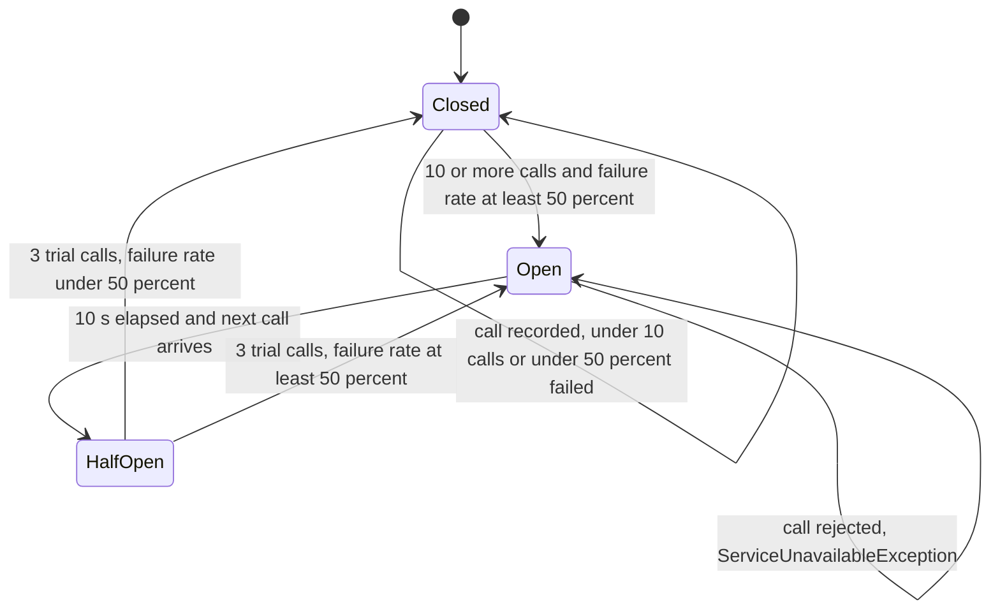

# Resilience

Active contributors: ajpahl1008 (AJ Pahl)

`AccountService`, `TransactionService` and `ProgramService` wrap every repository call in a Resilience4j circuit breaker. When Postgres keeps failing, the breaker opens and calls fail immediately with `ServiceUnavailableException` instead of waiting on the database.

## Purpose

A slow or down database would otherwise tie up request threads and pool connections on every page view. The breaker turns a sustained database failure into fast, recognizable failures and gives Postgres 10 seconds of no traffic from this service before trying again. `ServiceUnavailableException` is a separate type so the UI and logs can tell "the database threw" apart from "the app is not calling the database right now".

## Directory layout

```
src/main/java/com/mockingbirdbank/resilience/
  ResilienceConfig.java              shared CircuitBreakerConfig + registry bean
  ServiceUnavailableException.java   thrown when a breaker rejects a call
src/test/java/com/mockingbirdbank/resilience/
  CircuitBreakerBehaviorTest.java    trips the accounts and transactions breakers against failing repositories
```

The breakers themselves are created and used in `src/main/java/com/mockingbirdbank/service/`.

## Key abstractions

| Type | File | Role |
| --- | --- | --- |
| `ResilienceConfig.defaultConfig()` | `src/main/java/com/mockingbirdbank/resilience/ResilienceConfig.java` | Static factory for the one `CircuitBreakerConfig` every breaker uses. |
| `CircuitBreakerRegistry` bean | `src/main/java/com/mockingbirdbank/resilience/ResilienceConfig.java` | Registry built from `defaultConfig()` and bound to Micrometer. |
| `ServiceUnavailableException` | `src/main/java/com/mockingbirdbank/resilience/ServiceUnavailableException.java` | `RuntimeException` wrapping Resilience4j's `CallNotPermittedException`. |
| `protectedCall` | `src/main/java/com/mockingbirdbank/service/AccountService.java`, `src/main/java/com/mockingbirdbank/service/TransactionService.java`, `src/main/java/com/mockingbirdbank/service/ProgramService.java` | Private helper in each service that runs a repository supplier through its breaker. |

## Configuration

`defaultConfig()` sets five values. Everything else is a Resilience4j default (count-based sliding window, no slow-call tuning, every exception counts as a failure).

| Setting | Value | Reason given in the code |
| --- | --- | --- |
| `failureRateThreshold` | 50% | Half of recent calls failing means the database is struggling, not one bad query. |
| `slidingWindowSize` | 10 calls | The failure rate is judged over the last 10 calls. |
| `minimumNumberOfCalls` | 10 | No decision until there is a full window; the first 10 calls always reach the repository. |
| `waitDurationInOpenState` | 10 s | Fail fast "instead of piling up threads/connections against an already-struggling Postgres". |
| `permittedNumberOfCallsInHalfOpenState` | 3 | Three trial calls decide whether to close again. |

The config is a static method rather than inline in the bean so `CircuitBreakerBehaviorTest`, `AccountServiceTest`, `TransactionServiceTest` and `ProgramServiceTest` build their registries from the exact numbers that ship.

## Named breakers

| Name | Created in | Guards | Exception message when open |
| --- | --- | --- | --- |
| `accounts` | `AccountService` constructor | `appUserRepository.findByUsername`, `accountRepository.findByHolderIdOrderByAccountTypeAscIdAsc`, `accountRepository.findById` | "Accounts are temporarily unavailable" |
| `transactions` | `TransactionService` constructor | `transactionRepository.findByAccountIdOrderByPostedAtDesc` | "Transaction history is temporarily unavailable" |
| `programs` | `ProgramService` constructor | `participationRepository.findByHolderIdOrderByIdAsc` plus initializing each participation's `accounts` | "Programs are temporarily unavailable" |

Each service calls `circuitBreakerRegistry.circuitBreaker(name)` once, so the three breakers keep independent state. A run of failing transaction or program queries does not stop the dashboard's accounts from loading. The `AccountService` breaker also covers the user lookup in `currentHolder()`, so every dashboard view makes several calls through it: `currentHolder`, `accountsFor`, and `accountsFor` again inside `totalBalance`. `requireAccount` makes two: `currentHolder` and `findById`. See [Services](services.md).

## How it works

### protectedCall

```java
private <T> T protectedCall(Supplier<T> repositoryCall) {
    try {
        return circuitBreaker.executeSupplier(repositoryCall);
    } catch (CallNotPermittedException e) {
        throw new ServiceUnavailableException("Accounts are temporarily unavailable", e);
    }
}
```

Only the repository call goes inside the breaker. Business outcomes are decided outside it:

- `requireAccount` calls `protectedCall(() -> accountRepository.findById(id))`, then filters by owner and calls `orElseThrow(IllegalArgumentException)`. An empty `Optional` or a foreign account is a successful call, so a run of 404s never trips the breaker.
- `revealAccountNumber` applies the ownership filter and throws `AccessDeniedException` after `protectedCall` returns, so denied reveals are not breaker failures either.
- `currentHolder` throws `IllegalStateException` for a user with no holder outside the breaker.
- `ProgramService` applies the program rules after `protectedCall` returns, so an unmet rule is never a breaker failure.

Any exception the repository itself throws, such as `DataAccessResourceFailureException`, is recorded as a failure and rethrown unchanged. Only a rejected call becomes `ServiceUnavailableException`.

### States



Automatic transition from open to half-open is not enabled, so the breaker moves to half-open on the first call after the 10 seconds pass. Calls beyond the three permitted in half-open are rejected the same way as in the open state.

## UI handling of ServiceUnavailableException

The account number reveal path and the program sections catch it. The program sections also catch database errors from the program read. A failing query counts toward opening the `programs` breaker; a failed connection does not, because the `@Transactional` proxy around `ProgramService` opens the connection, and throws `CannotCreateTransactionException`, before `protectedCall` runs.

| Where | What it catches | User sees |
| --- | --- | --- |
| `AccountNumberDisplay.onToggle`, `src/main/java/com/mockingbirdbank/ui/view/AccountNumberDisplay.java:124-134` | `AccessDeniedException` or `ServiceUnavailableException` from `revealAccountNumber` | `showRevealFailed()`: a 4-second notification at top center, "We couldn't show the full account number right now. Please try again." The number stays masked. |
| `DashboardView.toggleAll`, `src/main/java/com/mockingbirdbank/ui/view/DashboardView.java:279-298` | `ServiceUnavailableException` from `revealAccountNumbers` | The same notification; no display is changed. |
| `DashboardView.programEvaluations`, `AccountDetailView.programSection`, both through `ProgramLookup.orUnavailable` (`src/main/java/com/mockingbirdbank/ui/view/ProgramLookup.java`) | `ServiceUnavailableException` from `ProgramService` (`programs` breaker open), and `DataAccessException`, `TransactionException` or `PersistenceException` from a database failure (logged at WARN); each is tracked as `programs.unavailable` with the exception's simple name as the reason | "Programs can't be shown right now. Please try again later." in place of the programs; the rest of the page renders normally, and the dashboard adds no unmet-requirements notice. |

Everywhere else the exception propagates. `DashboardView` calls `currentHolder`, `accountsFor` and `totalBalance` in its constructor, and `AccountDetailView.setParameter` catches only `IllegalArgumentException` around `requireAccount` and nothing around `transactionService.forAccount`. An open `accounts` or `transactions` breaker therefore still breaks those pages. With a breaker open, those pages fail through Vaadin's navigation error handling rather than a friendly message. The [dashboard](../features/dashboard.md) and [account detail](../features/account-detail.md) pages describe those views.

## Metrics

`ResilienceConfig.circuitBreakerRegistry` calls `TaggedCircuitBreakerMetrics.ofCircuitBreakerRegistry(registry).bindTo(meterRegistry)`, which publishes Resilience4j's standard meters to the same Micrometer `MeterRegistry` that holds `product.events`, each tagged with `name=accounts`, `name=transactions` or `name=programs`:

| Meter | Shows |
| --- | --- |
| `resilience4j.circuitbreaker.state` | One gauge per state; the current state reads 1. |
| `resilience4j.circuitbreaker.calls` | Call timers by `kind` (successful, failed, ignored). |
| `resilience4j.circuitbreaker.not.permitted.calls` | Calls rejected while open. |
| `resilience4j.circuitbreaker.failure.rate` | Current failure rate over the window. |
| `resilience4j.circuitbreaker.buffered.calls` | Calls held in the sliding window. |
| `resilience4j.circuitbreaker.slow.calls`, `.slow.call.rate` | Slow-call stats (no slow-call threshold is configured). |

`management.endpoints.web.exposure.include` in `src/main/resources/application.yml` is `health,info,featureflags,profiling`, so `/actuator/metrics` is not exposed over HTTP by default. See [Metrics](../how-to-monitor/metrics.md) for how to read them.

## Why not resilience4j-spring-boot3

`build.gradle` depends only on `io.github.resilience4j:resilience4j-circuitbreaker:2.4.0` and `io.github.resilience4j:resilience4j-micrometer:2.4.0`. The comment above them explains that `resilience4j-spring-boot3` targets Spring Boot 3's actuator and autoconfigure APIs, which are not guaranteed to work on Spring Boot 4. So there are no `@CircuitBreaker` annotations, no `resilience4j.*` properties in `application.yml`, and no circuit breaker health indicator. The registry bean, Micrometer binding and per-service wiring are all explicit Java.

## Tests

| Test | What it checks |
| --- | --- |
| `src/test/java/com/mockingbirdbank/resilience/CircuitBreakerBehaviorTest.java` | With a mocked repository that always throws `DataAccessResourceFailureException`, the first 10 `accountsFor(holder)` calls rethrow it and reach the repository 10 times; the 11th throws `ServiceUnavailableException` and the repository count stays at 10. A second test does the same for `TransactionService.forAccount` and the `transactions` breaker. |
| `src/test/java/com/mockingbirdbank/service/AccountServiceTest.java` | `revealAccountNumberFailsFastWhenCircuitBreakerIsOpen` forces `accounts` open with `transitionToOpenState()` and expects `ServiceUnavailableException`. |
| `src/test/java/com/mockingbirdbank/service/ProgramServiceTest.java` | `evaluationsForFailsFastWhenCircuitBreakerIsOpen` does the same for `programs`. |
| `src/test/java/com/mockingbirdbank/ui/view/DashboardViewTest.java` | `programsUnavailableStillShowsTheAccounts`: with `ProgramService` throwing `ServiceUnavailableException`, the dashboard shows the "unavailable" message and still renders the account cards. `programsDatabaseErrorBeforeTheBreakerOpensStillShowsTheAccounts` does the same for a `DataAccessResourceFailureException`. |
| `src/test/java/com/mockingbirdbank/ui/view/ProgramLookupTest.java` | An open breaker and the three database error types give an empty result and a `programs.unavailable` count; an unrelated exception propagates. |

No test covers the half-open state or recovery back to closed. These tests run without Spring or Docker; see [Testing](../how-to-contribute/testing.md).

## Entry points for modification

- **Tune thresholds**: change `defaultConfig()`. The behavior test reads the same method, so update its loop counts if `minimumNumberOfCalls` or `slidingWindowSize` change.
- **Protect a new repository call**: route it through the service's `protectedCall`, and keep any `orElseThrow` or permission check outside the supplier.
- **New service with its own breaker**: inject `CircuitBreakerRegistry`, call `circuitBreaker("<name>")` in the constructor, and copy the `protectedCall` pattern with a service-specific message.
- **Show a friendlier page when open**: catch `ServiceUnavailableException` in `DashboardView` or `AccountDetailView`, or add a Vaadin error view for it.

## Key source files

| File | Purpose |
| --- | --- |
| `src/main/java/com/mockingbirdbank/resilience/ResilienceConfig.java` | Breaker config and Micrometer binding |
| `src/main/java/com/mockingbirdbank/resilience/ServiceUnavailableException.java` | Fail-fast exception |
| `src/main/java/com/mockingbirdbank/service/AccountService.java` | `accounts` breaker and `protectedCall` |
| `src/main/java/com/mockingbirdbank/service/TransactionService.java` | `transactions` breaker and `protectedCall` |
| `src/main/java/com/mockingbirdbank/service/ProgramService.java` | `programs` breaker and `protectedCall` |
| `src/main/java/com/mockingbirdbank/ui/view/ProgramLookup.java` | Program sections' fallback for an open breaker or a database error |
| `src/main/java/com/mockingbirdbank/ui/view/AccountNumberDisplay.java` | Reveal failure notification |
| `src/main/java/com/mockingbirdbank/ui/view/DashboardView.java` | Reveal-all failure handling, programs section fallback |
| `src/test/java/com/mockingbirdbank/resilience/CircuitBreakerBehaviorTest.java` | Trip test for the `accounts` and `transactions` breakers |
| `build.gradle` | Resilience4j dependencies and the Spring Boot 4 note |
