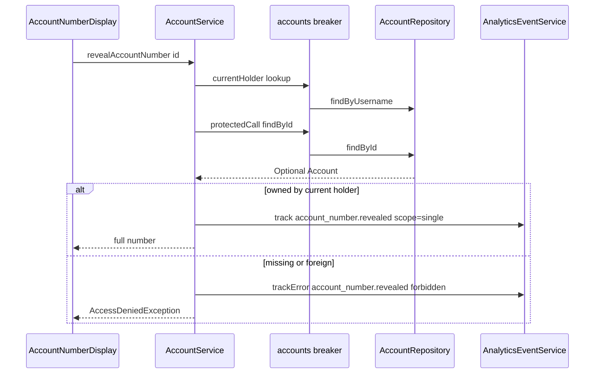

# Services

Active contributors: ajpahl1008 (AJ Pahl)

Three Spring services hold all of the application's business logic: `AccountService`, `TransactionService` and `ProgramService`. Views call them directly, and they in turn are the only callers of the account, transaction and program participation repositories during a user request.

## Purpose

- Resolve who is signed in and which `AccountHolder` that is.
- Read accounts, balances and transactions.
- Hand out full account numbers and account pages only to their owner, and record each reveal.
- Evaluate the holder's programs against their rules.
- Put every repository call behind a circuit breaker so a failing database fails fast.

## Directory layout

```
src/main/java/com/mockingbirdbank/service/
  AccountService.java       "accounts" breaker, holder resolution, owned account, reveal
  TransactionService.java   "transactions" breaker, history
  ProgramService.java       "programs" breaker, program rules
  ProgramEvaluation.java    evaluation result record
src/test/java/com/mockingbirdbank/service/
  AccountServiceTest.java                      Mockito unit tests
  TransactionServiceTest.java                  Mockito unit test
  ProgramServiceTest.java                      program rules, fixed clock, open breaker
  AccountTransactionQueryPerformanceTest.java  Testcontainers N+1 guard
```

The package has 4 main files (425 lines) and 4 test files (677 lines), about 1.6 test lines per main line.

## Key abstractions

| Method | File | Repository call | Returns or throws | Analytics |
| --- | --- | --- | --- | --- |
| `AccountService.currentHolder()` | `src/main/java/com/mockingbirdbank/service/AccountService.java` | `AppUserRepository.findByUsername` | The linked `AccountHolder`; `IllegalStateException` if the user has no holder | none |
| `AccountService.accountsFor(holder)` | same | `AccountRepository.findByHolderIdOrderByAccountTypeAscIdAsc` | Accounts, CHECKING before SAVINGS, then by ID | none |
| `AccountService.requireAccount(id)` | same | `currentHolder()` then `findById` | The signed-in holder's `Account`; `IllegalArgumentException("No such account: <id>")` if missing or owned by someone else | none (the caller tracks `not_found`) |
| `AccountService.revealAccountNumber(id)` | same | `currentHolder()` then `findById` | Full number; `AccessDeniedException` if missing or owned by someone else | `account_number.revealed` with `scope=single`, or `trackError(..., "forbidden", ...)` |
| `AccountService.revealAccountNumbers()` | same | `currentHolder()` then `accountsFor` | `Map<Long, String>` of account ID to full number, in list order | `account_number.revealed` with `scope=all` and `accountCount` |
| `AccountService.totalBalance(holder)` | same | `accountsFor(holder)` | Sum of balances, `BigDecimal.ZERO` if none | none |
| `TransactionService.forAccount(id)` | `src/main/java/com/mockingbirdbank/service/TransactionService.java` | `TransactionRepository.findByAccountIdOrderByPostedAtDesc` | Transactions, newest first | none |
| `ProgramService.evaluationsFor(holder)` | `src/main/java/com/mockingbirdbank/service/ProgramService.java` | `ProgramParticipationRepository.findByHolderIdOrderByIdAsc`, with each participation's accounts initialized | One `ProgramEvaluation` per participation, in ID order | none |
| `ProgramService.evaluationFor(account)` | same | `evaluationsFor(account.getHolder())` | `Optional` of the evaluation that includes the account | none |

Any method can also throw `ServiceUnavailableException` (from `src/main/java/com/mockingbirdbank/resilience/ServiceUnavailableException.java`) when its breaker is open.

## How it works

### Resolving the current holder

`currentHolder()` reads `SecurityContextHolder.getContext().getAuthentication().getName()`, looks up the `AppUser` with that username, and returns `appUser.getHolder()`. There is no caching: every call is a database query. A dashboard load calls it twice, once from `MainLayout` for the greeting and once from `DashboardView`. Since `AppUser.holder` is a `@OneToOne` (eager by default), the holder comes back in the same query.

The username comes from `AppUserDetailsService` at login (see [Sign-in](../features/sign-in.md)). The login credentials and the holder's personal data are separate tables linked one-to-one; see [Persistence](persistence.md).

### The protectedCall pattern

Each service has a private `protectedCall(Supplier<T>)`:

```java
private <T> T protectedCall(Supplier<T> repositoryCall) {
    try {
        return circuitBreaker.executeSupplier(repositoryCall);
    } catch (CallNotPermittedException e) {
        throw new ServiceUnavailableException("Accounts are temporarily unavailable", e);
    }
}
```

The breakers are fetched by name from the shared `CircuitBreakerRegistry` in each constructor: `"accounts"` for `AccountService`, `"transactions"` for `TransactionService`, `"programs"` for `ProgramService`. They are independent, so a run of failing transaction or program queries does not stop the dashboard's accounts from loading.

Only the repository call goes inside the supplier. `orElseThrow` and the ownership filter run outside it, so "no such account" or "not your account" never count as breaker failures. A comment on `AccountService.protectedCall` states this rule. A real database exception still propagates unchanged; it just counts toward the breaker's failure rate. Thresholds and state transitions are on the [Resilience](resilience.md) page.



### Exception semantics

| Exception | Meaning | Thrown by | How the UI handles it |
| --- | --- | --- | --- |
| `IllegalStateException` | Signed-in user has no linked holder (data problem) | `currentHolder()` | Not caught; reaches `GlobalErrorHandler` |
| `IllegalArgumentException` | Account ID does not exist, or belongs to another holder | `requireAccount()` | `AccountDetailView` tracks `account.viewed` / `not_found` and throws Vaadin's `NotFoundException` |
| `AccessDeniedException` (Spring Security) | Account missing or not owned, on the reveal path | `revealAccountNumber()` | `AccountNumberDisplay` shows a notification |
| `ServiceUnavailableException` | Breaker is open | any method | `AccountNumberDisplay` and `DashboardView.toggleAll()` show a notification; the program sections of `DashboardView` and `AccountDetailView` show "Programs can't be shown right now"; elsewhere it reaches `GlobalErrorHandler` |

The reveal path deliberately returns the same `AccessDeniedException` for a missing ID and for someone else's ID, so a caller cannot probe which account IDs exist. `AccountServiceTest` has one test for each case (`revealAccountNumberDeniesAccountOwnedBySomeoneElse`, `revealAccountNumberDeniesUnknownAccountTheSameWay`).

`requireAccount()` follows the same rule: it resolves `currentHolder()`, loads the account, and keeps it only if `isOwnedBy` matches, so a foreign ID fails exactly like a missing one. `AccountServiceTest.requireAccountRejectsAccountOwnedBySomeoneElseLikeAnUnknownOne` covers it. `TransactionService.forAccount()` has no check of its own; its only caller, `AccountDetailView`, calls it after `requireAccount()` has returned the account. See [Account detail](../features/account-detail.md) and [Security](../security.md#account-detail-ownership-check).

### Program evaluation

`ProgramService` (`src/main/java/com/mockingbirdbank/service/ProgramService.java`) evaluates a holder's programs against their rules every time it is called and returns `ProgramEvaluation` records. It only reads: an unmet rule becomes a message, and nothing changes an account or a program. "Today" for the Youth Savings age rule comes from the `businessClock` bean in `src/main/java/com/mockingbirdbank/config/BusinessClockConfig.java` (America/New_York). It filters each participation's accounts with `AccountService.isOwnedBy`, which is package-private so both services share it. The rules and the UI are described in [Account programs](../features/account-programs.md).

### Read-only transactions

All three classes carry `@Transactional(readOnly = true)` at class level, so each public method runs in a read-only transaction and Hibernate skips dirty checking. `spring.jpa.open-in-view` is `false` in `src/main/resources/application.yml`, so the persistence context closes when the service method returns. Views therefore must not touch lazy collections (`Account.transactions`, `AccountHolder.accounts`) or the lazy `Account.programParticipation` on entities they receive; transactions are fetched through `TransactionService.forAccount()` and programs through `ProgramService`, which initializes `ProgramParticipation.accounts` inside its transaction.

Internal calls such as `revealAccountNumbers()` calling `accountsFor()` are plain Java self-invocations and run inside the caller's transaction.

## Integration points

- **Callers:** `MainLayout`, `DashboardView`, `AccountDetailView`, `AccountNumberDisplay` (see [UI](ui.md)).
- **Repositories:** `AppUserRepository`, `AccountRepository`, `TransactionRepository`, `ProgramParticipationRepository` (see [Persistence](persistence.md)).
- **Circuit breakers:** `CircuitBreakerRegistry` bean from `ResilienceConfig` (see [Resilience](resilience.md)).
- **Analytics:** only `AccountService` injects `AnalyticsEventService`, and only for the reveal events. Page-view events are emitted by the views (see [Analytics](analytics.md)).

## Entry points for modification

- New read: add a derived query to the repository, call it through `protectedCall`, and keep any `orElseThrow` or filtering outside the supplier.
- New service: take `CircuitBreakerRegistry` in the constructor and use a new named breaker. The registry's default config from `ResilienceConfig.defaultConfig()` applies automatically.
- Anything per-account and user-facing should check ownership the way `requireAccount()` and `revealAccountNumber()` do with `isOwnedBy`, or run only after `requireAccount()` has returned the account.
- Keep the 90% per-class line coverage gate in mind: `service` is one of the gated packages in `build.gradle`.

## Key source files

| File | Why read it |
| --- | --- |
| `src/main/java/com/mockingbirdbank/service/AccountService.java` | Holder resolution, reveal, `protectedCall` comment |
| `src/main/java/com/mockingbirdbank/service/TransactionService.java` | Minimal example of the pattern |
| `src/main/java/com/mockingbirdbank/service/ProgramService.java` | Program rules and the `programs` breaker |
| `src/main/java/com/mockingbirdbank/resilience/ServiceUnavailableException.java` | Why open-breaker failures are a separate type |
| `src/test/java/com/mockingbirdbank/service/AccountServiceTest.java` | Ownership and open-breaker tests |
| `src/test/java/com/mockingbirdbank/service/ProgramServiceTest.java` | Program rule boundaries, business date, cross-customer accounts, open breaker |
| `src/test/java/com/mockingbirdbank/resilience/CircuitBreakerBehaviorTest.java` | Real trip against a failing repository |
