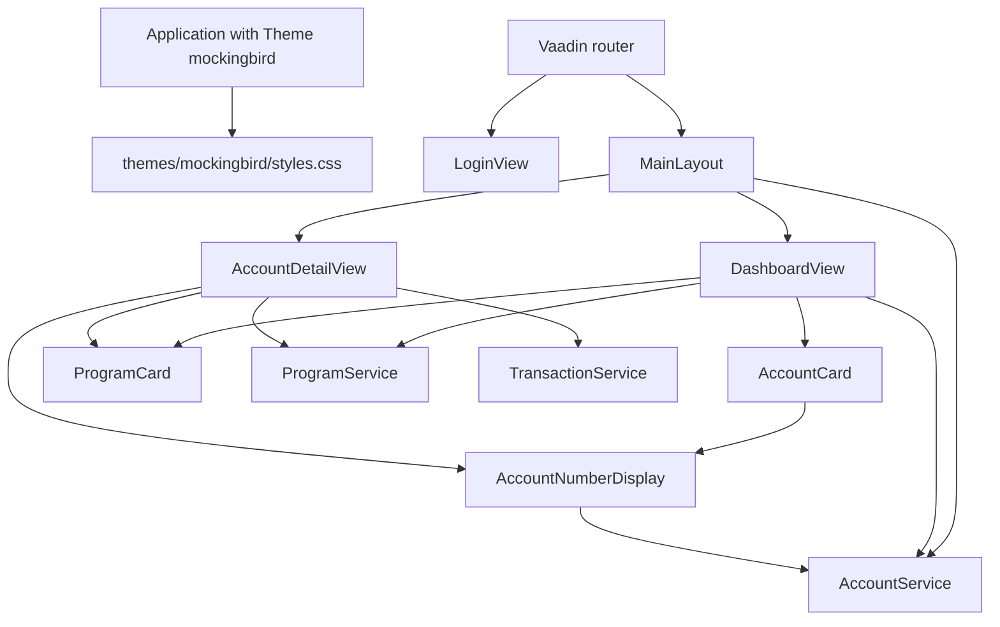

# UI

Active contributors: ajpahl1008 (AJ Pahl)

The UI is plain Vaadin Flow: Java classes that build components on the server, with no hand-written TypeScript or React views. Views call Spring services in-process, and every rendered page lives as component state in the server's memory.

## Purpose

Show the signed-in holder their accounts, transaction history and (behind a flag) programs, in a layout and palette that follow the Mockingbird Bank design mockup referenced in the class Javadocs. The UI never writes data. The only server calls beyond page rendering are the account number reveal clicks.

## Directory layout

```
src/main/java/com/mockingbirdbank/
  Application.java            @SpringBootApplication + @Theme("mockingbird")
  ui/layout/
    MainLayout.java           top bar shared by every signed-in view
    BirdMark.java             inline SVG logo
  ui/view/
    LoginView.java            /login
    DashboardView.java        / and /accounts
    AccountDetailView.java    /accounts/{id}
    AccountCard.java          one clickable account tile
    AccountNumberDisplay.java masked number with an eye toggle
    ProgramCard.java          one program, its accounts and unmet rules
    ProgramLookup.java        program read fallback for the views
src/main/frontend/themes/mockingbird/
  styles.css                  --mb-* CSS variables, light and dark
  theme.json                  Lumo imports
```

## Key abstractions

| Class | File | Role |
| --- | --- | --- |
| `Application` | `src/main/java/com/mockingbirdbank/Application.java` | Implements `AppShellConfigurator` and carries `@Theme("mockingbird")`, which loads `src/main/frontend/themes/mockingbird/`. Vaadin only accepts `@Theme` on the app shell class. |
| `MainLayout` | `src/main/java/com/mockingbirdbank/ui/layout/MainLayout.java` | `AppLayout` with the navy top bar: logo, wordmark, optional build version, greeting, dark mode toggle, sign out. |
| `BirdMark` | `src/main/java/com/mockingbirdbank/ui/layout/BirdMark.java` | An `Html` component holding a 30x30 inline SVG bird, so the logo needs no image asset and stays sharp at any size. |
| `LoginView` | `src/main/java/com/mockingbirdbank/ui/view/LoginView.java` | `LoginOverlay` posting to `login`; shows the error state when the URL has an `error` query parameter. |
| `DashboardView` | `src/main/java/com/mockingbirdbank/ui/view/DashboardView.java` | Total assets hero, account cards, optional welcome banner, account count line, programs section and unmet-requirements notice, "Show/Hide account numbers" toolbar. |
| `AccountDetailView` | `src/main/java/com/mockingbirdbank/ui/view/AccountDetailView.java` | Header, optional "Program" section, and a `Grid` of transactions for one of the signed-in holder's accounts. |
| `AccountCard` | `src/main/java/com/mockingbirdbank/ui/view/AccountCard.java` | An `Anchor` to `accounts/{id}` wrapping name, type tag, number line and balance. |
| `AccountNumberDisplay` | `src/main/java/com/mockingbirdbank/ui/view/AccountNumberDisplay.java` | Masked number plus eye button; see [Account number reveal](../features/account-number-reveal.md). |
| `ProgramCard` | `src/main/java/com/mockingbirdbank/ui/view/ProgramCard.java` | A `Div` showing one `ProgramEvaluation`: name, met or not-met pill, account links, unmet rules. Also builds the dashboard notice and the muted one-line messages. See [Account programs](../features/account-programs.md). |
| `ProgramLookup` | `src/main/java/com/mockingbirdbank/ui/view/ProgramLookup.java` | Runs the dashboard's and account page's program lookup; an open `programs` breaker or a database error gives an empty result, which the view shows as the "unavailable" message, and is tracked as `programs.unavailable`. |

## Routes

| URL | View | Layout | Access annotation | Notes |
| --- | --- | --- | --- | --- |
| `/login` | `LoginView` | none | `@AnonymousAllowed` | Registered with Spring Security via `configurer.loginView(LoginView.class)` in `src/main/java/com/mockingbirdbank/security/SecurityConfig.java`. |
| `/` | `DashboardView` | `MainLayout` | `@PermitAll` | `@RouteAlias("")` |
| `/accounts` | `DashboardView` | `MainLayout` | `@PermitAll` | `@Route("accounts")` |
| `/accounts/{id}` | `AccountDetailView` | `MainLayout` | `@PermitAll` | Same `@Route("accounts")` plus `HasUrlParameter<String>`, parsed into an account ID in the view; an unknown or non-numeric ID, or another holder's account, throws `NotFoundException`. |

`@PermitAll` here means "any authenticated user". Vaadin's navigation access control checks these annotations before a view is created, and unauthenticated requests are sent to `LoginView`. The HTTP-level rules for Actuator are separate; see [Security](../security.md) and [API](../api.md).

### Why MainLayout has @PermitAll

Vaadin checks access on the parent layout independently of the view. An unannotated layout is treated as `@DenyAll`, so without `@PermitAll` on `MainLayout` every view routed through it would be denied even though the views themselves are `@PermitAll`. The Javadoc on `MainLayout` records this. If you add a new layout, annotate it.

## How it works



Views do their work in the constructor (`DashboardView`) or in `setParameter` (`AccountDetailView`). Both resolve data through [services](services.md) and emit a product event (`dashboard.viewed`, `account.viewed`) through [analytics](analytics.md). `MainLayout` also calls `AccountService.currentHolder()` to render "Welcome back, <name>", so a dashboard load resolves the current holder twice.

Each view reads feature flags through `FeatureFlagService`:

| Flag accessor | Where | Effect |
| --- | --- | --- |
| `showBuildVersion()` | `MainLayout` | Adds a `#build-version` span under the wordmark, with commit details in its tooltip. |
| `showWelcomeBanner()` | `DashboardView` | Adds a navy "early preview" banner above the hero. |
| `showAccountCount()` | `DashboardView` | Adds a muted "You have N accounts" line under the "Your accounts" heading. |
| `showAccountNumberOnDashboard()` | `DashboardView` | Passes `null` instead of a number line to `AccountCard`, which then omits it. |
| `allowAccountNumberReveal()` | `DashboardView`, `AccountDetailView` | Uses `AccountNumberDisplay` instead of a plain masked `Span`. |
| `showAccountPrograms()` | `DashboardView`, `AccountDetailView` | Adds the "Your programs" section and notice on the dashboard and the "Program" section on account pages. When off, `ProgramService` is not called. |

Details are in [Feature flags](../features/feature-flags.md).

### Theme and CSS variables

`src/main/frontend/themes/mockingbird/styles.css` defines the palette as `--mb-*` custom properties on `html`, and overrides them under `html[theme~="dark"]`. Components style themselves inline with `getStyle().set(...)` against these variables rather than with CSS classes, so a color change belongs in `styles.css`, not in Java.

| Variable | Light | Dark | Used for |
| --- | --- | --- | --- |
| `--mb-navy` | `#12233F` | `#0E1A30` | Top bar and welcome banner background |
| `--mb-ivory` | `#F6F4EE` | (unchanged) | Wordmark and top bar button text |
| `--mb-ivory-muted` | `#C9CFDA` | `#A9B4CC` | Greeting and build version text |
| `--mb-page-bg` | `#F6F4EE` | `#0B1322` | View backgrounds |
| `--mb-surface` | `#FFFFFF` | `#1A2740` | Cards, hero, account header |
| `--mb-text` | `#12233F` | `#F6F4EE` | Primary text, debit amounts |
| `--mb-text-muted` | `#6B7280` | `#9AA3B2` | Labels, account number lines |
| `--mb-text-on-navy` | `#FFFFFF` | `#F6F4EE` | Welcome banner text |
| `--mb-hairline` | `#E7E2D3` | `rgba(246, 244, 238, 0.14)` | Borders |
| `--mb-positive` / `--mb-positive-bg` | `#1F6F63` / `#E7F1EE` | `#6FD3BE` / `#163C36` | Credits, links, Checking tag |
| `--mb-savings` / `--mb-savings-bg` | `#7A5A1F` / `#F3EBDD` | `#E8C27A` / `#3A2E14` | Savings tag |
| `--mb-shadow` | `rgba(18, 35, 63, 0.05)` | `rgba(0, 0, 0, 0.45)` | Card shadow |

`--mb-page-bg` and `--mb-ivory` start with the same value but are separate variables because the top bar stays dark in both modes, so its text must stay light while the page background turns dark. `theme.json` imports the Lumo `typography`, `color`, `spacing`, `badge` and `utility` modules; `MainLayout` uses `LumoUtility` classes for padding and font size.

### Dark mode

Dark mode is client-side only. The server never knows which mode is active.

- The "Dark mode" button in `MainLayout` runs JavaScript through `UI.getCurrent().getPage().executeJs(...)` that toggles `theme="dark"` on `<html>` and stores `dark` in `localStorage` under the key `mbb-theme` (or removes the key when switching back).
- On every `MainLayout` construction, `applyStoredTheme()` reads `mbb-theme` and sets or removes the attribute.
- Setting `theme="dark"` on `<html>` also switches Lumo's built-in dark palette, so Vaadin components follow along with the `--mb-*` overrides.

Because the attribute is applied by JavaScript after the page loads, a full page load in dark mode briefly shows the light palette first (a flash of unstyled content). A comment on `applyStoredTheme()` accepts this as a reasonable trade-off for a small toggle. The button label always reads "Dark mode", even when dark mode is on.

### Server-side state

Vaadin Flow keeps every component tree, including revealed account numbers and the `revealGeneration` counter in `AccountNumberDisplay`, in the HTTP session on the server. Two consequences:

- Every deployment runs exactly one replica (see `k8s/local/` and the LAB manifests in `k8s/`). A second replica would need sticky sessions or the user's UI would break on the next round trip. See [Deployment](../deployment/index.md).
- Fields that hold non-serializable Spring objects are `transient`, as with `AuthenticationContext` in `MainLayout`.

Sign out calls `AuthenticationContext.logout()`, which invalidates the session through Spring Security.

## Testing and coverage

The unit tests under `src/test/java/com/mockingbirdbank/ui/` are `view/AccountDetailViewTest.java`, `view/DashboardViewTest.java`, `view/ProgramCardTest.java` and `view/ProgramLookupTest.java`. `AccountDetailViewTest` checks which paths route to `AccountDetailView` through a route registry, and calls `setParameter` directly for numeric, non-numeric, unknown and own account IDs. `DashboardViewTest` builds `DashboardView` directly with a mocked `AccountService` and `ProgramService` (no running Vaadin UI is needed to construct these components) and checks the `showAccountCount` line and the `showAccountPrograms` branches. `ProgramCardTest` checks a card's account links, status and unmet rules, and `ProgramLookupTest` checks which exceptions turn into the "unavailable" result and the `programs.unavailable` event. The `jacocoTestCoverageVerification` block in `build.gradle` applies its 90% per-class rule only to `model`, `service`, `security`, `config`, `analytics`, `resilience` and `observability`. The comment above it explains why: the views are declarative layout code without much branching. Plain construction tests like these can check which components a view adds, but anything that depends on the browser (client callbacks, navigation, timers) still needs a browser fixture. The UI still counts toward the 30% project-wide floor.

The UI is exercised instead by:

- `./scripts/run-interactive-qa.sh`, which drives Chromium through `qa/` with Playwright: sign in, dashboard, an account's transactions, sign out, wrong password.
- `src/test/java/com/mockingbirdbank/ApplicationSmokeTest.java`, which boots the full context. It stops at a successful login for the MockMvc reason explained in `AGENTS.md`.

See [Testing](../how-to-contribute/testing.md).

## Entry points for modification

- **New view:** add a class under `ui/view/` with `@Route(value = "...", layout = MainLayout.class)` and `@PermitAll`. Inject services through the constructor. Wrap any service call whose failure has a better UX than the error page in a `try/catch` for `ServiceUnavailableException`; anything else reaches `GlobalErrorHandler`.
- **New optional UI element:** put it behind a flag (see [Feature flags](../features/feature-flags.md)).
- **New color:** add a `--mb-*` variable to both blocks in `styles.css`.
- **New layout:** remember `@PermitAll` on the layout class.

## Key source files

| File | Why read it |
| --- | --- |
| `src/main/java/com/mockingbirdbank/Application.java` | Theme registration |
| `src/main/java/com/mockingbirdbank/ui/layout/MainLayout.java` | Top bar, `@PermitAll` reasoning, dark mode JS |
| `src/main/java/com/mockingbirdbank/ui/view/DashboardView.java` | Main page and reveal-all toolbar |
| `src/main/java/com/mockingbirdbank/ui/view/AccountDetailView.java` | URL parameter handling, not-found path and program section |
| `src/main/java/com/mockingbirdbank/ui/view/ProgramCard.java` | Program card, notice and messages |
| `src/main/java/com/mockingbirdbank/ui/view/ProgramLookup.java` | Program read fallback |
| `src/main/java/com/mockingbirdbank/ui/view/AccountNumberDisplay.java` | Client callback, auto-hide timer, click handling inside an anchor |
| `src/main/frontend/themes/mockingbird/styles.css` | Palette for both modes |
| `src/main/java/com/mockingbirdbank/security/SecurityConfig.java` | Where `LoginView` is wired into Spring Security |

Related feature pages: [Dashboard](../features/dashboard.md), [Account detail](../features/account-detail.md), [Account programs](../features/account-programs.md), [Sign-in](../features/sign-in.md).
